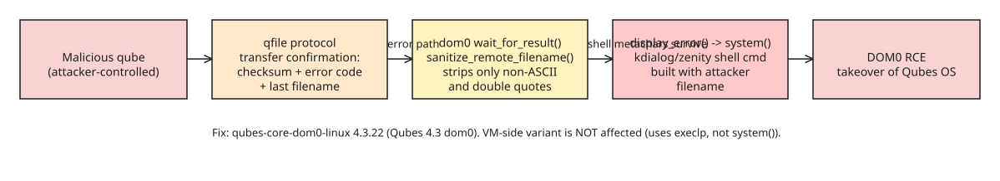

# QSB-118: Dom0 Arbitrary Code Execution via qvm-copy-to-vm Error Reporting

Qubes Security Bulletin 118 (2026-08-28) discloses a vulnerability where a **compromised qube can inject an arbitrary command into dom0** when the user copies a file *to* that qube with `qvm-copy-to-vm`. Because dom0 is the trusted control domain, this is effectively full Qubes OS takeover.

## Attack flow


## Root cause (two compounding bugs)

The `qfile` protocol sends a transfer confirmation back to dom0 containing a checksum, an error code, and **the name of the last received file**. On an error, dom0 displays that filename in a GUI dialog. Two defects combine:

1. **Insufficient sanitization.** `wait_for_result()` calls `sanitize_remote_filename()` on the attacker-controlled name before passing it to the error handler (`linux-utils/qrexec-lib/pack.c`):

```c
static void sanitize_remote_filename(char *untrusted_filename) {
    for (; *untrusted_filename; ++untrusted_filename) {
        if (*untrusted_filename < ' ' ||
            *untrusted_filename > '~' ||
            *untrusted_filename == '"')
            *untrusted_filename = '_';
    }
}
```

This replaces only non-printable characters and double quotes. **Shell metacharacters (`;`, `|`, `$()`, backticks, etc.) are left intact.**

2. **`system()` on attacker data.** The dom0 error handler builds a shell command with the unsanitized name and runs it through `system()` (`core-admin-linux/file-copy-vm/qfile-dom0-agent.c`):

```c
void display_error(const char *fmt, va_list args) {
    char buf[1024];
    (void) vsnprintf(buf, sizeof(buf), fmt, args);
    int ret = stat("/usr/bin/kdialog", &st_buf);
    #define KDIALOG_CMD "kdialog --title 'File copy/move error' --sorry "
    #define ZENITY_CMD  "zenity --title 'File copy/move error' --warning --text "
    asprintf(&dialog_cmd, "%s '%s: %s (error type: %s)'",
             ret == 0 ? KDIALOG_CMD : ZENITY_CMD,
             program_invocation_short_name, buf, strerror(errno));
    system(dialog_cmd);   // <-- attacker-controlled filename reaches the shell
}
```

So a crafted "filename" like `x'; <payload>; '` breaks out of the quoted argument and executes in dom0.

## Why only dom0 is affected

The **VM-side** variant of `qvm-copy-to-vm` uses `execlp("/usr/bin/zenity", ...)` with an argv array (no shell), so metacharacters are inert there. Only the dom0 agent funnels data through `system()`.

## Impact & remediation

- **Affected:** all Qubes OS releases.
- **Precondition:** attacker already controls a qube *and* the user initiates a `qvm-copy-to-vm` from dom0 to it (user-in-the-loop trigger).
- **Fix:** update dom0 package `qubes-core-dom0-linux` to **4.3.22** on Qubes 4.3 (migrating from security-testing to stable). No other user action required.

## Lessons for compartmentalized systems

- Treat *every* field that crosses a trust boundary as untrusted — including "metadata" like filenames in error reports, not just file contents.
- Prefer `execve`/argv over `system()` whenever a string from an untrusted source is interpolated into a command.
- Sanitization must be **allowlist-based** (keep only `[A-Za-z0-9._-]`) rather than blocklist-based; the blocklist here missed all shell metacharacters.

## References

- [QSB-118 announcement (qubes-os.org)](https://www.qubes-os.org/news/2026/08/29/qsb-118/)
- [qsb-118-2026.txt source + PGP signatures](https://github.com/QubesOS/qubes-secpack/blob/f65082c8211a421ed15a59219d6e54e93289fafb/QSBs/qsb-118-2026.txt)

## Further Reading (added 2026-10-19 by KB Zookeeper audit)

- [[qubes-devel] QSB-118: Dom0 arbitrary code execution in qvm-copy-to-vm error reporting](https://www.mail-archive.com/qubes-devel@googlegroups.com/msg05988.html) — Dear Qubes Community, We have published [Qubes Security Bulletin (QSB) 118: Dom0 arbitrary code execution in qvm-copy-to-vm error reporting](
- [Qubes OS on Mention: "QSB-118: Dom0 arbitrary code execution in qvm-copy-to-vm error…"](https://mention.earth/p/01a04e6e-a722-70cc-8f2f-d5164f6553b4)
- [Arbitrary code execution in QubesOS via copy-to-VM error reporting backchannel](https://www.headlinne.com/articles/arbitrary-code-execution-in-qubesos-via-copy-to-vm-error-reporting-backchannel-hacker-news)
