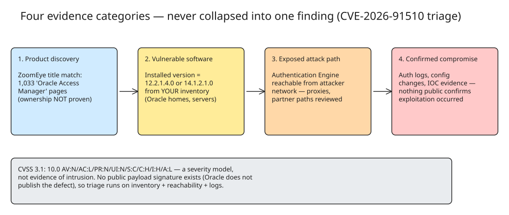

# Separating Exposure from Compromise: A Triage Method for High-Severity CVEs

CVE-2026-91510 (Oracle Access Manager Authentication Engine, Oracle Fusion Middleware, November 2026 CSPU, CVSS 3.1 **10.0**, vector `AV:N/AC:L/PR:N/UI:N/S:C/C:H/I:H/A:L`, affected versions 12.2.1.4.0 and 14.1.2.1.0) circulated with internet-scan screenshots showing "1,033" product-titled pages. Almost every claim built on those numbers silently merged four different facts into one. The article's core contribution is not the CVE — it is the triage discipline for any high-severity disclosure where the vendor publishes no implementation detail.

## The four evidence categories (never collapse them)

1. **Product discovery** — a scanner matched a page title to a product name. ZoomEye-class results (title `Oracle Access Manager`, 200 status, TLS, some `Server: Oracle-Access-Management` headers) prove *some* servers present that signature on the public internet. They do **not** prove those are instances of a specific product build, that they are internet-exposed by design, or that any of them belong to you.
2. **Vulnerable software** — a *confirmed* installed version in *your* inventory. For this CVE that means an authoritative answer to: do we run Oracle Fusion Middleware with the Access Manager Authentication Engine, and is it 12.2.1.4.0 or 14.1.2.1.0? Source: software inventory, license records, admin consoles, server-side metadata, vendor support notes. An admin console showing product/version beats a page title.
3. **Exposed attack path** — is the vulnerable component actually reachable from a network the attacker can use? Public-facing console vs. private subnet behind a load balancer vs. reachable only via an integration partner's path are three different risk levels. Requires traffic flow review, not banner grabs.
4. **Confirmed compromise** — authentication-log anomalies, config changes, IOCs, or vendor-confirmed exploitation. Absence of public exploit code and absence of published intrusions are both **unknowns**, not "not compromised" — but neither is exposure proof of breach.

A CVSS 10.0 is a *severity model* for the worst plausible configuration (network-reachable, no auth, no user interaction, changed scope, high C/I). It says nothing about whether the precondition chain is satisfied at your site, and nothing about intrusion.

## The signature problem

Because Oracle does not publish the underlying defect, there is **no reliable request signature** for the vulnerable endpoint: no crafted URL, parameter combination, or response string can be derived from public sources. Defensive scanning therefore reduces to *product* recognition (titles, headers, TLS metadata, error responses, static assets) — which establishes category 1 only. This is why "our scanner found it" and "we are vulnerable" are separated by categories 2–3.

## Triage procedure (reusable for any no-details high-severity CVE)

1. **Inventory first, scanner second.** Query authoritative sources (asset DB, license/entitlement records, admin consoles) for product+version. Do not treat internet-wide scan counts as an asset list — public results are unverified and unowned.
2. **Map reachability per instance.** For each confirmed-vulnerable instance, document how it is exposed (public, partner network, internal) before assigning business urgency.
3. **Pull the evidence that distinguishes compromise**: authentication logs around the disclosure date, configuration change history, unexpected accounts or policy edits. Absence of anomalies lowers urgency; it does not prove innocence.
4. **Follow the vendor, not the screenshots.** CSPU advisory text, support notes, and patch coverage windows for your *supported* versions drive the fix decision.
5. **Re-run the exposure analysis after remediation** — patching changes the graph (services restart on different paths, temp rules linger).
6. **Communicate in categories.** Status updates should say which category each statement belongs to. "1,033 exposed instances of our product" mixes a scanner artifact with an ownership claim; it is the archetypal collapse of category 1 into 2+3.

## Why this matters beyond one CVE

The pattern repeats on every patch Tuesday: a maximal-severity score, third-party scan counts, and silence about the defect. Teams that collapse the categories over-respond (emergency change windows for components they don't run) or under-respond (ignoring a reachable engine because "no exploits are public"). The four-category ledger makes both failures visible early.

## Vendor record verification (checked against the authoritative CVE entry, 2026-11-23)

Verified directly against the Oracle-published CVE record (cveawg.mitre.org API, state PUBLISHED, reserved 2026-09-14, published 2026-11-17, updated 2026-11-19):

- Product/component: Oracle Access Manager, Oracle Fusion Middleware, **component: Authentication Engine** — matches.
- Affected supported versions: **12.2.1.4.0 and 14.1.2.1.0** — matches (CPE `cpe:2.3:a:oracle:access_manager:{12.2.1.4.0,14.1.2.1.0}`).
- CVSS 3.1 base score **10.0**, vector `CVSS:3.1/AV:N/AC:L/PR:N/UI:N/S:C/C:H/I:H/A:L` — matches.
- Exploitability wording: *"Easily exploitable vulnerability allows unauthenticated attacker with network access via HTTP"*; impacts are unauthorized create/delete/modify **and** read of all OAM-accessible data plus partial DoS, with **scope change** ("attacks may significantly impact additional products") — this is precisely the worst-plausible-configuration model the four-category method warns about.
- The vendor record contains **no technical defect detail and no PoC** — the only vendor reference is the CSPU advisory itself, confirming the note's "signature problem" section: there is nothing public from which to derive an endpoint-level detection signature.
- Practical consequence: the fix decision is entirely patch-window driven (CSPU November 2026), not detection-signature driven; compensating controls must operate at the network/reachability layer (category 3), since category-2 confirmation cannot be automated from public data.

## References

- [Oracle CVE record for CVE-2026-91510 (CVE Program API, authoritative)](https://cveawg.mitre.org/api/cve/CVE-2026-91510)
- [Oracle Critical Security Patch Update Advisory — November 2026](https://www.oracle.com/security-alerts/cspunov2026.html)
- [Separating Exposure from Compromise for CVE-2026-91510 (DEV.to)](https://dev.to/kozhevniko/separating-exposure-from-compromise-for-cve-2026-91510-47b1)
- [Oracle Security Alerts — Critical Security Patch Update index](https://www.oracle.com/security-alerts/)
- [FIRST CVSS v3.1 specification (vector components)](https://www.first.org/cvss/v3.1/specification-document)
