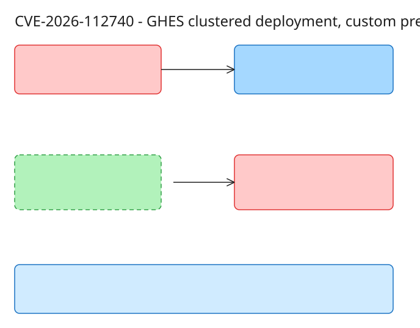

# CVE-2026-112740: GitHub Enterprise Server Pre-Receive Hook Sandbox Escape

CVE-2026-112740 is a boundary failure in GitHub Enterprise Server (GHES): an attacker already holding the **site-administrator** role could move into **command execution as the host `git` user on a peer Git server node** — outside the pre-receive hook sandbox. The severity is not the privilege level of the entry point but the isolation boundary it crossed.

## The boundary that failed

Pre-receive environments are part of GHES's hook execution system: administrators can point the appliance at environment content (a download URL), and clustered deployments replicate Git-related work across nodes. The defect sat in the handling of that **environment download URL** — a crafted URL injected commands that executed as the host `git` user on a *peer* Git server node.

Key distinctions that shape the incident scope:

- **Narrow preconditions.** Exploitation required a *clustered* deployment using *custom pre-receive hook environments*, with at least one peer Git server node. A single-node appliance without custom pre-receive environments does not match the stated conditions, and this was not a general unauthenticated request path.
- **Where the commands ran.** Evidence will not be only on the node the administrator touched — a team reviewing only that node may miss the peer-node execution entirely.
- **Trust required.** Site-admin access is already privileged; the CVE lowers the trust required *inside* that role and breaks a process-isolation boundary customers reasonably rely on.

## Affected versions and patch levels

Affected: GHES **before 3.23**. Fixed releases: **3.22.5, 3.21.10, 3.20.12, 3.19.16**. Match the actual patch level — do not infer safety from the major version.

> **Vendor record (verified verbatim vs GHSA-vgmg-xrw2-8659, 2026-11-23):** High severity, *Unreviewed*, published to the GitHub Advisory Database 2026-11-18; no package listing and affected/patched version fields marked "Unknown" in the advisory metadata — the prose description carries the real version data above. Reported via the GitHub Bug Bounty program.

## Incident response for an affected clustered instance

The patch removes the vulnerable code path; it does **not** tell you whether someone already used it. If the preconditions were present and administrative activity is unexplained:

1. **Before changing the system**, collect: deployment topology, custom environment sources, repository administrative activity, peer-node process history.
2. **Preserve logs outside the appliance.**
3. Review accounts with site-administrator rights and recent additions to that group.
4. Treat the peer node as potentially compromised until evidence says otherwise: rotate credentials reachable by the `git` account from that node; inspect scheduled jobs, repository hooks, and SSH trust material.

## Controls after patching

- Restrict site-admin access to named operators with a documented break-glass process.
- Separate custom hook environment management from routine repository administration where the platform permits.
- Review peer-node network access and log forwarding so a local sandbox escape can still be reconstructed centrally.
- Treat the pre-receive hook sandbox as **one defense layer, not the only boundary** around repository execution: host hardening, least privilege for the `git` account, and peer-node monitoring still matter post-CVE.

## References

- [Pre-Receive Hook Boundary Broke Under a Crafted Download URL (DEV.to)](https://dev.to/stark_zhuang_df5076f35c68/github-enterprise-servers-pre-receive-hook-boundary-broke-under-a-crafted-download-url-21ma)
- [GitHub Advisory GHSA-vgmg-xrw2-8659 (CVE-2026-112740)](https://github.com/advisories/GHSA-vgmg-xrw2-8659)
- [NVD: CVE-2026-112740](https://nvd.nist.gov/vuln/detail/CVE-2026-112740)
- [GHES 3.19 release notes](https://docs.github.com/en/enterprise-server@3.19/admin/release-notes#3.19.16)
