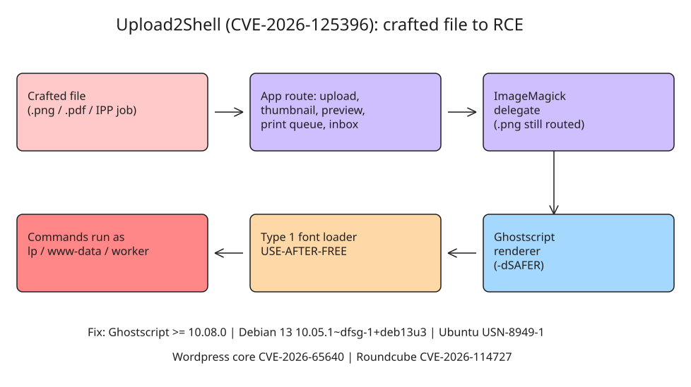

# Upload2Shell (CVE-2026-125396): Ghostscript Type 1 Font Loader UAF Breaks -dSAFER Into RCE

**Upload2Shell** is a use-after-free in **Ghostscript's Type 1 font loader** that lets a crafted document escape Ghostscript's `-dSAFER` sandbox, alter native path controls, and execute attacker-chosen commands as the rendering process (pwn.ai research, CVE assigned 2026-11-09). Ghostscript matters far beyond PostScript viewers: it sits **beneath print, email, upload, and preview workflows**, and — as pwn.ai's earlier ImageMagick research showed — files named `.png` or `.jpg` can still be routed into Ghostscript by image conversion when the delegate is present.

## Root cause and sandbox escape

- The flaw is a **use-after-free in the Type 1 font loader**. A crafted document triggers the UAF, gaining **native access inside the rendering process**, i.e. crossing the `-dSAFER` boundary that is supposed to confine interpreters to a restricted file/ops surface.
- `-dSAFER` has historically been treated as "good enough" for servers that invoke Ghostscript on untrusted input. This vulnerability demonstrates the assumption failing: from sandboxed interpreter to **arbitrary command execution as the rendering process user** (`lp`, `www-data`, or the container user).
- Upstream tracking: **Artifex Bug 709684**, fixed in **Ghostscript 10.08.0** (released 2026-09-08).

## Confirmed network access paths (unauthenticated RCE)

The evidence index records confirmed command execution across very different product categories — all converging on one interpreter:

| Product | Access condition | Executed as |
| --- | --- | --- |
| Debian 13 CUPS (gs 10.05.1~dfsg) | **Anonymous IPP Print-Job** to a shared network queue | `uid=7(lp)` on host |
| Roundcube 1.7.2 | External sender's attachment thumbnailed when email is **viewed** (ImageMagick delegate) — no click on attachment needed | `uid=33(www-data)` |
| WordPress Core 7.0.0–7.0.3 / 6.9.x (own advisory **CVE-2026-65640**) | `upload_files` capability: Author+ by default, or a Contributor granted it; Imagick + Ghostscript present | `uid=33(www-data)` |
| Forminator 1.55.1 (WordPress plugin) | **Signed-out** public PDF form storing to Media Library | `uid=33(www-data)` |
| Essential Addons for Elementor Lite 6.7.0 | Signed-out public Login/Register widget with upload field | `uid=33(www-data)` |
| MediaWiki 1.46.0 + PdfHandler | Anonymous PDF upload + thumbnail on wikis configured for anonymous uploads | `uid=33(www-data)` |
| DokuWiki 2026-07-14a | Open wiki upload + resize via optional ImageMagick backend | `uid=33(www-data)` |
| Mayan EDMS 4.11.5 | External email to a configured POP3 document source → worker renders attachment | `uid=1000` in container |
| ResourceSpace 11.0 | Authenticated upload or upload-share capability → preview worker | preview worker user |
| Google image/document pipeline (production) | Signed-out request for an attacker-hosted file | native renderer control + bounded worker file read; mitigated 2026-11-10 |

Additional traced (source-mapped, not executed) routes include CVAT frame workers, Paperless-ngx PDF/A conversion (`tesseract.py` calling Ghostscript directly), and django-filer via Pillow. Dropbox, Box and Zoom were named in the public teaser under separate Ghostscript roots.

## Disclosure timeline (compressed)

Discovery 2026-07-27 → Google production proof 07-30 → WordPress core fix 08-12 → Artifex upstream report → **Ghostscript 10.08.0** 09-08 → Debian/CUPS + 8 vendor reports 09-17/18 → Debian security update 09-25 → fixed Debian build `10.05.1~dfsg-1+deb13u3` 10-10 → **Ubuntu USN-8949-1** covering seven releases 10-21 → Roundcube hardening (**CVE-2026-114727**, restricts unsafe attachment image types before ImageMagick conversion) 10-19 → CVE published 11-09 → Google mitigation 11-10.

## What defenders should do

1. **Patch the renderer**: Ghostscript ≥ 10.08.0; Debian 13 ≥ `10.05.1~dfsg-1+deb13u3`; apply USN-8949-1 on Ubuntu.
2. **Find routes into the renderer**: any feature that converts/uploads/thumbnails/previews user files — email attachments, wiki uploads, print queues, EDMS inboxes — may reach `gs` through ImageMagick delegates even when the file is "just a PNG". Test with `identify -list delegate | grep -i gs` (or check the ImageMagick policy file for PDF/PS types).
3. **Remove or policy-block the delegate** if PDF/PostScript conversion is not a product requirement (ImageMagick `policy.xml` deny for `PDF`/`PS`/`EPS` coders, or uninstall Ghostscript).
4. **Audit WordPress fleets**: patch to fixed core (CVE-2026-65640) and update Forminator / Essential Addons for Elementor; public upload fields were reachable **signed-out**.
5. **Expose IPP queues**: an unauthenticated IPP Print-Job was a confirmed RCE entry on Debian 13 — treat shared CUPS queues as internet-facing attack surface.

## References

- [pwn.ai — Upload2Shell public record and evidence index](https://pwn.ai/upload2shell)
- [pwn.ai — Upload2Shell technical writeup](https://pwn.ai/upload2shell/research.html)
- [Ghostscript 10.08.0 release (fix)](https://github.com/ArtifexSoftware/ghostpdl-downloads/releases/tag/gs10080)
- [Ubuntu security notice USN-8949-1](https://ubuntu.com/security/notices/USN-8949-1)
- [WordPress advisory GHSA-8vr3-7mxf-gx8w (CVE-2026-65640)](https://github.com/WordPress/wordpress-develop/security/advisories/GHSA-8vr3-7mxf-gx8w)
