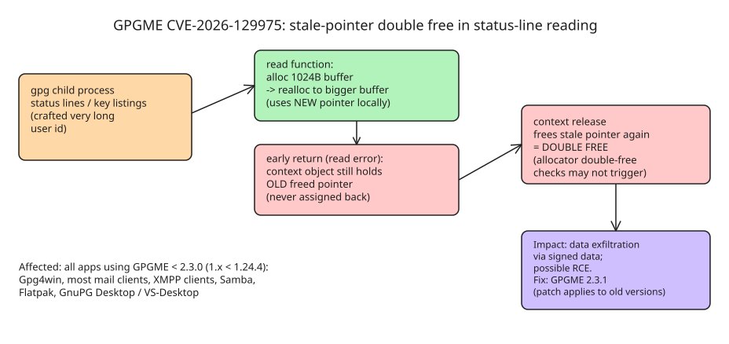

# GPGME CVE-2026-129975: Double Free from a Crafted Long User ID and the Stale-Pointer realloc Bug

On 2026-11-20 the GnuPG project disclosed **CVE-2026-129975** (internal ID **T8557**), a *critical*
double free in **GPGME** — the library almost every application uses to talk to `gpg`. A single
OpenPGP key containing a **crafted, very long user ID** triggers it. The practical impact starts at
**data exfiltration** from applications that process signed data, and the advisory explicitly states
**Remote Code Execution "can't be ruled out"**, so an immediate update was recommended. Fixed in
**GPGME 2.3.1** (2026-11-19) **and backported to the legacy 1.x branch as 1.24.4** (2026-11-20).
Per the advisory, *all versions prior to 2.3.0* are affected — and since 2.3.0 was never publicly
released, in practice "affected" means everything before 2.3.1 on the 2.x line, and everything
before 1.24.4 on the legacy line (which GnuPG warns "can't guarantee that it will see all security
patches", so prefer 2.3.1 when possible).

The disclosure was pulled forward: GnuPG had set coordinated disclosure for 2026-11-25, but GitLab
had to ship an update earlier due to the (unrelated) "Ruby2Shell" bug, so the advisory went out on
the 20th. The bug was found by Johan Carlsson and reported via GitLab on 2026-11-12.

## Root cause: realloc without publishing the new pointer

 — the read path from the `gpg` child process, the realloc that leaves the context holding a freed pointer, and the double free at context release.

The bug lives in two GPGME-internal functions that read **status lines and key listings** from the
`gpg` child process:

1. A **1024-byte buffer** is allocated initially.
2. When a line is longer (the crafted long user ID is the trigger), the buffer is **`realloc()`ed**
   to something bigger. The function then **uses the new pointer locally**.
3. The new pointer is only **assigned back to the context object at the end of the function**.
4. If the function **returns early** — a read error or other event — the context still holds the
   **stale pointer to the already-freed original buffer**.
5. When the context is later released, that stale memory is **freed a second time**.

The subtle part that makes this dangerous: between the first and second free there can be **other
allocations**, so the usual double-free sanity checks in memory allocators (which mostly detect
immediate double frees or corrupted chunk metadata) **may not trigger**. A double free that slips
past allocator checks is exactly the primitive an attacker needs for heap exploitation — hence the
non-zero RCE probability assessment.

This is a textbook instance of a class of bugs: *an owning structure is updated only on the success
path*. Any early return between "old memory freed by realloc" and "owner updated" creates an
aliasing window. Defensively: publish the new pointer immediately after `realloc` succeeds, or use
a `freopen`-style "allocate-copy-then-swap" pattern so the owner is never left pointing at freed
memory.

## Blast radius

Anything linking GPGME — shared library, DLL, or **statically linked** — before 2.3.1. The advisory
lists: **Gpg4win, GnuPG Desktop, GnuPG VS-Desktop, most mail clients, many XMPP clients, Samba,
Flatpak** (Flatpak uses it for package signature verification). Statically linked binaries must be
**rebuilt** against 2.3.1 — updating the shared library is not enough for them, which is the
classic supply-chain blind spot for this kind of library CVE.

## Remediation checklist

- Update the GPGME shared library to **2.3.1** (checksum of the source tarball:
  `1134a407b50204ee6fb9efaa6e1451c2460e543e  gpgme-2.3.1.tar.bz2`).
- Windows: take the DLL from **Gpg4win 5.1.2** (also refreshed GnuPG Desktop / VS-Desktop).
- Debian systems: GnuPG publishes its own packages at `repos.gnupg.org/deb/gnupg/`.
- If you cannot update: the advisory attaches a patch that "likely applies cleanly even to very
  old versions".
- **GPGME++ / GPGME Qt do not need updating** (they ride on the fixed C library).
- 2.3.1 also adds post-quantum algorithm constants (`GPGME_PK_MLKEM`, `GPGME_PK_MLDSA`,
  `GPGME_PK_DLTHM`) relative to 2.2.0 — a hint that GPGME is the tracking point for PQC rollout.

## Provenance & verification (checked against the advisory, 2026-11-21)

All claims above were verified against the gnupg-announce posting by Werner Koch
(2026-11-20 19:01:51 CET): CVE ID, T8557, discoverer (Johan Carlsson), GitLab notification
(2026-11-12), the pulled-forward disclosure date (2026-11-20 vs the planned 2026-11-25 due to
GitLab's unrelated "Ruby2Shell" update), the root-cause narrative, the affected-software list,
the 2.3.1 changelog (PQC constants `GPGME_PK_MLKEM`/`GPGME_PK_MLDSA`/`GPGME_PK_DLTHM` vs 2.2.0,
release-info dev.gnupg.org/T8427), and the tarball checksum. One nuance the advisory does **not**
cover: it lists only 2.3.1, but the official `gpg/gpgme` NEWS at tag `gpgme-1.24.4` shows the same
fix ("Fix a double free in the status line read code. [T8557, CVE-2026-129975]", 2026-11-20) was
**backported to the legacy 1.x branch as 1.24.4** — an earlier draft said "1.x below 1.24.4", a
zookeeper pass removed that as "unsupported by the advisory", and primary-source re-verification
restored it: the advisory is simply incomplete on the legacy backport (corroborated by Ostorlab
T7659 and independent coverage). When the advisory and the project's own NEWS disagree on the fix
matrix, the NEWS/tag is the ground truth.

Supply-chain hygiene for the fix: the source tarball
(`gpgme-2.3.1.tar.bz2`, 1393k) ships with an OpenPGP `.sig`; releases are signed by the GnuPG
dist keys (notably Werner Koch dist-signing-2020 ed25519
`6DAA 6E64 A76D 2840 571B 4902 5288 97B8 2640 3ADA`, and the 2026 keys of Ingo Klöcker and
GnuPG.com). Verify per `gnupg.org/download/integrity_check.html` before deploying the patch.

## Why this class matters beyond GPGME

Verification-adjacent libraries (signature checking, key parsing) are the **trust anchor** of
email and package ecosystems. A memory-corruption bug reachable by *supplying a key or signed
data* — i.e. attacker-controlled input handled by every user of the library — is the worst possible
placement: victims need no interaction beyond their normal mail/package workflow. Inventory
dependencies on GPGME the same way you inventory OpenSSL.

## References

- [GnuPG security advisory (gnupg-announce, 2026-11-20)](https://lists.gnupg.org/pipermail/gnupg-announce/2026q4/000517.html)
- [GnuPG tracker T8557](https://static.dev.gnupg.org/T8557)
- [GnuPG download page](https://gnupg.org/download/)
- [The Hacker News coverage: "GnuPG Warns Critical GPGME Flaw Could Expose App Data"](https://thehackernews.com/2026/11/gnupg-warns-critical-gpgme-flaw-could.html)
