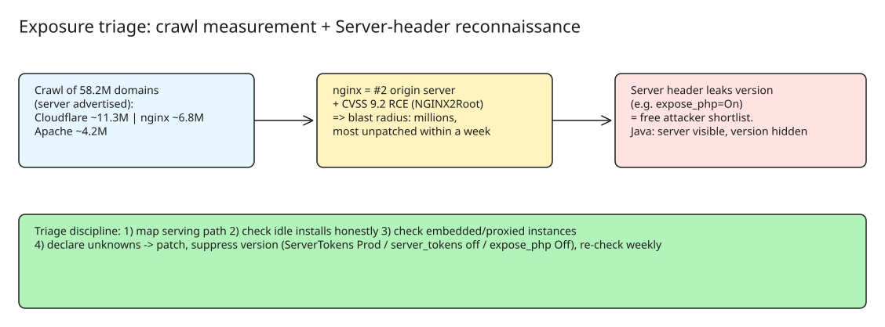

# Measuring Internet Exposure: Crawl Data, Server Headers, and the PHP 8.6 Wave

In November 2026, three pre-auth RCE scares landed within three days (Java4Shell / OpenJDK Base64, NGINX2Root, and a PHP security release wave). A search-engine operator used their own crawl — **~58.2M domains, ~38.4M pages** — to answer the two questions every ops team should ask in a disclosure week: *are we affected?* and *what does the internet actually run?* The methodology, and its one reusable lesson, are worth more than the individual CVEs (the Java4Shell and NGINX HTTP/2 flaws already have dedicated notes in this folder).

## The disclosure week, in one table

| Disclosure | What it is | Fixes | Status per article |
| --- | --- | --- | --- |
| Java4Shell (CVE-2026-114938) | Memory corruption in OpenJDK **Base64 decoder**; pre-auth RCE vs Keycloak, Jira, Confluence, Jenkins, Artifactory in default configs. Oracle CVSS 8.1, Calif 9.2 | Same-day patches | Not in CISA KEV through catalog 2026.11.20 (1,790 entries); no in-the-wild exploitation |
| NGINX2Root (disclosed 2026-11-18) | Five nginx flaws incl. unauthenticated RCEs; two rated 9.2 | **nginx 1.30.7 / 1.31.9** | See sibling note `explanation-nginx-http2-rce-cve-2026-123633-123007.md` for root-cause analysis |
| PHP wave (2026-11-19) | **PHP 8.6.0** feature release + security releases **8.5.13, 8.4.28, 8.3.37, 8.2.36**; headline fix a session-serializer RCE (CVE-2026-115560 per article) plus ~11 further CVEs | Patch releases | 8.6.0's 19 Nov 2026 date confirmed on php.net; CVE numbering attributed to the article |

## Methodology worth stealing: triage with evidence, not vibes

The author's "are we affected?" analysis is a model of disciplined triage:

1. **Map the serving path first.** Nothing in the stack ran Java or nginx (Go + Apache serving, Go crawler, PHP dashboard, Postgres DB) — so two of three CVEs were structurally out of scope.
2. **Check idle installs honestly.** OpenJDK 17 was *installed* on the DB box but no process or service used it, and the CPU lacked AVX-512 VBMI so the buggy intrinsic path couldn't execute → "patch when convenient, not urgent" rather than panic.
3. **Check embedded/proxied instances.** The one nginx nearby was bundled inside a container (1.24.0 on port 9191) — full config review showed no HTTP/2, QUIC, resolver, or mirror, so the flawed code paths didn't apply.
4. **Declare unknowns.** The article explicitly flags its own gaps (unverified trigger for the fifth nginx CVE, unknown router forwarding for port 9191). An exposure report without an "unknowns" list is a report that hides its risk.

## Crawl data: why blast radius is measured in millions

Advertised servers across the 58.2M-domain index (stats run 2026-11-21):

- **Cloudflare: ~11.3M** sites
- **nginx: ~6.8M** sites ← the #2 origin server, and the one hit by a 9.2 RCE that week
- **Apache: ~4.2M** sites

When a CVSS 9.2 lands in the second-most-common server on the internet, the honest assumption is that **most vulnerable sites will not patch that week** — which is why KEV-style catalogs, not CVSS alone, should drive your urgency.

## The reusable lesson: your `Server` header is free reconnaissance

- Version strings in `Server` headers (e.g. PHP versions) are a **filter list for attackers** — the crawl's commercial PHP-version inventory exists *only* because those versions leak in headers.
- **Java is the counter-example**: Jetty/Tomcat/Coyote are identifiable from headers, but Java *versions* almost never leak — so mass targeting of "vulnerable Java" from the crawl alone is impossible. Hiding version info forces attackers to probe per-target.
- The one-line rule: **check your own `Server` header before someone else does.** If it advertises a version, you have handed an attacker a shortlist. Patch, suppress the version (`ServerTokens Prod` on Apache, `server_tokens off;` on nginx, `expose_php = Off` for PHP), then re-check your exposure next week.

## References

- [Original article — Java4Shell, NGINX2Root, and a PHP security release: what 58 million crawled sites actually run](https://dev.to/cl0qsearch/java4shell-nginx2root-and-a-php-security-release-what-58-million-crawled-sites-actually-run-47b6)
- [PHP releases index (8.6.0 released 2026-11-19)](https://www.php.net/releases/)
- [PHP 8 ChangeLog](https://www.php.net/ChangeLog-8.php)
