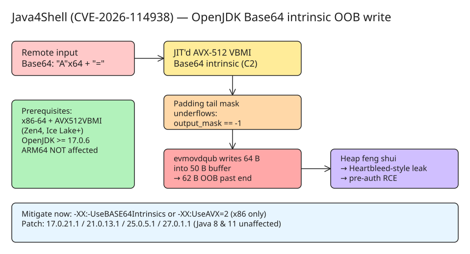

# Java4Shell (CVE-2026-114938): Memory Corruption in OpenJDK's AVX-512 Base64 Decoder

**Java4Shell** is a critical (CVSS 4.0: 9.2) memory-corruption vulnerability in OpenJDK HotSpot's hand-written x86-64 assembly for the Base64 decoder. A remote, unauthenticated attacker sending malformed Base64 can overwrite adjacent heap memory, leak it Heartbleed-style, and reach **pre-auth remote code execution** — in a language whose headline selling point is memory safety. Disclosed by Calif on 2026-11-17 alongside OpenJDK and Oracle patches.



## Why "memory-safe" Java is still vulnerable

Java checks *your* memory accesses — but OpenJDK itself contains C, C++ and assembly. To decode Base64 fast, HotSpot's C2 JIT substitutes an **intrinsic** using AVX-512 VBMI vector instructions on supported CPUs. The bug lives in that assembly, in the handling of the padded tail (the trailing `=` characters).

## Root cause (the mask underflow)

The intrinsic processes input in 256-byte, then 64-byte blocks; inputs under 64 bytes use `evmovdqub` (`VMOVDQU8`), a masked 64-byte store driven by a 64-bit `output_mask`:

```
input_mask := bzhiq(-1, input_length)
output_len := (input_length / 4) * 3
if input[input_length - 1] == '=':
    output_len -= 1        // <-- can underflow
    input_mask >>= 1
    ...
output_mask := bzhiq(-1, output_len)
```

When the remaining tail is of form `=`, `X=`, `XY=` etc., `output_len` computes to 0, the padding decrement underflows it to `-1`/`-2`, and `bzhiq` is a no-op for values ≥ 64 — so `output_mask == -1u64`: **all 64 bytes get written** regardless of the real output length.

The trigger: **64 `A` characters followed by one `=`** (`AAAA…A=`, 65 chars). The decoded buffer is sized `(ceil(65/4)*3) − padding = 50` bytes, but the buggy store writes 64 bytes at offset 48 → **62 bytes out-of-bounds** past the buffer. Java then rejects the input with `IllegalArgumentException` — after the corruption already happened. (On older OpenJDK 17 the trigger is `'A'*128 + '='` because the block threshold differs.)

Exploitation writes mostly fixed bytes (only bytes 0–1 are controlled, bytes 48–63 are always `0x9a`), so Calif used **remote heap feng shui** to position objects so the constant overwrite yields a heap leak, then RCE.

## Blast radius

- **Affected:** OpenJDK ≥ 17.0.6 and all downstream distributions (Amazon Corretto, Eclipse Temurin, Microsoft Build of OpenJDK, Azul Zulu, BellSoft Liberica, SAP SapMachine, Red Hat, Oracle Java SE/GraalVM). Java 8 and 11 lack the intrinsic and are unaffected.
- **Hardware gate:** requires x86-64 with AVX-512 VBMI — Intel Xeon Ice Lake+, AMD Zen 4+ (EPYC/Ryzen). **ARM64 is not affected.**
- **Demonstrated pre-auth RCE in default configs:** Keycloak, Jira, Confluence, JFrog Artifactory, Jenkins, PingFederate. Post-auth: Kafka broker, Solr, Elasticsearch, Gerrit, Spinnaker. Also Struts/Spring Boot sample apps, and a **client-side** variant: a Java program connecting over TLS to a malicious server can be owned without exposing any service.

Check a Linux host for the vulnerable CPU combination:

```bash
grep -m1 '^flags' /proc/cpuinfo | tr ' ' '\n' | grep -E '^(avx512f|avx512bw|avx512vbmi|bmi2)$'
# vulnerable only if ALL four flags are present
```

## Remediation

1. **Upgrade** to patched builds (released 2026-11-17): 17.0.21.1, 21.0.13.1, 25.0.5.1, 27.0.1.1 (see the [OpenJDK security advisory](https://openjdk.org/groups/vulnerability/advisories/2026-11-17) and [Oracle CPU](https://www.oracle.com/security-alerts/cspunov2026.html)).
2. **Mitigate** where patching must wait — start the JVM with either:
   - `-XX:-UseBASE64Intrinsics` (disables the hardware-accelerated Base64 codec), or
   - `-XX:UseAVX=2` (disables AVX-512; **x86-64 only** — ARM JVMs fail to start with this flag).

Weaponized per-product exploit chains are being withheld until upgrades land; PoCs will likely follow quickly.

## The disclosure timeline gap: the bug was reported in September

OpenJDK PR [#32781](https://github.com/openjdk/jdk/pull/32781) (`8392044: AVX-512 Base64 decoder overwrites output buffer on short padded tail`, albertnetymk, opened **2026-09-09**) already contained the exact root cause months before public disclosure: in `StubGenerator::generate_base64_decodeBlock()` the `L_finalBit` tail handler computes `output_size = (len/4)*3`; with a leftover tail of `length < 4` (e.g. `"A".repeat(64)+"="`) it starts at 0 and the padding path decrements it **below zero**, producing a wrong `output_mask` — the stub stores past the logical output length and "corrupts the heap" before Java even returns. The proposed fix was a one-line early return to Java when `length < 4`.

What happened to the PR is the cautionary part:

- It needed 2 reviews (`hotspot-compiler`), attracted 1 participant, and **never got a single review**.
- It was linked to real-world symptoms: Adoptium crash reports [#1480 (parallel GC crash)](https://github.com/adoptium/adoptium-support/issues/1480), [#1524 (`JVM_ArrayCopy+0xa5`)](https://github.com/adoptium/adoptium-support/issues/1524) and [#1513 (compiler-thread crash)](https://github.com/adoptium/adoptium-support/issues/1513) — production heap corruption was already visible, misdiagnosed as generic JVM crashes.
- The stale-bot pinged it after 8 weeks of inactivity; the author **closed it unfixed on 2026-11-04** — 13 days before Calif's public disclosure forced an emergency OpenJDK/Oracle advisory on 2026-11-17.

Lesson: a correct, minimal fix sitting unreviewed in a queue for two months is an exploitable window. If you run OpenJDK on AVX-512 VBMI hardware, treat intrinsics-level PR queues (`hotspot-compiler`) and unexplained `JVM_ArrayCopy`/GC crashes as early vulnerability signal, not noise.

## The meta-story: centaur hacking and "vibe-uncoding"

Calif found and weaponized the bug with AI (Codex) assisting a single researcher: ~1 hour to discovery, ~2 more hours to first working exploit, **&lt; $200 in token cost** — a case study for [[explanation-machine-speed-vulnerability-discovery]]. Their framing: the "centaur hacker" (human context + AI horsepower). The takeaway argument — **vibe-uncoding**: most attack surface is code nobody needed ("do you need a hand-rolled assembly Base64 decoder to process a few hundred bytes?"); AI makes large-scale dead-code removal economical, and deletion is a security primitive.

## Related

- [[explanation-machine-speed-vulnerability-discovery]] — the operational context this incident validates
- [[../fuzzing/INDEX]] — intrinsic-level assembly bugs are classic fuzzing targets

## References

- Original research and PoC: [Java4Shell: Write once, RCE everywhere — Calif](https://calif.io/java4shell/)
- September disclosure PR (closed unfixed): [openjdk/jdk PR #32781](https://github.com/openjdk/jdk/pull/32781)
- Patched versions and triage: [Aikido — Java 17 RCE (CVE-2026-114938) fix & versions](https://www.aikido.dev/blog/java-17-rce-vulnerability-cve-2026-114938)
- Coverage: [The Hacker News — Oracle to patch 11 Java flaws as critical OpenJDK RCE lands](https://thehackernews.com/2026/11/oracle-to-patch-11-java-flaws-today-as.html)
