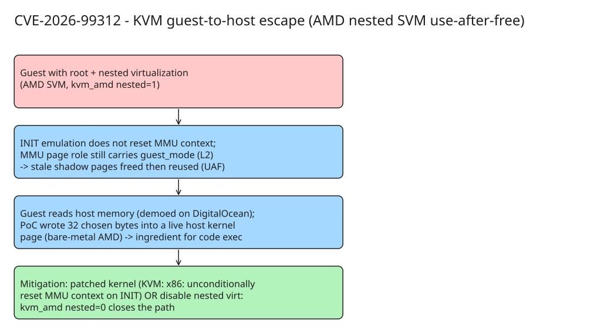

# CVE-2026-99312: KVM Guest-to-Host Escape via Use-After-Free in Nested SVM INIT Emulation

**CVE-2026-99312** is a use-after-free in the Linux kernel's KVM hypervisor, in the handling of **AMD nested virtualization (nested SVM)**. A guest that already has root — nothing more than "a VM and root inside it", i.e. every cloud customer's baseline — can break isolation downward and reach **host kernel memory**. Terra Security demonstrated reading host memory on **DigitalOcean** production infrastructure, and on their own bare-metal AMD server wrote **32 attacker-chosen bytes into a live host kernel page** while a witness module in the host kernel watched its own page change underneath it. Arbitrary write to host memory is the basic ingredient for code execution.

> Sourcing note: the primary Terra article blocks automated fetchers; this note is grounded in the article's indexed excerpts plus the upstream CVE fix summary. Verify against the original before operational use.

## Root cause: MMU context not reset on INIT

The kernel fix commit states the mechanism: **"KVM: x86: Unconditionally reset MMU context when emulating INIT."** When KVM emulates an INIT for a nested (L2) guest, it previously skipped the MMU reset if paging was already disabled — but the **shadow-MMU page role embeds `guest_mode` (L2 vs L1)**. Skipping the reset leaves shadow page-table entries whose role no longer matches the guest's mode: pages get freed while the shadow MMU still references them, and a subsequent allocation reuses the memory the stale entries point at → **use-after-free of host-side shadow-page structures**. The vulnerability's roots trace to an *earlier security fix* in the nested-SVM path — the patch changed state transitions without covering the already-paging-disabled case.

## Impact ladder

| Step | What the guest achieves |
| --- | --- |
| Read primitive | Host memory disclosure, demonstrated against DigitalOcean (a real multi-tenant cloud) |
| Write primitive | 32 chosen bytes into a live host kernel page (bare-metal AMD PoC) |
| Next stage | Arbitrary host write → code execution as root on the host; classic VM-escape blast radius (all co-tenant VMs) |

Requirements: **AMD CPU + nested virtualization enabled (`kvm_amd nested=1`) + root inside the guest**. No host-side interaction, no escape from the QEMU process model needed — the flaw is in the in-kernel hypervisor itself.

## Mitigation

1. **Update to a kernel carrying the fix** (unconditional MMU-context reset on INIT emulation).
2. If you cannot patch yet, **disable nested virtualization**: set the `nested` parameter of the `kvm_amd` module to `0` (e.g. `options kvm_amd nested=0` in `/etc/modprobe.d/`, reload module or reboot). That removes the nested-SVM code path entirely and closes the attack surface — the trade-off is losing nested-virt features (in-guest hypervisors, some CI/Android-emulator/VM-in-VM workloads).

Check exposure: `cat /sys/module/kvm_amd/parameters/nested` on every KVM host; anything but `N`/`0` is in scope.

## Pattern: the shadow MMU is the soft underbelly

This is the second KVM escape in weeks to land in the **shadow MMU** (`arch/x86/kvm/mmu/mmu.c`): **Januscape (CVE-2026-53359)**, a ~16-year-old race/UAF, lets a root guest with nested virt make the host associate a shadow page-table entry with the wrong guest frame number. Both escapes attack the single component that reconciles "guest's view of physical memory" with "host page tables remain authoritative" — and both required only guest root. Multi-tenant KVM fleets should treat nested-virt support as an opt-in, per-host capability with its own patch SLA, not a default.

## Related

- [[explanation-nginx-http2-rce-cve-2026-123633-123007]] — same disclosure week: decade-old memory-safety flaws in foundational infrastructure, found by AI-assisted research.
- [[explanation-machine-speed-vulnerability-discovery]] — why hypervisor patch windows must shrink when discovery is machine-paced.

## References

- [KVM Guest-to-Host Escape — Terra Security Research](https://www.terra.security/blog/kvm-guest-to-host-escape)
- [CVE-2026-99312: KVM Guest-to-Host VM Escape Explained — The CyberSec Guru](https://thecybersecguru.com/exploits/cve-2026-99312-kvm-nested-svm-guest-to-host-escape/)
- [CVE-2026-53359: Januscape Linux KVM Guest-to-Host Escape — SecureLayer7](https://blog.securelayer7.net/januscape-linux-kvm-vulnerability/)
- [Januscape technical writeup — V4bel/Januscape (GitHub)](https://github.com/V4bel/Januscape)
