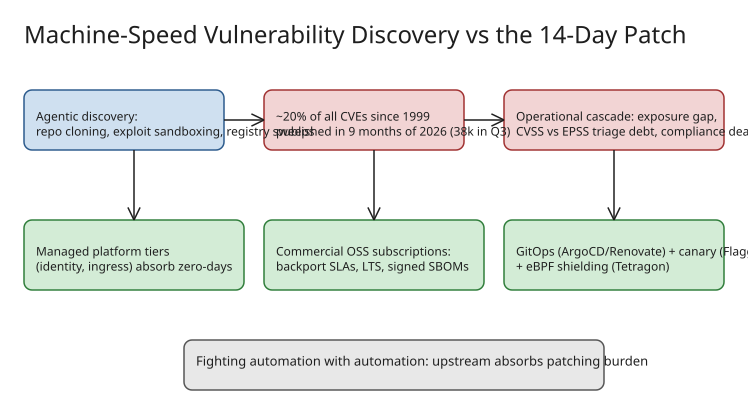

# Machine-Speed Vulnerability Discovery: Why the 14-Day Patch Cycle Died

Why the traditional two-week patch cycle can no longer keep up with AI/agent-driven vulnerability discovery, and which operating-model shifts (managed tiers, backport SLAs, GitOps + runtime shielding) teams adopt in response. **Caveat: this is a sponsored post by Ory** — the "outsource to managed identity/edge" recommendation serves the sponsor; treat the vendor-specific advice as marketing and keep the data and the general patterns. Related: [[../supply-chain/howto-audit-transitive-github-action-dependencies-pin-deep]], [[../detection/explanation-codeql-taint-robustness-natural-rewrites]].

## The numbers

- **~20% of all CVEs ever published** (since 1999) appeared in the **first nine months of 2026** alone.
- Nearly **38,000** of those landed in **Q3 2026** (Cyber Strategy Institute).
- Cause is *not* worse code — it is that vulnerability hunting became an **autonomous, distributed compute problem**:
  - **Agentic codebase traversal:** modern systems clone repos, trace async data flows across microservices, build exploit payloads in sandboxes, and confirm exploitability *before* filing — unlike legacy SAST's noisy pattern matches.
  - **Exhaustive compute at scale:** agent swarms continuously sweep package registries and public repos, decompiling transitive dependencies and auditing C/C++ utilities plus Go/Rust/Node runtimes for concurrency bugs, deserialization flaws, memory leaks.
  - **High-leverage targeting:** identity layers, reverse proxies, parsers, container runtimes — where one flaw reaches everyone.

When machines search the entire public software graph exhaustively, every reachable flaw eventually gets found. Human-paced remediation is structurally mismatched to machine-paced discovery.

## The operational cascade

1. **Unmanageable exposure gap.** The hazard is elapsed time between public exploit discovery and production deployment. When agentic frameworks generate working zero-day/N-day exploits within *hours* of a code push, a multi-day patch window is an open door.
2. **Alert paralysis and triage debt.** Teams are stuck between **CVSS** (theoretical severity) and **EPSS** (predicted real-world exploitation likelihood), unable to tell an unreachable helper function from a weaponizable zero-click flaw — triage becomes continuous crisis management.
3. **Compliance deadlock.** NIST SP 800-53 (control **SI-2**), PCI-DSS 4.0, and DORA enforce strict remediation timelines; when 9.0+ CVSS findings arrive in weekly batches, security leads write risk-acceptance waivers instead of hardening systems.

Fire-drill loop a critical flaw triggers in a typical enterprise: halt sprint → trace internal dependencies for real exploitability → reconcile dependency breaks/merge conflicts/regressions → emergency multi-region deployment. Against automated discovery, manual labor at this cadence is an economic dead end.

## The three response strategies

The common thread: **preserve open standards, shift the patching burden upstream.**

1. **Managed platform tiers for critical edge and identity.** Identity/authorization planes and ingress proxies are your perimeter; self-hosting community forks means constant emergency rebuilds. Managed clouds absorb zero-day mitigation, regression testing, and upstream backporting.
2. **Commercial OSS subscriptions with contractual backporting SLAs** (for data-sovereignty/air-gapped/zero-trust-VPC shops that cannot use SaaS):
   - contractual response windows for High/Critical CVEs instead of community best-effort;
   - **non-breaking LTS backports** — security fixes applied to your branch without major-version schema/API churn;
   - **verified distribution streams** — signed SBOMs and hardened container images to cut CI/CD triage friction.
3. **Continuous delivery automation + runtime shielding** for everything you keep in-house:
   - automated GitOps patch flow: **ArgoCD / Renovate**;
   - progressive deployment controllers: **Flagger / Argo Rollouts** with automated canary verification;
   - **eBPF-based runtime shielding** (e.g., **Cilium Tetragon**) for kernel-level network enforcement — isolating vulnerabilities in flight and buying test time without emergency rollouts.

## Operational takeaway

Treat patch SLAs as an architectural requirement, not a process aspiration: for each foundational component (auth, gateway, parser, runtime), decide consciously whether the team *is* the maintainer (then automate the patch-to-prod path with GitOps + canary + runtime shielding) or a *subscriber* (then demand contractual backports, SBOMs, and signed images). Measure triage on EPSS-likelihood, not raw CVSS volume — and never let risk-acceptance waivers become the standing answer.

## References

- [The death of the 14-day patch: Surviving machine-speed vulnerability discovery — The New Stack](https://thenewstack.io/machine-speed-vulnerability-discovery/)
- [CVE Vulnerability & Risk Management — The New Stack topic page](https://thenewstack.io/cve-vulnerability-risk-management/)
- [Chainguard targets Java's unpatched vulnerability backlog with drop-in remediated libraries — The New Stack](https://thenewstack.io/chainguard-java-libraries-spring-boot-cves/)
