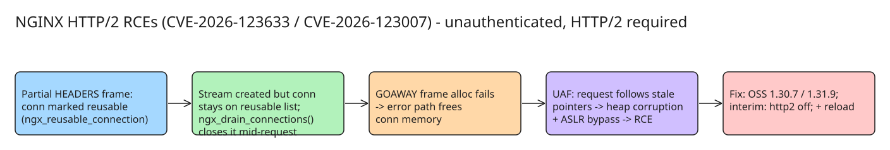

# NGINX HTTP/2 Pre-Auth RCEs: CVE-2026-123633 (UAF) and CVE-2026-123007 (send_window Underflow)

On 2026-11-18 F5 shipped a coordinated security release fixing two **critical (CVSS 4.0: 9.2) unauthenticated remote-code-execution vulnerabilities in NGINX core**, both in its HTTP/2 implementation. Wiz Research, Ikotas Labs, Metnir, Rapid7, and Xint independently found them. NGINX fronts ~225M sites, so a single vulnerable deployment can compromise every application behind it — **even when the application code itself is secure**. Both flaws require HTTP/2 to be enabled; CVE-2026-123007 dates back to NGINX 1.9.5 (2015), the UAF to ~1.19.7 (2021).

## CVE-2026-123633 — HTTP/2 connection use-after-free

The bug is a lifecycle mismatch between the *reusable connection list* and active request streams:

1. An attacker sends **only part of a `HEADERS` frame**. With no active streams, `ngx_http_v2_handle_connection()` marks the connection reusable (`ngx_reusable_connection(c, 1)`) and returns early because `h2c->state.incomplete` is set.
2. The attacker completes the frame. `ngx_http_v2_create_stream()` creates the request stream and increments `h2c->processing` — **but never removes the connection from the reusable list**.
3. Under proxy load, opening an upstream connection calls `ngx_get_connection()`; when free slots run low, `ngx_drain_connections()` picks "reusable" connections to close — including this actively-processing one.
4. Before closing, NGINX tries to send a `GOAWAY` frame; if frame allocation fails (internal frame limit reached), the error path **frees the connection memory while the request still runs on it** → use-after-free. Stale pointers then reference attacker-shaped data → RCE.

Exploitation is realistic but nontrivial (memory disclosure, heap grooming, version-specific builds) — same profile as PHP2Shell. It is most reachable in **reverse-proxy configurations** when connection slots run low.

## CVE-2026-123007 — HTTP/2 `send_window` integer underflow

A flow-control accounting bug in three steps:

1. **Credit for unsent data:** when a stream is canceled while response data is queued, `ngx_http_v2_filter_cleanup()` refunds the allowance (`h2c->send_window += window`) **without capping at `NGX_HTTP_V2_MAX_WINDOW`** — the counter can exceed the maximum the rest of the HTTP/2 code assumes is impossible.
2. **Broken bounds check:** `ngx_http_v2_state_window_update()` checks `window > NGX_HTTP_V2_MAX_WINDOW - h2c->send_window`, but with the counter already past the maximum, the unsigned subtraction **wraps around and underflows to a huge positive value**, admitting arbitrary further increases (a flood of `WINDOW_UPDATE` frames).
3. **Invalid length → OOB copy:** the giant counter reaches `ngx_http_v2_send_chain()`, is cast to signed `off_t` (becomes negative), producing a buffer description whose end precedes its start; the TLS send path in `ngx_ssl_send_chain()` converts this into an **out-of-bounds memory copy** → memory disclosure, heap corruption, RCE.

Demonstrated with an **ASLR bypass on official 1.31.7/1.31.8 builds**, HTTP/2 over TLS on 64-bit — on a server serving **ordinary static files, no backend, no third-party modules**.

## Affected and fixed versions

| Product | CVE | First affected | Fixed releases |
| --- | --- | --- | --- |
| NGINX OSS | CVE-2026-123633 | 1.19.7 | 1.30.7 stable; 1.31.9 mainline |
| NGINX Plus | CVE-2026-123633 | R33; 37.0.0 | 37.0.7.1; 37.2.0.1 |
| NGINX OSS | CVE-2026-123007 | 1.9.5 | 1.30.7 stable; 1.31.9 mainline |
| NGINX Plus | CVE-2026-123007 | R33; 37.0.0 | 37.0.8.1; 37.3.0.1 |

## Mitigation and detection

- **Upgrade** to a fixed release; re-enable HTTP/2 only after.
- **Interim mitigation — disable HTTP/2**: set `http2 off;` in affected server blocks (NGINX ≥ 1.25.1) and remove the `http2` parameter from any `listen` directives; test compatibility, `nginx -s reload`, and confirm old workers exited.
- CDNs/WAFs that **terminate HTTP/2** blunt exploitation (payloads aren't reflected byte-for-byte to NGINX), implementation-dependent.
- Hunt signals: unexpected NGINX worker crashes or child processes spawning commands; for CVE-2026-123007 specifically, **long-lived HTTP/2 connections sending large amounts of data** (the `WINDOW_UPDATE` flood).
- Both bugs predate AI-assisted discovery by years; Wiz found them with Wiz Atlas (Gemini 4 Carbon / ChatGPT 5.6 Sol for validation), and multiple independent teams hit the same flaws in the same window — the complexity barrier that protected memory-unsafe "reviewed" code is dissolving. Treat "old, battle-tested code" as no longer implying "audited".

## Related

- [[explanation-java4shell-openjdk-base64-rce]] — same wave of AI-assisted memory-safety discoveries in foundational infrastructure (OpenJDK Base64 decoder, disclosed one day earlier).
- [[explanation-machine-speed-vulnerability-discovery]] — the operational model shift these backlogged-flaw disclosures force (patch SLAs as architecture).

## References

- [Unauthenticated RCE in NGINX: CVE-2026-123633 and CVE-2026-123007 — Wiz Research](https://www.wiz.io/blog/nginx-http2-rce-vulnerabilities)
- [NGINX official security advisories](https://nginx.org/en/security_advisories.html) — F5's own severity labels differ from the CVSS headline: CVE-2026-123007 is rated **major**, CVE-2026-123633 **medium** on the advisory page despite both carrying CVSS 4.0 9.2; both fixed in 1.31.9 mainline / 1.30.7 stable (vulnerable ranges: 123007 since 1.9.5, 123633 since 1.19.7). The same 1.31.9/1.30.7 release also fixes an HTTP/3 UAF (CVE-2026-121810) and a resolver UAF (CVE-2026-123634).
- [NGINX HTTP/2 module docs (http2 directive)](https://nginx.org/en/docs/http/ngx_http_v2_module.html)
- [PHP2Shell — Wiz Research (prior case in the same pattern)](https://www.wiz.io/blog/php2shell-php-rce)
