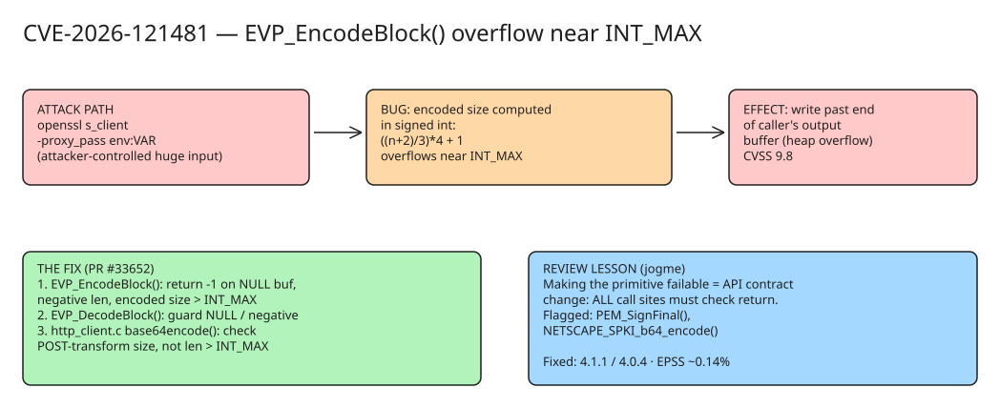

# CVE-2026-121481: OpenSSL EVP_EncodeBlock() Buffer Overflow Near INT_MAX

A CVSS 9.8 buffer overflow in OpenSSL's block Base64 encoder, disclosed publicly through the fix pull request (openssl/openssl#33652, opened 2026-11-10). The OpenSSL Security Team asked for the fix to be developed **in public**; the formal OpenSSL advisory is still pending. **Status as of 2026-12-01 schedule (verified 2026-11-20): no patched release exists yet.** GHSA-83xj-7xh4-4p7x was published 2026-11-18 (Critical, CVSS:3.1/AV:N/AC:L/PR:N/UI:N/S:U/C:H/I:H/A:H, CWE-122 heap-based buffer overflow), with patched versions still "Unknown" in the GitHub Advisory Database. The fixes are targeted for releases **4.0.4 and 4.1.1, scheduled 2026-12-01** alongside the fixes from the 10 November and 17 November advisories (PRs labeled `branch: master`, `4.0`, `4.1`). Trackers list the affected line as the OpenSSL 4.0.x/4.1.x series (EUVD-2026-128602). EPSS ≈ 0.14% (3rd percentile).

## The bug in one sentence

Calling `EVP_EncodeBlock()` with an input length close to `INT_MAX` overflows the **int arithmetic used to compute the encoded output size** (Base64 expands 3 bytes → 4 chars), so the function writes past the end of the caller-supplied output buffer.

This is the classic *size-calculation integer overflow before memcpy* pattern: the output buffer is sized with `((n + 2) / 3) * 4 + 1`-style arithmetic in a signed `int`; near `INT_MAX` the result wraps negative or small, passes any naive length check, and the encode then happily writes kilobytes of heap past the allocation.

## The fix (PR #33652)

Three parts, all input-validation hardening:

1. **`EVP_EncodeBlock()` returns `-1` for invalid inputs**: `NULL` input or output buffers, negative lengths, and any length for which the encoded size does not fit in an `int`. This mirrors wolfSSL's OpenSSL-compatibility layer, which already returns an error for the same inputs.
2. **Similar guard for `EVP_DecodeBlock()`**: reject `NULL` buffers and negative lengths (no upper length limit needed — decoded length always fits in an `int`).
3. **Fixed an incorrect length check in `base64encode()`** in `apps/lib/http_client.c`, which only rejected `len > INT_MAX` — too late to prevent the encoded-size overflow.

Plus: tests in `test/base64_dec_avx2_test.c` and `-1` return documentation in `doc/man3/EVP_EncodeInit.pod`.

An instructive review finding: reviewer *jogme* requested changes because making these functions able to fail means **every call site must check the return value** — specifically flagged were `PEM_SignFinal()` and `NETSCAPE_SPKI_b64_encode()`. Hardening a primitive to return errors is only half the job; the API contract change ripples.

## Demonstrated exploit path

The reporter demonstrated triggering it from the command line: pass an enormous `-proxy_pass` to `openssl s_client`. The password must be supplied via an environment variable (`-proxy_pass env:VAR`) because the command line itself would otherwise be too long for the OS. GOST (gost.run) was confirmed to accept such oversized passwords out of the box — i.e., any software that forwards an attacker-influenced, unbounded string into `EVP_EncodeBlock()` is a candidate.

## Why this class keeps recurring

The PR author notes the pattern matches **CVE-2021-23840** (a prior OpenSSL encoder overflow), and this file's ancestor bug dates to CVE-2016-2105 (`EVP_EncodeUpdate` integer overflow, OpenSSL &lt; 1.0.1t/1.0.2h). Three lessons:

- Signed `int` as the universal length type in a C API is a standing hazard once any function performs multiplicative size math on it.
- "Validate against `INT_MAX`" is not a sufficient guard — you must validate against the **post-transform** size.
- Compat layers (wolfSSL implementing OpenSSL's EVP semantics) are useful oracles: where two independent implementations disagree on error behavior, the divergence often marks an underspecified contract.

## Operational checklist

- **No patched release is available yet** (verified 2026-11-20) — 4.0.4 and 4.1.1 are scheduled for the 2026-12-01 security release. Until then: mitigation over upgrade. Track the GHSA advisory (GHSA-83xj-7xh4-4p7x, patched versions still "Unknown") for the official affected-range statement, and patch the moment 4.0.4/4.1.1 ship.
- Inventory any service that base64-encodes attacker-controlled, potentially huge inputs (proxy credentials, HTTP client libs, certificate/PEM tooling) — `EVP_EncodeBlock()` callers are the exposed surface.
- Note that exploitation requires *very large* inputs to reach near-`INT_MAX` lengths, which tempers realistic remote-triggerability (consistent with the low EPSS) even at CVSS 9.8. CVSS measures worst-case impact; exploit feasibility depends on whether your code paths can carry such lengths.

## References

- [OpenSSL PR #33652 — fix + full disclosure discussion](https://github.com/openssl/openssl/pull/33652)
- [wolfSSL EVP compatibility layer (reference behavior for -1 returns)](https://github.com/wolfSSL/wolfssl/blob/779d388f837aec1cf59f609621f79d3605f2bb94/wolfcrypt/src/evp.c#L14051-L14060)
- [CVE-2021-23840 (similar historical pattern)](https://nvd.nist.gov/vuln/detail/cve-2021-23840)
- [GHSA-83xj-7xh4-4p7x on GitHub Advisory Database (published 2026-11-18, CWE-122, patched: Unknown)](https://github.com/advisories/GHSA-83xj-7xh4-4p7x)
- [NVD record CVE-2026-121481 (published 2026-11-18)](https://nvd.nist.gov/vuln/detail/CVE-2026-121481)
- [HN discussion: Buffer overflow in EVP_EncodeBlock() (CVE-2026-121481, CVSS 9.8)](https://news.ycombinator.com/item?id=50569226)
