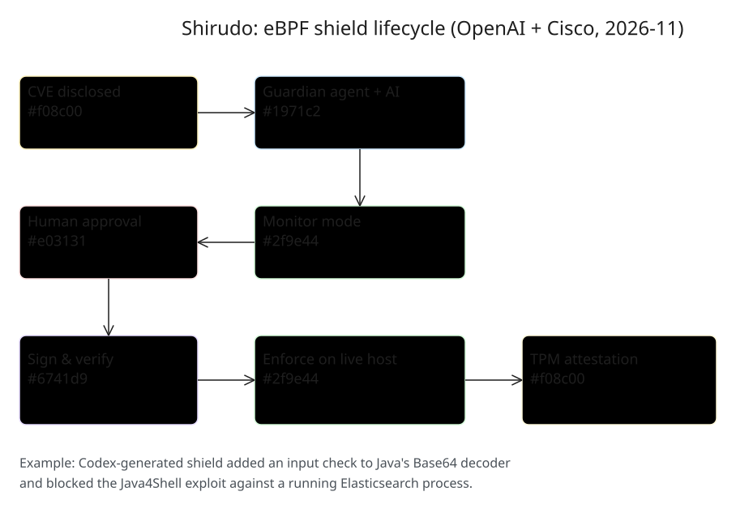

# Shirudo: eBPF Runtime Shields for Protecting Unpatched Linux Systems

**Shirudo** (Japanese for "shield") is an open-source runtime jointly launched by **OpenAI and Cisco on 2026-11-23** that lets operators protect *running* Linux systems while patches are being built and tested — no restart, no waiting for the vendor. It formalizes **virtual patching (mitigation-in-place)** with eBPF, agent-developed shields, cryptographic signing, and TPM-backed attestation.

## The problem it targets

Testing and deploying a patch takes days or weeks. Blocking the vulnerable operation outright is usually not an option because **an exploit and a legitimate request often rely on the same Linux syscall/operation** — a blunt block takes the service offline. The shield model instead asks: can a *temporary, targeted safeguard* block exactly the behavior that exposes the vulnerability while letting legitimate traffic through — and can that be *tested* before enforcement?

## How it works: the four core capabilities

1. **Live protection** — eBPF shields block vulnerable code paths *without restarting the system*. A "guardian agent" first runs in **monitor mode**: operators observe how a proposed shield would affect real application traffic before switching it to enforce mode.
2. **Defense at machine speed** — agents get **programmable controls** to investigate a vulnerability, synthesize a targeted shield, and validate it against both the exploit *and* real workloads. Humans (security teams) approve and control what actually gets deployed.
3. **Trusted deployment** — shields are **cryptographically signed and verified before loading**; the kernel's own **eBPF verifier** checks programs against safety rules, and kernel security controls restrict unauthorized changes.
4. **Hardware-backed verification** — a **Trusted Platform Module (TPM)** keeps a verifiable record of protections being loaded or removed, so operators can attest whether a fleet meets its required protection state.

## The Java4Shell proof point

In a [controlled test by Isovalent](https://isovalent.com/blog/post/cisco-openai-shirudo/), a **Codex-generated shield blocked a Java4Shell exploit against a running Elasticsearch service without a restart**. Mechanically: the shield added an input check to Java's Base64 decoder and was **attached directly to the live Elasticsearch process** — the malicious payload was rejected at the eBPF hook while Elasticsearch kept serving. (Compare with the JVM-flag mitigations in the [Java4Shell note](explanation-java4shell-openjdk-base64-rce.md): `-XX:-UseBASE64Intrinsics` disables the vector codec process-wide; an eBPF shield is targeted and removable.)

## Licensing, distribution, and getting started

- **Repo:** [shirudo-dev/shirudo on GitHub](https://github.com/shirudo-dev/shirudo), licensed **BSD 2-Clause**, with the BPF programs **dual-licensed BSD/GPL** (kernel-friendliness for distribution).
- **Try it:** [VM quickstart](https://docs.shirudo.dev/start/quickstart.html) signs, loads, and verifies a test protection; [Isovalent's self-guided lab](https://labs.isovalent.com/#/lab/shirudo-getting-started) gives a hands-on environment.
- **Deep dive:** the [Linux Plumbers Conference technical walkthrough](https://lpc.events/event/20/contributions/2437/) shows applying a shield and verifying it on the target host.
- **Ecosystem context:** Cisco's eBPF depth comes from its **2023 acquisition of Isovalent** (founded by the creators of eBPF, behind Cilium/Tracee) — Shirudo is the security-mitigation branch of that strategy. OpenAI's stated long-term goal combines this with hardened kernels, least-privilege workloads, automatically generated policies, and independent network controls ("defense at machine speed" with humans in the loop).
- **Stated roadmap goal:** ship **tested shields alongside vulnerability disclosures**, so operators get a ready-made stopgap the day a CVE goes public.

## When to consider shields vs. patches (operator's view)

| Situation | Better move |
| --- | --- |
| Patch validated and deployable now | Patch — shields are a stopgap, not a fix |
| Exploit in the wild, patch needs days of testing | Monitor-mode shield → validate against real traffic → enforce |
| Vendor won't patch (EOL software) | Shield + plan removal/replacement |
| Exploit path indistinguishable from legit traffic | Shield likely too blunt or useless; fix at network/WAF or isolate |

## Limitations to watch

- Shield correctness is everything: a shield that blocks too much is an outage, one that blocks too little is false security — the monitor-mode + workload replay validation step is the core discipline.
- eBPF verifier rules bound what a shield *can* express; some exploit behaviors (e.g., pure user-space logic in managed runtimes) may need hooks at library boundaries, as in the Base64-decoder example.
- TPM attestation records *that* a shield was loaded — you still need the operational tooling to compare those records against desired state across the fleet.

## References

- [OpenAI announcement: OpenAI and Cisco introduce Shirudo](https://openai.com/index/introducing-shirudo/) (2026-11-23)
- [Isovalent: Cisco + OpenAI Shirudo controlled test (Java4Shell / Elasticsearch)](https://isovalent.com/blog/post/cisco-openai-shirudo/)
- [Shirudo GitHub repository](https://github.com/shirudo-dev/shirudo)
- [Shirudo docs — VM quickstart](https://docs.shirudo.dev/start/quickstart.html)
- [Linux Plumbers Conference technical walkthrough](https://lpc.events/event/20/contributions/2437/)
- Related KB note: [Java4Shell (CVE-2026-114938): Memory Corruption in OpenJDK's AVX-512 Base64 Decoder](explanation-java4shell-openjdk-base64-rce.md)
