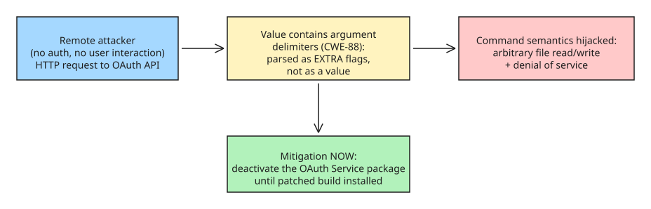

# Synology-SA-26:21 — CVE-2026-120382, Critical Argument Injection in the DSM OAuth API

Published 2026-11-19, status **Ongoing**: Synology disclosed a **critical (CVSS 3.1: 9.8)** vulnerability in the OAuth API of DiskStation Manager (DSM). Remote, unauthenticated attackers can read or write arbitrary files and cause denial of service. For anyone running a Synology NAS exposed to a network, this is a drop-everything advisory.

## Vulnerability anatomy

| Field | Value |
|---|---|
| CVE | CVE-2026-120382 |
| Severity | Critical — CVSS3 **9.8** |
| Vector | `CVSS:3.1/AV:N/AC:L/PR:N/UI:N/S:U/C:H/I:H/A:H` |
| Weakness | **CWE-88**: Improper Neutralization of Argument Delimiters in a Command |
| Entry point | OAuth API in DSM |
| Impact | Arbitrary file read/write + denial of service, remotely |

The vector spells out why it's alarming: **network-reachable, low complexity, no privileges, no user interaction**, with full impact on confidentiality, integrity, and availability. CWE-88 means the OAuth API builds command lines where argument delimiters (spaces, `=`, `--` prefixes) are not neutralized — an attacker crafts input that gets parsed as *extra arguments* rather than as a value, hijacking the command's semantics.

## Affected products and fixed releases

| Product | Severity | Fixed release availability |
|---|---|---|
| DSM 7.4 | Critical | Upgrade to **7.4.1-90080-2** or above (scheduled by 2026-11-20) |
| DSM 7.3 | Critical | Upgrade to **7.3.2-86009-6** or above (scheduled by 2026-11-20) |
| DSM 7.2.2 / 7.2.1 | Critical | Ongoing — upgrading to 7.3.2-86009-6+ recommended |
| DSM 7.1 | Critical | Ongoing |
| BeeStation OS 1.5 | Critical | Ongoing |
| APM 1.2/2.0, DSM Enterprise 1.0, SRM 1.2/1.3 | Not affected | N/A |

Vulnerable thresholds: DSM **before** 6.2.4-25556-9, 7.1.1-42962-10, 7.2.1-69057-14, 7.2.2-72806-11, 7.3.2-86009-6, and 7.4.1-90080-2.

## Response guidance

1. **Immediately deactivate the OAuth Service package** — Synology's official mitigation removes the attack surface. If nothing legitimately depends on DSM OAuth (some backup/connectivity integrations do), disable it first, patch second.
2. Patch to the fixed builds above as soon as they land (scheduled 2026-11-20 for 7.3/7.4).
3. Devices still on 7.1/7.2.x should plan the **jump to 7.3.2-86009-6+** rather than waiting for same-branch builds.
4. Treat a NAS behind the firewall as at-risk anyway: `AV:N/PR:N/UI:N` means any reachable OAuth endpoint is exploitable — including via SSRF from internal apps or lateral movement from one compromised host.
5. Audit for the aftermath if you were exposed: unexpected file writes, new accounts/tokens issued via OAuth, and DSM service disruption.

## Why this class of bug keeps happening

Argument-delimiter injection (CWE-88) is the command-injection cousin that survives "we don't call a shell" hardening: even without a shell, argument *parsers* treat delimiters as structure. The durable fixes are API-level: pass arguments as arrays to execve-style calls, validate values against an allowlist, and reject or escape delimiter sequences in free-form fields that reach command construction.

## References

- [Synology_SA_26_21 advisory](https://www.synology.com/en-uk/security/advisory/Synology_SA_26_21) (original source)
- [CVE-2026-120382 — CVE record](https://www.cve.org/CVERecord?id=CVE-2026-120382)
- [CWE-88: Improper Neutralization of Argument Delimiters in a Command](https://cwe.mitre.org/data/definitions/88.html)
- [CVSS 3.1 calculator for the published vector](https://www.first.org/cvss/calculator/3.1#CVSS:3.1/AV:N/AC:L/PR:N/UI:N/S:U/C:H/I:H/A:H)
