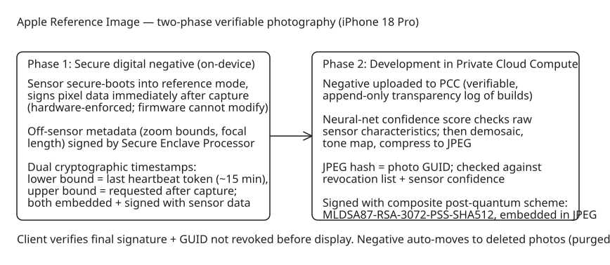

# Apple Reference Image — Hardware-Signed, Post-Quantum-Signed Verified Photography

Apple's Security Engineering and Architecture team (SEAR) described **Apple Reference Image**, an opt-in camera mode debuting on the main sensor of iPhone 18 Pro / Pro Max that produces a securely timestamped reference image attesting to what the sensor actually captured. It is positioned as a response to AI-generated/edited photorealistic imagery making "looks real" insufficient evidence of authenticity, and as a structural improvement over C2PA-based provenance metadata.

## Why post-capture signing (C2PA-style) falls short

Industry approaches based on the C2PA standard attach provenance metadata **after** capture and certify edit history from that point forward. Two failure modes:

1. **Compromise anywhere in the editing chain invalidates the guarantee**, and a viewer has no way to detect such a failure.
2. **Privacy risk**: tying an image to a public identity (device or individual) endangers photographers working in dangerous conditions.

Apple's design instead requires three properties simultaneously:

- **Semantic authenticity** — the reference image faithfully shows what the sensor captured; transformations from raw pixels to viewable image are publicly verifiable.
- **Resilience to compromise** — authenticity cannot be undermined by sensor tampering, common cryptographic attacks, or a software-level jailbreak; fraudulent images can still be revoked without exposing the photographer's identity.
- **Privacy preservation** — an outside observer cannot determine whether two reference images came from the same device; image contents are not exposed to Apple or anyone else.

## The two-phase design

### Phase 1: secure digital negative (on-device)

The camera sensor is securely booted into a specialized **reference capture mode** that cryptographically signs pixel data immediately after capture and prevents the sensor firmware from modifying it — hardware-enforced assurance that the OS receives exactly what the sensor captured, defeating injection/tampering on the sensor-to-OS transport. Signing raw sensor values alone does not yield a viewable image (demosaicing, lens-shading correction are still needed), and delaying signing until after software processing is vulnerable to OS-level alteration — hence the split into two phases.

Metadata gets the same treatment: sensor-produced metadata is signed at capture time together with pixels; off-sensor values (digital zoom boundaries, focal length) are signed by the **Secure Enclave Processor (SEP)**.

Timestamping uses Apple's cryptographic timestamp service twice: a retained heartbeat token (globally on average every 15 minutes) provides a proven **lower bound** on capture time; a second token requested after capture provides an **upper bound**. Both bounds are embedded and signed with the sensor data. The resulting secure digital negative contains pixels, essential metadata, and timestamp bounds — all protected from device software compromise.

### Phase 2: development in Private Cloud Compute (PCC)

The user-uploaded negative is developed inside PCC — demosaicing, tone mapping, compression — in an environment whose production builds are recorded in an append-only, cryptographically tamper-proof transparency log; binaries are publicly inspectable and a device only sends data to nodes that attest to running a logged build. Before development, a neural network with hidden weights computes a **confidence score** confirming the image has physical characteristics expected of raw sensor output.

The developed JPEG is hashed; that hash serves double duty as (a) the value submitted for signing and (b) the bits used for the photo GUID. PCC sends the GUID, raw hash, confidence score, and sensor ID to a companion service that records them, updates the running per-sensor confidence score, and checks the revocation list. If all checks pass, the commitment is signed with a **composite post-quantum scheme: MLDSA87-RSA-3072-PSS-SHA512**, and the signature is embedded in the JPEG.

### Client-side verification and lifecycle

Whenever the reference image is displayed, the client verifies the final JPEG signature and confirms the photo GUID is not on the current revocation list before showing it. After successful development, the secure digital negative automatically moves to the deleted photos folder (recoverable by the user; otherwise purged after 30 days). If a device is later found compromised, its images can be revoked and flagged retroactively without revealing which images came from the same sensor.

## Diagram: two-phase pipeline

## Why this matters beyond Apple

- **Signing at capture time vs. after processing** is the core architectural lesson: any provenance system that signs only after a long software pipeline inherits every compromise in that pipeline. Splitting into hardware-signed negative + verifiable-cloud development isolates the trust boundary.
- The **composite MLDSA87-RSA-3072-PSS-SHA512** signature is a concrete example of hybrid post-quantum signing deployed for "decades" of validity — the same harvest-now-decrypt-later reasoning as JDK 27's JEP 527 hybrid key exchange (see [JDK 26 performance improvements](../../programming/java/explanation-jdk-26-performance-improvements.md) for the Java-side post-quantum work).
- **Revocation without identity exposure** (per-sensor confidence + GUID revocation lists, no device-to-image linkage observable by outsiders) is a pattern worth studying for any provenance system that must protect vulnerable sources.

## References

- [Apple Security Research: Apple Reference Image — A New Approach for Verified Photography](https://security.apple.com/blog/apple-reference-image/)
- [Apple Private Cloud Compute (background)](https://security.apple.com/blog/private-cloud-compute/)
- [C2PA standard (industry provenance baseline)](https://c2pa.org/)
