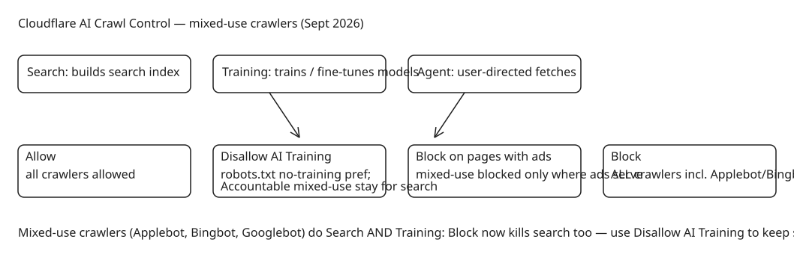

# Cloudflare's Disallow AI Training Setting — Keeping Search While Refusing Model Training

Cloudflare announced (2026-09-15) a new **Disallow AI Training** setting that breaks the long-standing tradeoff between staying discoverable in search and refusing to let crawlers train on your content. The root cause of that tradeoff is the **mixed-use crawler**: a single crawler identity serving both search indexing and model training (Applebot, Bingbot, Googlebot). Refusing one use previously meant refusing the other.

## Why robots.txt alone cannot solve it

A `robots.txt` directive can be published by anyone but cannot identify *who* is crawling, determine *why*, or stop a crawler that ignores it. Cloudflare's approach is network-level: publish the preference, classify each crawler's behavior (Search / Training / Agent), block operators that ignore the preference, and report actual operator behavior on Radar.

## The new setting matrix

Controls are applied at the domain level across three behaviors — **Search**, **Training**, **Agent** (user-directed fetches such as chat-fetch bots and browser-use agents):

| Setting | Effect |
| --- | --- |
| `Allow` | All crawlers allowed unless blocked by another setting or WAF rule |
| `Disallow AI Training` | Bot Preference Sync publishes the no-training preference in robots.txt. Accountable mixed-use crawlers (Applebot, Bingbot, Googlebot) remain allowed for search; every other training crawler is blocked — including training-only crawlers run by Amazon, Anthropic, Meta, and OpenAI, whose blocking does not affect search |
| `Block on pages with ads` | Crawlers (including mixed-use) blocked only on pages detected to serve ads. Cannot be expressed in robots.txt because the ad-serving page list is too large and changes too fast — hence no "Disallow AI Training on pages with ads" variant exists |
| `Block` | All crawlers, including mixed-use, are blocked — search included |

Key behavior change: **`Block` and `Block on pages with ads` now apply to mixed-use crawlers** (Applebot, Bingbot, Googlebot). Previously they did not, because blocking them would have killed search. To stop training while keeping search, you must explicitly select `Disallow AI Training`.

## The "Accountable" designation

Cloudflare created an **Accountable** designation for bot operators that meet or commit to four requirements:

1. A mechanism for site owners to opt out of AI training via robots.txt or a similar standard.
2. A mechanism to opt out of AI summaries (set with the operator directly today; through Cloudflare by early next year).
3. URL-level visibility into which pages were made available for training, plus metrics on how content appeared in search.
4. Assurance that opting out of training does not affect traditional search results.

Apple, Google, and Microsoft currently qualify (capabilities today plus time-bound commitments). Amazon, Anthropic, Meta, and OpenAI are also categorized as Accountable because they separate their Search and Training crawlers, so Cloudflare can block the training crawler without touching search.

### Per-crawler specifics

- **Applebot**: opt out of training with a `Disallow` rule for `Applebot-Extended` in robots.txt; AI summary preferences via the `nosnippet` directive in page HTML; paywalled content can be labeled to exclude it from generative output. URL-level inspection tooling is in progress (committed for next year). Apple states disallowing training does not impact search ranking.
- **Googlebot**: opt out with a `Disallow` rule for `Google-Extended`; webmaster-portal toggle excludes content from generative search results; metrics/reporting available; additional URL-level transparency tools expected within weeks. Google states `Google-Extended` is neither an inclusion nor a ranking signal in Google Search.
- **Bingbot**: granular controls via Bing Webmaster Tools today through the `NOARCHIVE` meta tag (content tagged `NOARCHIVE` is excluded from Bing Chat answers and from training Microsoft's foundation models). A robots.txt-level no-training preference is targeted for early 2027 — until then, selecting Disallow AI Training does not automatically convey a no-training preference to Bing.

## Migration behavior (effective September 15)

- "Block AI Bots" is deprecated in favor of the granular Search/Training/Agent controls; Managed Robots.txt is deprecated in favor of Bot Preference Sync (existing customers are migrated).
- Domains that never used the granular controls: legacy `Block` or `Block on pages with ads` migrates to **Search=Allow, Training=Disallow AI Training, Agent=Block on pages with ads**.
- Domains that previously configured granular controls keep their practical effect; previous Training selections of Block/Block-on-pages-with-ads migrate to Disallow AI Training.
- New domains get one of two presets based on ad monetization: non-ad sites get `Training=Allow`; ad-monetized sites get `Training=Disallow AI Training` and `Agent=Block on pages with ads`.

## Context numbers from the post

Less than 1% of Cloudflare sites block search bots, while **17% enable some mechanism to block training** — the gap that motivated granular controls over a one-size-fits-all "Block AI". On AI summaries: more than half of consumers read them in search results, those readers are over 40% more likely to end their search after reading one (zero-click), yet AI-referred visitors convert at roughly 3–5x the rate of traditional-search referrals. Cloudflare's stated next step is per-content control over how much content appears in summaries, building on IETF `ai-prefs` work.

## Diagram: setting matrix for mixed-use crawlers

## Practical takeaways

1. If you previously relied on "Block AI Bots" to stop training while keeping Google indexing, verify your migrated settings — the new default mapping keeps search (`Search=Allow`) and sets `Training=Disallow AI Training`, which is the intended outcome, but confirm it in zone Security Settings.
2. For Bing specifically, add the `NOARCHIVE` meta tag today if you want an immediate no-training signal; robots.txt-level support arrives early 2027.
3. If your business depends on ad revenue from page views, the recommended preset (Disallow AI Training + Block-on-pages-with-ads for agents) is a reasonable starting point: it keeps humans and search while refusing training and blocking agent fetches where ads would be served.

## References

- [Cloudflare Blog: Have it both ways — stay discoverable in search while disallowing AI training](https://blog.cloudflare.com/accountable-mixed-use-ai-crawlers/)
- [Cloudflare Bot Preference Sync announcement](https://blog.cloudflare.com/bot-preference-sync/)
- [Applebot data usage controls (Apple support)](https://support.apple.com/en-us/119829)
- [Google common crawlers: Google-Extended documentation](https://developers.google.com/crawling/docs/crawlers-fetchers/google-common-crawlers#google-extended)
- [Bing Webmaster Tools: AI performance controls](https://www.bing.com/webmasters/help/ai-performance-9f8e7d6c)
- [IETF ai-prefs working group documents](https://datatracker.ietf.org/wg/aipref/documents/)
