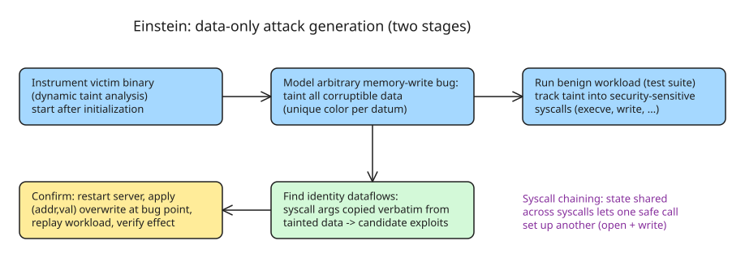

# Data-Only Attacks Are Easier Than You Think — The Einstein Exploitation Pipeline

Data-only attacks exploit a program's **data** rather than its control flow: the victim executes all of its intended code (benign functions, system calls), but with attacker-controlled arguments. They have been known since ~2005 ("Non-Control-Data Attacks Are Realistic Threats", USENIX Security) but were long dismissed as too application-specific and complex to be a practical threat. Johannesmeyer, Slowinska, Bos, and Giuffrida (VU Amsterdam VUSec) published **Einstein** at USENIX Security 2024 showing that assumption is wrong: data-only exploits can be generated automatically, at scale, by low-effort attackers.

## Why control-flow hijacking got hard — and why data-only fills the gap

About 70% of security bugs reported by Microsoft, Google, and Mozilla are memory-safety bugs (buffer overflows, use-after-free). The classic weaponization is **control-flow hijacking**: overwrite a code pointer so the program executes attacker code. Decades of defenses — DEP/NX, CFI, CPI — have made diverting control flow increasingly infeasible.

The data-only alternative: let the program run its own intended code path, but corrupt the *arguments* it passes to security-sensitive syscalls (`execve`, `write`, `sendmsg`). The benign and malicious executions are structurally identical; only the data differs.

**Classic example (web server CGI-BIN):** a memory-write bug lets an attacker overwrite the global `cgi_bin_path` from `/usr/local/server/cgi-bin` to `/bin`. A request `POST /sh` with body `touch /tmp/attacker-was-here` then makes the server itself call `execve("/bin/sh", ...)` — arbitrary code execution without a single byte of attacker code running.

## Why they were considered impractical (and why that was wrong)

1. **Application-specific** — building one requires deep knowledge of program semantics to find which data is security-critical and how to reach it.
2. **Complex** — prior automated approaches used heavyweight symbolic execution, simplifying assumptions, or manual gadget chaining; many even built Turing-complete machines inside the target.

Einstein's key insight: none of that is necessary. Four observations make the problem tractable with lightweight analysis:

- Target a **universal interface**: syscalls (any program talks to the kernel through them), not application semantics.
- **Turing completeness is unnecessary** — attackers want specific goals (`execve` for code execution, `write` for filesystem corruption).
- **No need to divert control flow** — programs invoke interesting syscalls on their own valid runtime paths.
- After initialization, many data are treated as **immutable**, so a corrupted value flows unchanged ("identity dataflow") all the way to the sensitive syscall — no constraint solving needed.

## How Einstein works

Einstein is an open-source exploitation pipeline (github.com/vusec/einstein) with two stages:

Stage 1 — **candidate generation**: instrument the victim binary with dynamic taint analysis; after initialization completes (all config loaded), model an arbitrary memory-write bug by uniquely tainting every datum it could corrupt. Drive the program with a benign workload (its own test suite) and track taint into security-sensitive syscalls. When a syscall argument is *identical* to tainted data — an **identity dataflow** — emit candidate `(address, value)` overwrite pairs. Einstein also tracks library state shared across syscalls, enabling **syscall chaining**: one safe call corrupts state that another safe call later consumes (e.g., `open` pathname + unrelated `write` fd/buf → filesystem corruption).

Stage 2 — **confirmation**: restart the server, apply the candidate overwrite at the bug point, replay an exploit workload (`POST /sh` with a shell command), and verify the effect (file created). This filters out candidates that are neutralized by runtime checks.

## Evaluation results

| Target | Tainted sensitive syscalls (% identity flow) | Code coverage |
| --- | --- | --- |
| httpd | 1834 (97%) | 27.3% |
| lighttpd | 92 (98%) | 27.8% |
| nginx | 1623 (82%) | 49.1% |
| postgres | 2105 (27%) | 46.5% |
| redis | 218 (84%) | 33.6% |

For **nginx**, Einstein produced **944 confirmed exploits**: 1 code-execution, 17 write-what-where, 375 write-what, 79 write-where, 41 send-what-where, 372 send-what, 59 send-where — at only 27–49% test-suite coverage. Two case-study exploits **bypass state-of-the-art mitigations** including syscall filtering and selective DFI:

- **Code-execution**: an `execve` whose pathname and argv come directly from a global variable → trivial arbitrary code execution by overwriting that one string.
- **Write-what-where via chaining**: corrupt the `openat` pathname of one request path and the fd/buf of an unrelated `write` call to corrupt server files.

## The mitigation dilemma

For control-flow hijacking, mitigations could be both *comprehensive* (cover the whole attack surface) and *practical* (cheap to deploy): DEP/CFI/CPI target a well-defined pointer-overwrite → indirect-branch chain. Data-only attacks break that symmetry — they can overwrite **any** data corrupting **any** operation:

| Defense class | Examples | Problem |
| --- | --- | --- |
| Comprehensive but impractical | Memory safety (Rust/Go rewrites), full DFI | Poor performance or onerous software/hardware changes |
| Practical but noncomprehensive | Memory error scanning, selective DFI, syscall filtering | Einstein generates exploits that trivially bypass them |

**Takeaway for vendors**: deploy comprehensive defenses where feasible; use Einstein itself to audit case-by-case which of your syscalls have identity dataflows from attacker-controllable state. The open research direction is making comprehensive defenses practical enough to adopt widely.

## Practical checklist (defenders)

- Audit global/config variables that flow verbatim into `execve`, `open*`, `write`, `sendmsg` arguments — these are the identity-dataflow targets.
- Treat "the program only executes its own code" as **not** a safety property: intended syscalls with corrupted arguments are the attack surface.
- Syscall filtering and selective DFI alone do not close this class; combine with memory-safety hardening of the components that hold security-critical state.

## References

- [USENIX ;login: Data-Only Attacks Are Easier than You Think](https://www.usenix.org/publications/loginonline/data-only-attacks-are-easier-you-think)
- [Practical Data-Only Attack Generation — USENIX Security 2024 paper](https://www.usenix.org/conference/usenixsecurity24/presentation/johannesmeyer)
- [Einstein tool (open source, VUSec)](https://github.com/vusec/einstein)
- [Paper PDF](https://download.vusec.net/papers/einstein_sec24.pdf)
