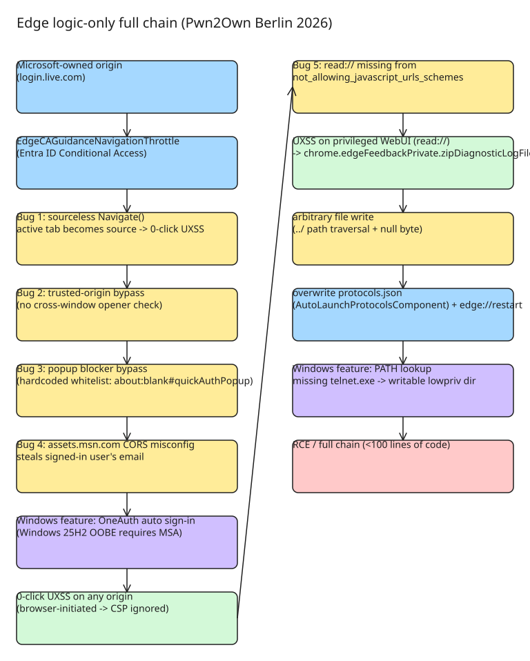

# Forging a Microsoft Edge Full Chain with Logic Bugs Only (Pwn2Own Berlin 2026)

## Context

Orange Tsai (DEVCORE Research) built a completely **handmade, logic-only Microsoft Edge full chain — no memory corruption, no AI** — for Pwn2Own Berlin 2026. Per TrendAI Zero Day Initiative, the chain **chained 4 logic bugs to achieve a sandbox escape on Microsoft Edge, earning $175,000 and 17.5 Master of Pwn points — a full win**. The author states the whole chain is made up of **five bugs and two Windows features**, and presented the full bug-hunting and chaining process at HITCON and Hexacon 2026. The chain was nominated for and **won the 2026 Pwnie Award "Epic Achievement"**.

## The key insight: forgotten Navigation Throttles

**Navigation Throttles** live in the Chromium browser process and intercept all navigation requests initiated by either the Browser or the Renderer. Of the 3,000+ Chrome CVEs fixed over the past five years, **fewer than 20 involve Navigation Throttles** — an under-hunted corner of the browser.

## Entry point: EdgeCAGuidanceNavigationThrottle

`EdgeCAGuidanceNavigationThrottle` is Edge's enterprise **Entra ID (Conditional Access)** feature: it guides users to the right User Profile when Edge detects them signing in with a work account on a Microsoft website. To fire the throttle, the navigation must originate from a specific Microsoft-owned origin such as `login.live.com`:

```js
location.href = `https://guidance-ca-error/?email={email}&switch_profile={url}`
```

Once fired, Edge compares the email of the current User Profile with `?email`:

- **Mismatch** → Edge pops up an account-switch dialog.
- **Match** → Edge grabs the URL from `switch_profile={url}` and launches a **new navigation via Chromium's internal Navigation API** (the original navigation is cancelled):

```cpp
NavigateParams params(browser, switch_profile_url, ui::PAGE_TRANSITION_LINK);
params.disposition = WindowOpenDisposition::CURRENT_TAB;
params.window_action = NavigateParams::SHOW_WINDOW;

Navigate(&params);
```

Because the new navigation is initiated by the **Browser Process**, it can reach normally-prohibited pages (`edge://settings`, `devtools://...`) and pseudo-schemes like `javascript:alert(origin)`. But firing the throttle still requires an execution context on `login.live.com`, so by itself it is at most a Self-XSS or a stronger Open Redirect — the bug sat in the author's notes for weeks.

## The five bugs and two Windows features

1. **Bug 1 — Sourceless navigation (the UXSS primitive).** If `Navigate()` is called without `source_contents`, Chromium automatically uses the **current active tab** as the renderer source — and with `disposition = CURRENT_TAB` (the default), that same tab becomes the target. The throttle's `Navigate()` does exactly this (even Chromium's own example code gets it wrong). With a delayed trigger plus the user switching tabs, the browser-initiated navigation lands on an **arbitrary tab** (e.g. `google.com`) → a **zero-click UXSS**. The author calls this a new UXSS attack surface.
2. **Bug 2 — Trusted-origin bypass (missing cross-window opener check).** The throttle validates the firing origin via `web_contents->GetLastCommittedURL()`, forgetting that a navigation can also come from **another window**. `window.open('https://login.live.com/')` from any site, then navigating the popup to `guidance-ca-error?...`, fires the throttle from any origin.
3. **Bug 3 — Popup Blocker bypass (hardcoded whitelist).** The Popup Blocker blocks `window.open(malicious)`, but Edge ships a hardcoded popup whitelist (apparently for internal use): `window.open('about:blank#quickAuthPopup')` is **granted**, then `popup.location = 'https://malicious.tld'` navigates it away.
4. **Bug 4 — CORS misconfiguration leaking the login email.** The throttle requires a signed-in profile whose email matches `?email`. `assets.msn.com` (embedded in `edge://new-tab-page-online`) returns the currently signed-in user's email, and its CORS misconfiguration lets **any website** `fetch(..., {credentials: 'include'})` the victim's email — no social engineering needed.
5. **Bug 5 — `read://` scheme missing from the JS-URL blacklist (sandbox-escape step).** A UXSS alone is not ACE. Chromium's renderer ignores `javascript:` URLs from origins on the privileged-scheme blacklist (`edge://`, `devtools://`, …, `not_allowing_javascript_urls_schemes`). Edge's own Reading Mode **Immersive Reader** uses a custom `read://` scheme that Microsoft forgot to add to the blacklist, so the UXSS works on this privileged WebUI. From there, `chrome.edgeFeedbackPrivate.zipDiagnosticLogFiles(filename, json)` writes attacker-controlled content (as `filename.json`) to a temp folder and zips it up; `../` escapes the folder and a **NULL byte drops the `.json` extension** → **arbitrary file write** with controlled filename and content.

Windows features:

1. **OneAuth auto sign-in (+ Windows 25H2 OOBE).** OneAuth lets any Edge WebView application automatically sign in with the current MSA credentials when visiting Microsoft-owned sites. Since Windows 25H2, OOBE requires an MSA sign-in (absent the local-account workaround), so merely visiting `www.microsoft.com` makes Edge **create a signed-in profile automatically** — the throttle's signed-in-profile requirement is met on stock hardware.
2. **Windows PATH lookup for the missing `telnet.exe`.** To turn the arbitrary file write into ACE, the chain overwrites `AppData\Local\Microsoft\Edge\User Data\AutoLaunchProtocolsComponent\1.0.0.10\protocols.json` (read at Edge initialization; it defines which origins may launch which URL protocol handlers) to allow `telnet://` from any origin. The telnet handler invokes `telnet.exe`, which is not shipped by default, so Windows searches the PATH — which includes `C:\Users\lowpriv\AppData\Local\Microsoft\WindowsApps`, a directory **writable by the low-priv user**. Dropping a small 32-bit PE there yields ACE (a 64-bit DLL side-load was abandoned: the file write is JSON-wrapped, so content must be valid UTF-8, and no valid 64-bit PE header satisfies that). Edge is then restarted via the browser-initiated `edge://restart` navigation (only needed for the Pwn2Own demo). The whole exploit is **less than 100 lines of code**.



## UXSS as a new attack surface — "Attack Surface is the new 0day"

The author frames the sourceless-navigation UXSS as a **new attack surface** and, in the AI era, agrees with the framing that **"Attack Surface is the new 0day"**: for logic bugs, the hard part is *finding* the bugs (not the exploitation — once found, chaining is the easiest part), so novel, unexplored attack surfaces are the gold mine. This was one reason the author explored the surface before "sharing it with the AI giants".

## Follow-ups and the author's take on AI-assisted vs handmade research

- **Follow-ups mentioned**: a Windows RCE the author just reported (**CVE-2026-58608**); flipping the chain to **pop Microsoft Edge from `calc.exe`**; **porting this logic-only full chain to Google Chrome** ("almost there"); and progress to be shown at **CODE BLUE Japan**.
- **AI stance (the author's stated opinion)**: the whole two-month research was done **with no LLMs/AI involved** — the author only started using coding agents around March 2026, after all bugs were already found. For memory corruption the hard part is exploitation; for logic bugs the hard part is discovery, so the exploit was deliberately kept AI-free. At the same time the author says he is "tokenmaxxing and addicted to AI" outside this chain: "once you've tasted how convenient LLMs are, no one would want to go back to hunting bugs by hand. That's also the future, I think." He is "not that afraid of being replaced by AI" — instead excited about what AI makes possible.

## Press coverage (2026-10-29)

Within a day of the Orange blog post, the full-chain result picked up broad security-press pickup (GBHackers, Cyber Press, Daily.dev, among others). Two points of note from the coverage cycle:

- **No public Chrome port reported as of 2026-10-29.** The author's stated intent to port the same three logic-bug classes to Chromium has not materialized in any public report; the chain remains Edge-specific.
- **The "no AI" angle dominated the coverage.** Nearly every secondary story led with the "last proof of human craft" framing; the CVE-2026-58608 follow-up (Windows RCE) is the author's only post-blog disclosure so far.

## References

- [The Last Proof of Human Craft: Forging a Microsoft Edge Full Chain (Orange Tsai)](https://blog.orange.tw/posts/2026-10-the-last-proof-of-human-craft-browser-full-chain/)
- [Presentation slides — HITCON / Hexacon 2026 (PDF)](https://github.com/orangetw/My-Presentation-Slides/blob/main/data/2026-The-Last-Proof-of-Human-Craft-en.pdf)
- [TrendAI Zero Day Initiative confirmation tweet](https://x.com/thezdi/status/2054868495888777266)
- [CVE-2026-58608 — Windows RCE (author's follow-up report)](https://msrc.microsoft.com/update-guide/vulnerability/CVE-2026-58608)
- [Cyber Press: Orange Tsai's Microsoft Edge Pwn2Own Berlin 2026 full chain](https://cyberpress.net/en/orange-tsai-microsoft-edge-pwn2own-berlin-2026-full-chain/)
- [GBHackers: Microsoft Edge full-chain exploit demoed at Pwn2Own](https://gbhackers.com/microsoft-edge-full-chain-exploit-pwn2own/)
