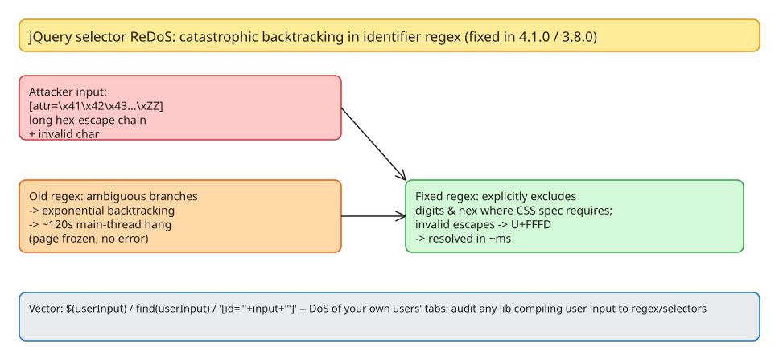

# jQuery 4.1.0 / 3.8.0: ReDoS in Selector Identifier Matching and the 3.x Endgame

On 17 November 2026 jQuery shipped **4.1.0** (first minor of the 4.x line) and **3.8.0** — the
"passing the torch" release: 3.x gets years of backported fixes as a farewell, after which the
3.x branch accepts **only critical security fixes and bug fixes**. Given jQuery ran on **65.3% of
the top 10M websites as of October 2026** (3–4x any other JS library), even a parser-level bug in
the selector engine has enormous blast radius.

## The ReDoS: catastrophic backtracking in the identifier regex

The regex jQuery used to match identifiers in selectors exhibited **catastrophic backtracking**:
a **long chain of hexadecimal escapes followed by an invalid character** — e.g. inside an
attribute selector — made the regex engine explore exponentially many backtracking paths and
**hang the page** (community reports measured hangs on the order of ~120 seconds; the patched
build resolves the same input in milliseconds).

The attack surface is any code path that feeds **untrusted strings into a jQuery selector**:
`$(userInput)`, `$(ctx).find(userInput)`, attribute-selector templates like
`[id="' + userInput + '"]`. It is a pure availability bug — no XSS, no data leak — but it
freezes the main thread.

**The fix:** the production build now **explicitly excludes digits and hex characters where the
CSS specification requires it**, matching the spec more closely so the ambiguous,
backtracking-prone branch of the regex disappears. Invalid escape sequences in selectors are now
also decoded to **U+FFFD** (the replacement character) as the CSS spec requires.

Operational note: **regex ReDoS in client-side libraries is underrated** — the DoS target is your
own users' browser tabs, triggered by content you render, and it does not error, it just hangs.
Any library that compiles user input into a regex or selector is a candidate; audit them the same
way you audit server-side parsers.

## Migration-relevant changes in 4.1.0

- **AJAX transport `complete` callback gains an object form.** Custom transports may now invoke
  `function({ status, statusText, responses, headers })` instead of positional arguments — new
  fields can be added without breaking argument order. 4.1.0 already uses this for `responseURL`.
- **`jqXHR.responseURL`** exposes the final URL after browser-followed redirects (only when the
  transport can supply it — XHR yes, IE 11 / script / JSONP transports no). Check for
  open-redirect tracking with it.
- **Form-associated custom elements** (`customElements.define(..., { formAssociated: true })`) now
  serialize correctly with `.serialize()` / `.serializeArray()` — membership in `form.elements`
  decides submittability instead of tag-name filtering.
- **CSS methods work in XML documents**: internally switched to `createElementNS` with the XHTML
  namespace so `.css()` works on XSLT-transformed documents where `createElement` puts elements
  in the XML namespace with no `style` property.
- **`querySelectorAll` everywhere**: `getElementsByTagName`/`getElementsByClassName` are gone
  internally — qSA returns a static list (no dynamic-collection snapshotting) and fixes long-standing
  bugs (MathML tag-name matching on cloned nodes in IE 11, leading-combinator selectors on
  document fragments, unusual characters in tag names).
- **`uniqueSort` is now O(N) time / O(1) extra space** — single-pass two-pointer compaction
  replaced repeated merges (was O(N²) time / O(N) space). Same output order.

## What 3.8.0 removes (so 3.x users see the 4.x migration surface)

- Array methods `push`, `sort`, `splice` on the jQuery prototype (internal-only since Sizzle was
  folded in). Replace `$elems.push(elem)` with `[].push.call($elems, elem)`.
- `jQuery.expr[":"]` and `jQuery.expr.filters` — deprecated since 3.0.0, never moved into the
  `deprecated` module. Use **`jQuery.expr.pseudos`**.
- Backported 4.0.0 fixes: self-clearing scripts in `.html()`, `jQuery.cleanData` skipping
  elements, correct `<col>` dimensions, more robust `leverageNative`, CSS-zoom and hidden-iframe
  compat test fixes.

## Decision guidance

1. If you still serve jQuery 3.x: take 3.8.0 **now** for the ReDoS fix, but plan the 4.x
   migration — 3.x is critical-fixes-only from here.
2. Grep your codebase for selectors built from user input (`$(.*\+`, `[id=`, `:has(` templates);
   that pattern is both the ReDoS vector and a general code smell — pass elements, not
   string-concatenated selectors, or sanitize with `$.escapeSelector()`.
3. If you ship pinned jQuery on a CDN, treat this like any CVE-driven bump: re-scan your
   dependency inventory and pin the new version hash.

## See also

- `explanation-third-party-js-supply-chain-optimizely-csp.md` — same delivery path (CDN'd JS), different threat class
- `../web-app-security-hoffman/howto-automate-dependency-tree-cve-scanning.md` — how to catch library CVEs like this automatically

## References

- [jQuery 4.1.0 and 3.8.0 Released: Passing the Torch — Official jQuery Blog](https://blog.jquery.com/2026-11-17/jquery-4-1-0-and-3-8-0-released-passing-the-torch/)
- [Developpez coverage (FR): jQuery 4.1.0 / 3.8.0 avec correction ReDoS](https://javascript.developpez.com/actu/389272/Les-versions-4-1-0-et-3-8-0-de-la-bibliotheque-Javascript-jQuery-sont-disponibles-avec-une-correction-d-une-vulnerabilite-ReDoS-dans-la-correspondance-des-identifiants/)
