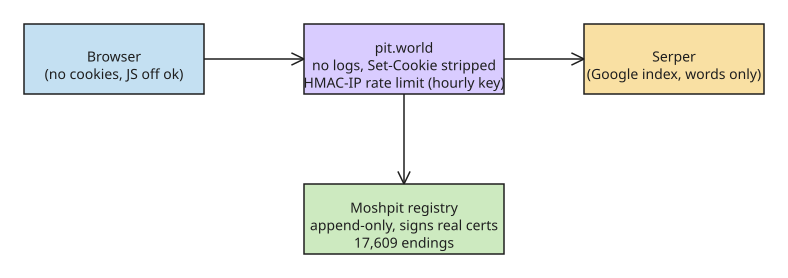

# pit.world: Privacy-by-Construction Search Proxy and the Moshpit DNS Namespace

**pit.world** is a search engine that "keeps nothing about you" and also searches a second, non-ICANN internet namespace called **Moshpit**. Two ideas worth studying: the *privacy-by-construction* server design, and the Moshpit append-only name registry.

## Privacy by construction

The browser only ever talks to pit.world; pit.world forwards **only the query words** to one search provider (the Google index, via Serper) — no IP, browser fingerprint, cookie, or referrer. The server-side properties that make the "keeps nothing" claim verifiable:

| Control | Mechanism |
|---|---|
| Access logs | nginx keeps **none** for the site |
| Error logs | raised to `crit`, so even a failed request never writes the query |
| Cookies | server **strips `Set-Cookie`** from every response |
| Rate limiting | keys on an **HMAC of the client IP** under a secret that is regenerated **every hour** and never stored |
| Click tracking | result links go straight to the target with `no-referrer`; no redirect through the proxy |
| Fingerprinting | works with **JavaScript off** — Tor Browser at "Safest" works |

The author verified the no-logs claim on the live box: searched a made-up word, then grepped every nginx log and the service journal for it — zero hits. Note the design choice: hourly-rotated, never-stored HMAC secrets mean the rate-limit state cannot be joined to past requests even by an attacker with disk access — at the cost of per-window rate-limit consistency.

## The Moshpit network

Moshpit is a **namespace beside ICANN's**: anyone can claim an ending (`.hacker`, `.eggs`, `.pit`), put names under it, and point them anywhere.

- The registry is **open and append-only**, and it **signs real certificates**, so `https://chovy.hacker` is a working HTTPS site for anyone on the network.
- At the time of writing: **17,609 endings** claimed.
- Type a Moshpit name into pit.world and it resolves through the registry, displayed next to web results; the front page shows recent claims and which endings are for sale.
- Client resolution options: install `moshcode` and run `moshcode dns enable`, or point your browser's secure DNS at `https://dns.moshcode.sh/dns-query` (DoH).

## Usage

- **Default engine:** Firefox picks it up from the address bar; Chrome/Brave/Edge take `https://pit.world/search?q=%s` as a custom engine. Bangs work: `!pit chovy.hacker`, `!gh hqtui`.
- **Terminal/agents:**

```bash
bun add -g pitworld
pit search "private search engines"
pit resolve chovy.hacker
pit            # TUI
claude mcp add pit -- pit mcp
```

- **JSON API:** `GET /api/search`, no key needed. Code is MIT: [github.com/moshcoder/pit.world](https://github.com/moshcoder/pit.world).

## Assessment

The interesting security property is not "we log less" but that every layer that *could* leak is structurally disabled (logs off, cookies stripped, no referrer, JS-off). The Moshpit registry is a more unusual object: a second, append-only, cert-signing name namespace — worth watching for how its naming claims and certificate trust actually get operated. Caveat: the network description above is single-sourced (the author's own post); independent coverage of Moshpit was not found during this research run.

## Diagram



## References

- [pit.world: private search, and a doorway to the Moshpit network — DEV.to](https://dev.to/chovy/pitworld-private-search-and-a-doorway-to-the-moshpit-network-1d4b) (primary source)
- [pit.world](https://pit.world/) (live service)
- [github.com/moshcoder/pit.world](https://github.com/moshcoder/pit.world) (MIT source)
