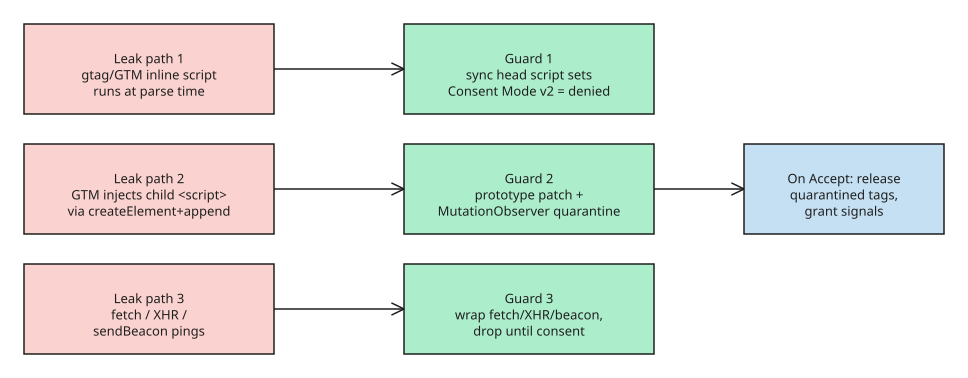

# Pre-Consent Tracker Leaks: Why Cookie Banners Miss GTM-Injected Scripts and sendBeacon

A common and auditable GDPR/ePrivacy failure: on many e-commerce sites, opening Chrome DevTools → Network **before** clicking "Accept All" still shows live requests to `google-analytics.com`, `connect.facebook.net`, and `analytics.tiktok.com`. The site *has* a cookie banner — it just doesn't actually stop the trackers. Understanding why is more useful than any specific CMP product.

## Why banners leak despite "blocking" trackers

1. **UI-only banners.** Most banners render a consent bar and set a preference flag, but nothing intercepts script *execution*. Tags already in the HTML run immediately.
2. **Dynamically injected scripts.** Google Tag Manager injects child scripts at runtime (`analytics.tiktok.com`, hotjar, clarity, meta pixel). A banner that only filters the initial DOM sees none of this — the injection happens after parse via `document.createElement('script')` + `appendChild`.
3. **Non-`<script>` beacon channels.** `navigator.sendBeacon()`, `fetch()` with `keepalive`, and `XMLHttpRequest` let a "blocked" tracker still exfiltrate pageview data. Blocking script tags alone is insufficient.
4. **Consent Mode not defaulted.** If Google Consent Mode v2 signals (`ad_storage`, `analytics_storage`, `ad_user_data`, `ad_personalization`) are not explicitly set to `denied` *before* gtag/GTM loads, GTM runs in a granted-like state and fires tags regardless of the banner's UI state.
5. **Heavy commercial CMPs are no guarantee.** Cookiebot/OneTrust-class CMPs ship 100–200 KB+ of JS (their own pre-consent fingerprinting/performance questions aside) and their pre-consent interception of GTM-injected async scripts has historically been partial.

## What a correct pre-consent blocker must do

The mechanism pattern (illustrated by Consentinel, a ~12 KB gzipped GPL-2.0 open-core script blocker referenced in the source article):

1. **Load synchronously at the top of `<head>`** — before gtag/GTM — so guards install before any tracker initializes.
2. **Intercept DOM script injection**: patch DOM prototypes and use a `MutationObserver` to quarantine dynamically appended `<script>` elements matching known tracker domains (GA4, GTM-injected, Meta, TikTok, Hotjar, Clarity) until consent for that category is granted.
3. **Intercept network channels**: wrap `fetch`, `XMLHttpRequest`, and `navigator.sendBeacon` to drop pre-consent tracking beacons.
4. **Set Consent Mode v2 defaults explicitly** — all four `ad_storage` / `analytics_storage` / `ad_user_data` / `ad_personalization` to `denied` at load, then update to `granted` on accept (this also fixes ad-platform conversion modeling).
5. **Zero CLS**: render consent UI as a floating dock/sheet so it doesn't shift layout (Core Web Vitals + dark-pattern compliance: the banner must not be the UI the page depends on).

## Auditing your own site (the practical takeaway)

1. Open DevTools → Network, filter `google-analytics | googletagmanager | connect.facebook | analytics.tiktok | clarity.ms | hotjar`.
2. Load the page in a fresh profile and **do not interact with the banner**.
3. Any hits = pre-consent leak; check whether they came from initial `<script>` tags, GTM injection (initiator column shows `gtm.js`), or beacons (type `ping`/`beacon`).
4. Verify Consent Mode defaults: `window.dataLayer` should contain an early `consent` command with all four signals `denied`.

## Caveats

The source article is written by the author of Consentinel (self-promotion present; benchmark/comparison tables should be treated as vendor claims). The **leak mechanisms and required guard set** above are standard, independently documented concerns (Google's own Consent Mode v2 documentation describes the denied-by-default contract; GDPR enforcement actions have targeted pre-consent firing). Evaluate any CMP by testing on your own site with the audit procedure, not by vendor comparison tables.

## References

- Source article: [Why Most Cookie Banners Still Leak GTM & Meta Pixel Before Consent](https://dev.to/rabig3015ai/why-most-cookie-banners-still-leak-gtm-meta-pixel-before-consent-and-a-12kb-open-source-fix-2835)
- Consentinel module (example implementation): [rabig3015-ai/consentinel-magento2](https://github.com/rabig3015-ai/consentinel-magento2)
- Google Consent Mode v2 concept (search: "Consent Mode v2 set default ad_storage denied") — the denied-default contract is the compliance anchor.
