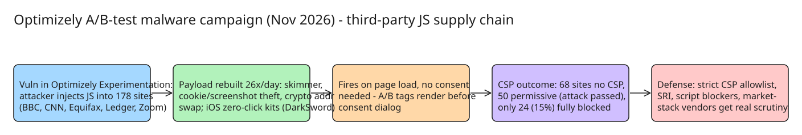

# Third-Party JavaScript Supply Chain: The Optimizely A/B-Test Malware Campaign and Why CSP Is the Missing Control

On 2026-11-16 an attacker exploited a vulnerability in **Optimizely Experimentation** to inject malicious JavaScript into customer projects, and at least **178 top web destinations** — including the BBC, CNN, Equifax, Ledger and Zoom — served it to visitors within 24 hours. None of those sites had their own code or infrastructure breached. The incident is the clearest evidence yet that the web's dominant defense against exactly this scenario — **Content Security Policy** — is either absent or too permissive to work.

## What happened

- Malicious JavaScript was delivered **through the A/B-testing pipeline itself**: the payload was rebuilt **26 times during a single day**, versioned and measured like a product feature. Report URI's Scott Helme observed the same technique defenders use — iteration loops — pointed the other way.
- The dropped kit was multi-purpose: **payment-card skimming, cookie and screenshot theft, and cryptocurrency address swapping** on checkout pages.
- It also served **zero-click iOS exploit kits** (named "DarkSword" and "Coruna") targeting known vulnerabilities in older iPhones/iPads, chaining roughly half a dozen flaws into full device compromise.
- Optimizely's statement: an "unauthorized party exploited a vulnerability in Optimizely Experimentation to add malicious JavaScript to some customer projects." Remediation was blocking the vulnerable path, deploying a fix, removing injected code, ending sessions, revoking tokens, and resetting affected accounts; Cloudflare-side protections were added to block delivery of malicious code.
- Damage was modest (~**$7,500** in cryptocurrency plus an unknown number of card records) — an indicator of reach, not of the ceiling.

## Why it fired without any user interaction

A/B-testing snippets are engineered to run **as high in the page as possible and immediately on load**, deliberately *not* gated behind a consent dialog, because they must measure the unfiltered original experience. Infoblox researcher Zach Edwards: the compromised payload therefore "didn't require any clicking or consent to trigger — most of the impacted clients would immediately serve up the payload as soon as someone loaded the page." The same design property that makes the product work makes its compromise maximally dangerous.

Context: per the HTTP Archive **2025 Web Almanac**, the **median homepage loads at least 22 JavaScript files**, most of them third-party.

## The CSP numbers that matter

Report URI measured CSP coverage across the 178 affected sites:

| CSP state | Sites | Outcome |
| --- | --- | --- |
| No CSP at all | 68 | Malicious domain injection unrestricted |
| CSP present but permissive | 50 | **Both the payload delivery and the data theft passed** |
| CSP that fully blocked the payload | 24 (15%) | Attack stopped |

Across the web's busiest sites, CSP deployment is only about **10%** (crawler.ninja, top 1M sites). Helme's framing: the current absence of CSP is "the Wild West" — organizations run code they don't know the behavior of. The reason for the low adoption is organizational, not technical: marketing teams need tags to load, so policies get loosened until they no longer constrain anything.

A genuine caveat from practitioner discussion: a CSP that allowlists a compromised first-party vendor's own domain does not stop an in-place payload swap. It stopped **this** attack because the injected script fetched its kit from several domains that were not Optimizely's. `strict-dynamic` weakens the story further — it requires nonces/hashes, and script that can inject can often steal a nonce. So CSP is necessary, not sufficient: it constrains **exfiltration and second-stage fetch destinations**, which is precisely where this campaign was caught.

## Defense checklist

**Site operators**
1. Deploy a CSP with an explicit `script-src` allowlist; audit it quarterly against the tags actually in use, and treat every wildcard (`*`, `https:`, `unsafe-inline`) as a finding.
2. Prefer nonces/hashes over host allowlists where you control the templates; be deliberate about `strict-dynamic` (it reopens dynamic injection by design).
3. Pin third-party scripts with **Subresource Integrity** where the vendor ships stable builds.
4. Move marketing/experimentation tags onto a **separate hostname/domain** so their cookies cannot reach the authenticated origin.
5. Give the marketing stack the same supply-chain review you give payments and auth: who can publish code that executes on your origin, and how fast.
6. Monitor the gap: Report URI / `report-to` endpoints, plus a canary that alerts when an unknown script origin appears on checkout pages.

**End users** — the effective control flipped: ad and script blockers are now the firewall. uBlock Origin / NoScript-class tooling blocks most third-party JavaScript; the 2016-era advice (antivirus plus host firewall) does not address code executing inside your browser's origin.

## Related

- [[../ai-agent-security/explanation-adaptive-prompt-injection-agent-swarms]] — same trust-collapse theme: the input you trust is the one you did not write.
- [[../supply-chain/howto-audit-transitive-github-action-dependencies-pin-deep]] — pinning and auditing for the *other* JS supply chain (build-time vs run-time).

## References

- [Attackers Used Optimizely to A/B Test Malware on Top Websites — Krebs on Security](https://krebsonsecurity.com/2026/11/attackers-used-optimizely-to-a-b-test-malware-on-top-websites/)
- [World's largest brands infected with malware via Optimizely — Report URI blog](https://blog.report-uri.com/worlds-largest-brands-infected-with-malware-via-optimizely/)
- [Content Security Policy — MDN](https://developer.mozilla.org/en-US/docs/Web/HTTP/Guides/CSP)
- [2025 Web Almanac — HTTP Archive](https://almanac.httparchive.org/en/2025/table-of-contents)
- [Optimizely Security Incident Report, Nov 17 2026 (PDF)](https://pages.optimizely.com/rs/947-RKE-048/images/Security%20Incident%20Report%20-%20Optimizely%20Web%20Experimentation%20-%20Nov%2017%202026.pdf)
