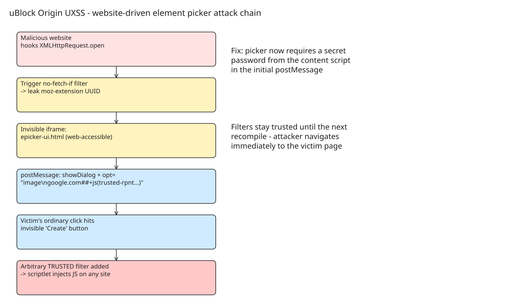

# Universal XSS in uBlock Origin via Website-Driven Element Picker

In November 2026 a **one-click universal XSS (UXSS)** was disclosed in the MV2 Firefox build of uBlock Origin (a weaker variant also affected the MV3 build, uBO Lite). A malicious website could trick the extension into adding **arbitrary trusted filters** on any domain — and because uBO trusted filters can inject JavaScript (scriptlets), that means arbitrary JS execution in the context of any site. Reported by **Smitty van Bodegom (syvb)**, fixed in uBO 1.75.4; see the [GitHub advisory GHSA-cmqw-9r2w-6wv2](https://github.com/gorhill/uBlock/security/advisories/GHSA-cmqw-9r2w-6wv2).

Notably, the vulnerability was found with AI assistance: the author asked GPT-5.6 Sol to look for a UXSS from filter injection; the model proposed the issue and the author verified it. The PoC code was mostly written by Claude.

## Why trusted filters equal code execution

uBlock Origin filters are compiled into the blocker engine. Filters added through the **element picker** (the right-click "block element" UI) are always treated as **trusted** until the next filter recompile — and trusted scriptlet filters such as `##+js(trusted-rpnt, script, ...)` inject JavaScript into matching pages. Gaining the ability to add a trusted filter for an arbitrary domain is therefore equivalent to UXSS.

## The attack chain

1. **Leak the extension UUID.** On Firefox the picker UI is served from `moz-extension://<UUID>/web_accessible_resources/epicker-ui.html`, and the UUID is random per install. uBO's default uAssets rules include a `lootdest.*##+js(no-fetch-if, adsbygoogle, war:googlesyndication_adsbygoogle.js)` rule whose `fetch` hook performs an **XHR to a `moz-extension://<UUID>/...` URL**. The attacker page hooks `XMLHttpRequest.prototype.open` and reads the UUID out of that URL:

   ```js
   const origOpen = XMLHttpRequest.prototype.open;
   XMLHttpRequest.prototype.open = function(m, url, ...a) {
       const e = /^moz-extension:\/\/[^/]+/.exec(url);
       if (e) { /* e[0] contains the extension UUID */ }
       return origOpen.call(this, m, url, ...a);
   };
   // trigger the no-fetch-if filter:
   fetch('/adsbygoogle.js').catch(() => {});
   ```

   The author notes the UUID leaks through several paths, not just this one rule.

2. **Embed the picker.** Set an invisible (`opacity: 0`) iframe's `src` to `moz-extension://${uuid}/web_accessible_resources/epicker-ui.html`. The page is web-accessible, so it loads inside the attacker's frame.

3. **Drive it over `postMessage`.** Create a `MessageChannel`, send `{ what: 'epickerStart' }` to the iframe with `port2` transferred, then reply to its `start` message with `showDialog` (carrying the desired filter text) and a `resultsetDetails` message that enables the *Create* button and sets the `opt` field.

4. **Inject an arbitrary filter through `opt`.** The picker normally restricts what filters a user can enter and blocks scriptlet filters. But `opt` — normally a request type like `image` that gets appended as `$image` — is attacker-controlled. Embedding a newline turns it into filter injection:

   ```
   "image\ngoogle.com##+js(trusted-rpnt, script, ...)"
   ```

5. **Get the click.** With the iframe invisible or overlaid, any ordinary click on the attacker page can land on the invisible *Create* button. One click, arbitrary trusted filter, UXSS on any site.

Filters survive until the user next edits custom filters (which triggers a recompile and clears trust), so the attacker simply navigates to the victim page immediately.

## The fix

The core flaw was that the element picker accepted `postMessage` traffic from any embedder. One of the vendor fixes: the real picker now receives a **secret password from the content script** and requires it in the initial `postMessage` handshake, so attacker-driven frames can no longer talk to it.

## Disclosure timeline & affected versions

Reported privately to `ubo-security@raymondhill.net` by **Smitty van Bodegom (syvb)** on 2026-11-01; advisory GHSA-cmqw-9r2w-6wv2 published **2026-11-15** (severity **High**, **no CVE assigned**). Affected: **≤ 1.75.2**; patched in **1.75.4** (live on AMO 2026-11-03), with defense-in-depth follow-ups in **1.76.0** (2026-11-08). The four fix commits, in order:

1. `bf69cf7` — "Avoid use of potentially tainted XHR methods in scriptlets" (shipped 1.75.2, Nov 2) — closes the `no-fetch-if`/`war:` UUID-leak vector.
2. `9859477` — "Launch element picker only with a verified secret token" (1.75.4, Nov 3) — the handshake-secret fix.
3. `b1f7d27` — "Validate about to be created filter in element picker" (1.76.0, Nov 8) — rejects the newline injection in `opt`.
4. `150df12` — "Prevent war:-related filters for the time being" (1.76.0, Nov 8) — disables the `war:` scriptlet mechanism entirely.

Note the patching was iterative: the initial XHR-hook fix was bypassed the same day by defining a `responseText` getter on `XMLHttpRequest.prototype` instead (`this.responseURL` still leaked the UUID), demonstrating that UUID exposure had multiple paths — a general lesson: patch the *capability* (unauthenticated picker control), not just the observed leak primitive.

## Lessons

- **Web-accessible resources are an attack surface.** Any extension page reachable by URL from a web frame, plus an unauthenticated `postMessage` protocol, is a full control channel for the attacker.
- **`postMessage` endpoints need authentication.** A shared secret / nonce obtained from the trusted content script is the minimal defense; `'*'` target origins plus no sender auth is the anti-pattern.
- **Any field appended verbatim into a filter string is an injection point** — validate or reject newlines rather than sanitizing the obvious fields only.
- **Trusted-by-UI-origin status is a privilege** that must not be reachable from untrusted input paths.
- AI-assisted vulnerability research is now productive for hypothesis-driven hunts ("there might be a UXSS from filter injection — take a look"), with humans verifying.

See also: [Element picker — uBlock wiki](https://github.com/gorhill/uBlock/wiki/Element-picker)

## Diagram



## References

- [Universal XSS in uBlock Origin from website-driven element picker — iter.ca](https://iter.ca/post/ubo-uxss/) (write-up by Smitty van Bodegom)
- [GitHub Security Advisory GHSA-cmqw-9r2w-6wv2 — gorhill/uBlock](https://github.com/gorhill/uBlock/security/advisories/GHSA-cmqw-9r2w-6wv2) (full report + PoC + fix-commit chronology)
- [uBlock Origin patches one-click universal XSS in its element picker — RuntimeWire](https://runtimewire.com/article/ublock-origin-patches-one-click-universal-xss-element-picker)
- [Reporter's PoC demo — lootdest.pages.dev/demo](https://lootdest.pages.dev/demo)
