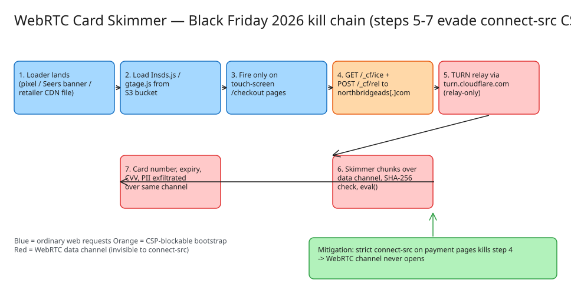

# WebRTC Card Skimming: The Black Friday 2026 Retail Campaign

On 2026-11-27, InfoHawk disclosed a card-skimming script planted on five online stores — **Lascana, Samsonite, American Tourister, Revolve, FWRD** — in the week before Black Friday. It captured card number, expiry, CVV plus name/address/phone/email **as the user typed**, before the store even checked the payment: a card could be taken even if the order was declined, and nothing looked wrong to the shopper. All sites removed the code on Nov 24–25 after notification; InfoHawk confirmed live exfiltration of test card details on Lascana's checkout.

## The twist: the skimmer and the stolen data both travel over WebRTC

WebRTC lets a page open its own channel to a peer and stream data outside ordinary HTTP monitoring. `connect-src` CSP directives govern fetch/XHR/WebSocket — **not** WebRTC data channels. That makes the exfil path invisible to the control most sites actually rely on.

### Kill chain (7 steps; only step 4 is an ordinary web request a CSP can block)

1. **Loader lands on the page** via one of three delivery paths: an altered Quorum marketing pixel (Lascana), an edited Seers cookie-banner setting (Samsonite, American Tourister), or an altered file on the retailer's own CDN (Revolve, FWRD)
2. **Loads `Insds.js` or `gtage.js`** from an Amazon S3 bucket
3. **Targets mobile checkouts only** — runs only on small/touch screens; the Samsonite variant fires only on `/checkout` (desktop homepage scans miss it entirely)
4. **WebRTC setup via web requests:** `GET /_cf/ice` (relay details) and `POST /_cf/rel` (WebRTC offer) to a brand-named `northbridgeads[.]com` host — *this* step `connect-src` can block
5. **TURN relay exchange:** every relay answer uses `turn.cloudflare.com`, relay-only — the traffic blends into legitimate Cloudflare WebRTC and hides the true endpoint
6. **Skimmer code arrives in chunks** over the data channel, checked against a SHA-256 digest, then executed with `eval`
7. **Stolen data returns the same way** — over the same WebRTC data channel

## IOC / detection checklist for site owners

1. Search page source, tag managers, consent-banner settings, CDN files for scripts from `<brand>-static.s3.amazonaws[.]com` (`Insds.js`, `gtage.js`)
2. If you load `qscripts.s3.amazonaws[.]com/pscript.js` (Quorum pixel), check its **last line** for one of those buckets and remove the pixel if present
3. **Seers banner config** (`cdn.seersco.com/banners/<account>/<domain>/cb.js`): verify every URL field holds only a URL — in the affected configs the privacy-policy link field also held a hidden `` whose `onerror` handler loaded the malicious code
4. On a **phone-sized touch screen**, at the payment step, watch for `/_cf/ice` and `/_cf/rel` requests to `*.northbridgeads[.]com` and a relay-only WebRTC connection
5. Hunt strings: `KghRtc`, `rtc-signal-v1`, `quickfetch`

## Immediate mitigation

On every page that takes payment, set a `connect-src` rule listing **only the hosts you use**. That kills steps 4's two bootstrap requests — without them the WebRTC channel never opens, whichever file was tampered with.

## The systemic problem

Three different delivery mechanisms across five independently-run retailers, all relying on the same attacker infrastructure — other sites are likely affected. Root causes:

- Sites load third-party code (often via tag managers) from servers they don't control; the vendor can change that code at any time, and it can pull in further unreviewed code
- That code runs as an ordinary script with the same rights as first-party code — it can read the DOM, watch keystrokes, load more code
- Login/personal-info/payment pages load the same marketing scripts as the rest of the site. Card fields should sit in an isolated payment frame; third-party tags should be off payment pages entirely

Compare the 2026-11-16 Optimizely Web Experimentation abuse, where the vendor's own servers delivered malicious A/B variants to 178 organizations (Zoom, BBC, CNN) with no change to site code — the same trust inversion, different delivery truck.

## Consumer guidance

Check statements for unknown charges (debit especially — weaker protections, report fast). Credit-card liability for unauthorized charges is capped at $50 federally and generally zero when only the number was stolen; file a written dispute within 60 days of the statement.

## Related notes

- `../supply-chain/explanation-supply-chain-attack-evolution-and-impact.md`
- `../supply-chain/explanation-tanstack-mini-shai-hulud-npm-worm-supply-chain-attack.md`

## References

- [Credit card skimming scripts using WebRTC found on popular shopping sites (InfoHawk)](https://www.infohawk.com/news/2026-11-27-black-friday-webrtc-skimmer)
- [Misuse of WebRTC on the Web: A Measurement Study (Radboud University)](https://www.cs.ru.nl/masters-theses/2026/R_te_Wechel___Misuse_of_WebRTC_on_the_Web_A_Measurement_Study.pdf)
- [Attackers used Optimizely to A/B test malware on top websites (Krebs on Security)](https://krebsonsecurity.com/2026/11/attackers-used-optimizely-to-a-b-test-malware-on-top-websites/)
- [CISA/FBI E-Skimming fact sheet](https://www.cisa.gov/sites/default/files/publications/NCSAM_ESkimming_2020.pdf)
- [MDN: Content-Security-Policy: connect-src](https://developer.mozilla.org/en-US/docs/Web/HTTP/Headers/Content-Security-Policy/connect-src)
