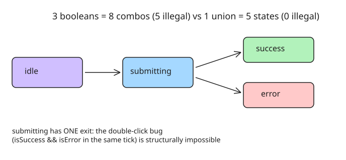

# Three Booleans Is Not a State Machine: Modelling UI Logic with Discriminated Unions

## The structural bug
The most common component bug pattern is not a typo — it is modelling async UI state as independent flags:

```tsx
const [isLoading, setIsLoading] = useState(false);
const [isError, setIsError] = useState(false);
const [isSuccess, setIsSuccess] = useState(false);
```

Three booleans admit **eight combinations, only three of which are legal**. The other five are bugs that appear under slow networks, because the flags are set in different places, on different async paths, sometimes in an `await` that resolves after the component re-rendered. Nobody deliberately sets `isLoading && isSuccess` — the combination emerges from independent write paths. Add an optimistic-pending case and you invent a fourth flag: sixteen states, five legal.

## The fix: one discriminator, illegal states unrepresentable
A TypeScript discriminated union collapses the bag of booleans into a position in a graph:

```ts
type Status =
  | { kind: "idle" }
  | { kind: "validating" }
  | { kind: "submitting"; optimistic: boolean }
  | { kind: "error"; message: string; retryable: boolean }
  | { kind: "success"; orderId: string };
```

One variable, five states, **no illegal combinations by construction** — the compiler forces handling of each case. This is a finite state machine; you do not need a library to get the benefit. The article's migration case (a checkout button with four flags and a resetting `useEffect`): after moving to one `status` prop, a fast double-click could no longer set `isSuccess` and `isError` in the same tick, because `submitting` has one exit and the click handler is ignored inside it — the bug became **structurally impossible**. The diff was smaller than the original component: a correct state model is usually less code, because you stop writing guard clauses that patch an incorrect one.

## When a visual state-machine tool pays for itself
A plain union is enough for most components. A tool (XState-style, or the Exode editor described in the article: hierarchical state machine with typed inputs, states, guarded transitions and listeners, driven via `<ExodeUICanvas artboard="product-card" inputs={...} onTrigger={...} />`) earns its place when **transitions have conditions that non-engineers need to see and tune** — e.g. a product card where hover reveals quick-add *unless* out of stock, quick-add is disabled while submitting, failed requests retry twice, success resets after 2.4 s, quantity changes cancel in-flight requests, and reduced-motion users skip the animation but still see the toast. That is not a union, it is a graph, and the people who care about the exact timing are designers.

## When NOT to use a state machine
1. **The logic is a pure function of props** — `isOpen && <Panel />` does not need a machine.
2. **Nobody will maintain the diagram** — a state machine that drifts from the code is worse than a boolean, "because it lies with confidence".
3. **The states are mostly visual variants** — hover, focus, pressed, disabled are CSS pseudo-classes; do not put them in a graph.

**Rule of thumb**: if you can describe the behaviour in a sentence ("idle, then submitting, then success or error"), write the union and move on. If describing it takes a paragraph with the word "unless" twice, draw the graph. The interesting middle is 3–8 states, real async, shared with a designer.

## Diagram: the illegal-combinations problem



## General principle
State is not a bag of facts — it is a position in a graph. Every time you add a boolean, ask which combinations it makes legal, and whether all of them should be. See also the decision-model framing in [Actor-Judge-Teacher decision models](../../aimachinelearning/agentarchitecture/explanation-actor-judge-teacher-decision-models.md): explicit state/decision modelling beats emergent flag soup in both UI code and agent code.

## References
- [Original article: Three Booleans Is Not a State Machine (DEV.to)](https://dev.to/shinoj_cm_6b559b3ab51bf47/three-booleans-is-not-a-state-machine-modelling-ui-logic-that-cant-be-in-two-states-at-once-a9l)
- [Exode editor (hierarchical state-machine UI tool referenced in the article)](https://exodeui.com/)
