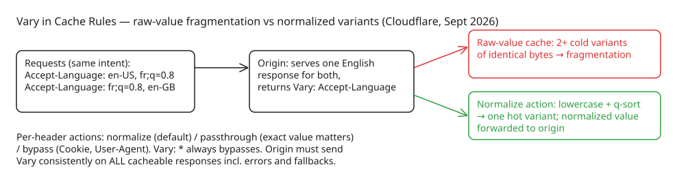

# Cloudflare's Vary Support in Cache Rules — Taming HTTP's Ugliest Header

Cloudflare shipped (2026-09-23) **`Vary` support in Cache Rules on every plan**. The `Vary` response header has been called "[the ugliest part of HTTP that we haven't yet improved](https://mnot.net/blog/2026/linting_the_web)" — a "horrible, kludgy mechanism" with "pretty abysmal interoperability" across intermediaries. Cloudflare's contribution is not fixing `Vary` itself but deciding *how much variation actually matters* for the cache: the origin declares which request headers may affect the response; you decide how each one is handled.

## The core problem: correct caching that becomes useless

One URL can have more than one correct response (different languages, image formats, compression schemes). `Vary` tells a cache *which request fields* may affect the response — but not which differences actually matter.

- **Ignore `Vary`** → risk serving the wrong bytes to a client (an API client gets HTML because it entered the cache first).
- **Treat every raw header value as distinct** → a handful of similar requests spread into thousands of barely-reusable cache entries.

The central asymmetry: applications produce a *small, finite* set of representations from an *enormous* set of request values. An origin serving English/French/German collapses `Accept-Language: en-US, fr;q=0.8` and `fr;q=0.8, en-GB` into the same English response — but a cache comparing raw values cannot safely assume equivalence (different order, different language tags). It stores them as separate variants even when the bodies are byte-identical.

The problem compounds multiplicatively: ten possible values across one field create ten variants; ten values across three fields create 1,000 combinations. Real headers have far greater cardinality — `User-Agent` is near-infinite, cookies are per-visitor, and preference headers differ in ordering, whitespace (spaces vs tabs matter), and quality values. The result: a cache that is **perfectly correct and almost permanently cold** — identical responses scattered across entries too cold to stay hot, evicting one another and sending more traffic back to origin. Eviction removes cold entries but cannot *merge* them just because the responses are identical.

Scale data from Mark Nottingham's analysis of 120M+ responses from ~50,000 popular sites: almost **3,000 sites vary on four or more fields**; some vary on 10, 23, or even 47 fields. (Deliberate high-cardinality variation — e.g. a CDN injecting a geographic region header to partition content predictably — is fine when values are controlled and all components agree on their meaning; uncontrolled cardinality is what destroys the cache.)

## How Cache Rules control Vary: three per-header actions

The design splits the decision in two: (1) the origin uses `Vary` to name the request headers that may affect a response, (2) the Cache Rule determines how Cloudflare handles each named header's value. Headers without an individual setting use the rule's **default action**. If the origin does not return `Vary`, Cloudflare caches normally (the rule may still rewrite `Accept`/`Accept-Language` before forwarding).

| Action | What Cloudflare does | Best used for |
| --- | --- | --- |
| **Normalize** | Normalizes request headers before selecting a cached variant; header-specific rules for `Accept`, `Accept-Language`, `Accept-Encoding`; other headers get whitespace trimming and repeated-line combining (original order, casing preserved) | The default — negotiated content with finite value sets |
| **Passthrough** | Uses the raw bytes of the header for cache matching (casing, whitespace, order, duplicates preserved; multi-line values combined in order with commas); outgoing header lines unchanged | When the exact value changes the response and small differences matter |
| **Bypass** | Does not store the response when the origin names that header in `Vary` (existing entries are not removed — purge them if needed) | Personalized, high-cardinality, or unexpected headers such as `Cookie` or `User-Agent` |

Cloudflare recommends **normalize as the default**, bypass for personal/unbounded values, passthrough when exact value changes the response. Regardless of configured actions, **`Vary: *` always bypasses cache** — it means any aspect of the request (even out-of-band information like client IP) may affect the response.

### What normalization actually does

For `Accept`, `Accept-Language`, and `Accept-Encoding`: values are lowercased, then **sorted by quality value** (highest first, alphabetical tie-break), so client ordering no longer affects the cache key. After sorting, parameters are stripped from entries with a nonzero q-value; shortening language tags or filtering to configured formats/languages can also drop `q=0` ("not acceptable") entries — e.g. `en-US;q=0` becomes `en`. If your origin needs to see those exclusions, use passthrough for that header instead.

**Ordering matters**: Cloudflare forwards the *normalized* `Accept`/`Accept-Language` values to the origin (and normalized `Accept-Encoding` when Respect Strong ETags is enabled). Otherwise the cache could group raw values under one key while the origin still sees distinct raw values and produces different responses that the cache later treats as interchangeable. Forwarding the normalized value keeps origin selection aligned with cache matching.

### Storage decision matrix

- No `Vary` in response → cached normally.
- Every named header resolves to normalize or passthrough → stored as a cached variant.
- Any named field uses bypass → not stored.
- Response contains `Vary: *` → not stored.

## Origin responsibilities and rollout testing

The feature places real responsibility on the origin: **every cacheable response that can differ based on request fields must return the appropriate `Vary` header consistently — including error and fallback responses.** If one response omits it, Cloudflare may cache it without the variance needed to keep it isolated.

Recommended post-rollout test: send the same URL with different header values that should normalize to the same cached variant, from the *same client*; confirm expected format/language; inspect `CF-Cache-Status` for hits once populated; investigate persistent misses or unexpected bypasses. Keep the supported set small (e.g. one representation per media-type × language pair) and define rule boundaries clearly — preference order, missing headers, and values that normalize to empty can still create more cache keys than the nominal combinations.

## Ecosystem context: this is the third swing at Vary's problems

- **2018**: IETF [Variants spec](https://datatracker.ietf.org/doc/draft-ietf-httpbis-variants/) moved cache-key algorithm responsibility to individual content-negotiation specs (`Variants` + `Variant-Key` response headers) — less server complexity, but caches must update per new negotiation feature.
- **2023+**: [Availability Hints](https://dattingham.net) draft (Nottingham): each negotiation mechanism conveys the *set of available representations* along its axis, giving caches a shortcut to scanning every stored response; also useful for reducing `Accept-Language` fingerprinting risk.
- **CDN practice** ([audit war story](https://www.cdnworld.com/article/vary-header-cache-keys)): a retailer's product pages ran an inherited `Vary: User-Agent`, yielding an 11% effective hit ratio on their most expensive pages; replacing it with edge-side device bucketing into two classes (varying on one computed header) took the ratio past 90% within a day and cut origin compute by a third. The arithmetic rule of thumb: *effective object count = objects × cardinality of every varied header* — which is why quarterly inspection of top-100 URLs' cache keys is cheap insurance.

## Diagram: fragmentation vs normalization

## Key takeaways

1. `Vary` is a *declaration* ("these fields may matter"), not an algorithm — the cache still has to decide which differences are real, and raw-value comparison fragments the cache multiplicatively with header cardinality.
2. Cloudflare's fix is per-header policy: **normalize** (q-sorted, lowercased, parameter-stripped; forwarded to origin so selection stays aligned), **passthrough** (raw bytes as key), or **bypass** (don't store). `Vary: *` always bypasses.
3. The origin keeps the hard job: consistent `Vary` on every cacheable response including errors/fallbacks, and a small supported representation set.
4. Standardization efforts (IETF Variants 2018, Availability Hints draft) attack the same problem from the protocol side; CDN-side key normalization is the pragmatic stopgap — and audit data shows inherited high-cardinality `Vary` headers are a common silent hit-ratio killer.

## References

- [Cloudflare: We just shipped support for the ugliest part of HTTP: Vary](https://blog.cloudflare.com/vary-support/)
- [Mark Nottingham: Linting the Web (Vary analysis)](https://mnot.net/blog/2026/linting_the_web)
- [IETF http-wg: Vary and Availability Hints discussion](https://lists.w3.org/Archives/Public/ietf-http-wg/2025AprJun/0211.html)
- [HTTP Representation Variants draft (draft-ietf-httpbis-variants)](https://greenbytes.de/tech/webdav/draft-ietf-httpbis-variants-latest.html)
- [CDN World: Vary, cache keys, and the art of not fragmenting](https://www.cdnworld.com/article/vary-header-cache-keys)
