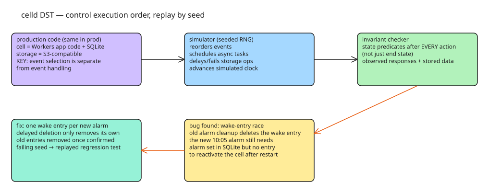

# Deterministic Simulation Testing — How celld Finds Distributed Bugs by Controlling Execution Order

Distributed bugs are hard because they depend on a specific sequence of delayed messages, failed writes, and node restarts — a sequence that changes on the next test run. **Deterministic simulation testing (DST)** fixes that by running the *production* code inside a simulator that controls event order and fault injection, so a failing run is fully reproducible from a seed. celld — a runtime for Cloudflare Workers and Durable Objects applications on your own machines, with an S3-compatible object store as its only external dependency — uses DST in its (still private) simulator, and it has already found previously unknown bugs.

## The architecture: event selection is separated from event handling

A **cell** in celld runs application code with its own SQLite database; celld handles events such as incoming requests, completed storage operations, and timer firings. The key structural requirement for DST: **the code that selects the next event is separate from the code that handles it**. That separation lets the simulator reorder events while the event-handling code is byte-for-byte the production code.

The simulator also controls:

- **when async tasks run** (which task gets scheduled next),
- **how object storage responds** — it can delay a write, make it fail, or succeed immediately,
- **the clock** — simulated time advances without real time passing, which is how time-dependent behavior (retries, alarms) is tested against other events.

## Seeds and invariant checkers

A **seed** is the RNG's starting value: same code + settings + seed ⇒ same sequence, intermediate states, and result. Different seeds explore different runs; a failing seed is a reproducible test case.

After each action, a **checker** validates **invariants** — conditions the system must uphold throughout the run — using observed responses and stored data. The test loop in pseudocode:

```js
const simulation = createSimulation({ settings, seed });

for (let step = 0; step < settings.maxActions; step++) {
  const candidates = simulation.availableActions();
  if (candidates.length === 0) {
    checkCompletion(simulation);
    break;
  }
  const action = simulation.choose(candidates); // random, seeded
  simulation.run(action);
  checkInvariants(simulation);
}
```

An "action" is anything the simulator can advance: delivering a request, letting a task run, advancing the simulated clock, or completing a storage operation. If no actions remain, completion conditions are checked (e.g. all planned requests finished). The simulator is configured with which requests and faults it may explore; within those limits it uses seeded randomness for everything else.

## A real bug the simulator found: the alarm/wake-entry race

Setup: an alarm schedules a cell to run at a time **stored in the cell's SQLite database**. Idle cells can be unloaded to make room; to find alarms without reopening every cell's database, celld scans **wake entries** in object storage — each identifies a cell and when to reactivate it. Once active, the cell reads the scheduled time from SQLite.

The buggy optimization: celld **reused wake entries** to reduce storage writes. Example: an app deletes a 10:00 alarm and sets a new 10:05 alarm; if the 10:00 wake entry still exists, celld could reuse it (reactivate at 10:00, early enough), then read 10:05 from SQLite.

The failing interleaving the simulator found (no test prescribed this sequence):

1. Both the delete (10:00) and the new set (10:05) return success while the old alarm's cleanup is still pending.
2. The simulator advances the pending cleanup: it removes the 10:00 wake entry — the one the new 10:05 alarm still needs.
3. Checker invariant violation: the 10:05 alarm is still set in SQLite, but **no wake entry remains** to reactivate the cell.
4. Consequence: if the node restarts before 10:05, the alarm silently never fires, despite earlier success responses.

The fix: **each new alarm gets its own wake entry** in object storage; a delayed deletion of an older alarm can only remove that older entry; old entries are removed once confirmed unneeded. The failing run became a regression test that replays the exact request/cleanup order — and the invariant is checked **during** the run, not just at the end: if the wake entry disappeared and was later restored, a final-state check would miss the violation.

## Replaying failures

Replay = same code + settings + seed. Each run lets you inspect the exact moment the old cleanup deleted the needed wake entry, without re-searching for the failing order. The next exploration directions: more request/storage-fault/restart combinations (e.g. a node restarting during a storage outage and receiving new requests before storage recovers), and more guarantees (a write reported as successful must survive a node restart).

## Reusable pattern

1. Separate **event selection** from **event handling** in production code — it is the precondition for simulating order.
2. Route all external effects (tasks, storage, clock) through the same injectable seam.
3. Drive exploration with a seeded RNG; treat a seed as a test case you can check in.
4. Define invariants as **state predicates checked after every action**, not just end-state assertions.
5. Turn every found failure into a replayed regression test.

This is the same lineage as "Eight Fallacies of Distributed Computing" (the network is reliable, latency is zero, …) — DST is the practical answer to those fallacies: instead of assuming the fallacies away, make the simulator break them on purpose, deterministically.

## Diagram



## References

- [Deterministic simulation testing in celld — exploring execution orders and reproducing bugs](https://celld.dev/docs/engineering/deterministic-simulation-testing/)
- [The Eight Fallacies of Distributed Computing](https://nighthacks.com/jag/res/Fallacies.html)
