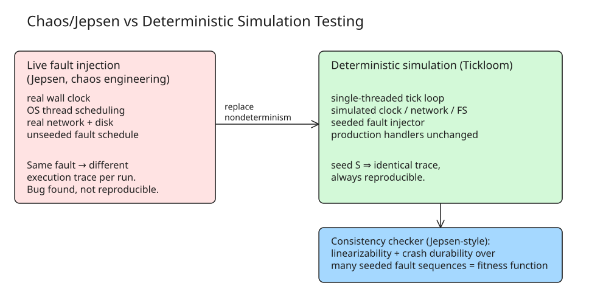

# Deterministic Simulation Testing with Tickloom: Making Distributed Bugs Reproducible

Deterministic simulation testing (DST) replaces real clocks, networks, and disks with simulated components driven by a **single-threaded execution loop**, so every execution — including fault injection — is reproducible from a seed. Unmesh Joshi (Thoughtworks, author of *Patterns of Distributed Systems*) explains the technique on martinfowler.com using **Tickloom**, his Java implementation inspired by FoundationDB and TigerBeetle. It complements the production-code-in-a-simulator view of [[explanation-celld-deterministic-simulation-testing]] with the *why* (nondeterminism taxonomy) and a concrete `Tickable` architecture.



## Why standard testing misses distributed bugs

Unit and integration tests validate components; neither proves what **clients observe** when partial failures overlap with live traffic. Production failures are rarely clean:

- **Gray failures** — not crashes but anomalies: asymmetric routing, selective packet drops, GC pauses just long enough to miss a consensus heartbeat, a WAL `fsync` taking 500 ms instead of 2 ms, silent sector corruption. These create exactly the event interleavings that break robust systems, and standard tests cannot summon them on demand.
- **Availability ≠ correctness** — chaos engineering asks "does the cluster stay up?"; a system can keep answering while serving **stale reads after an acknowledged write**. Jepsen-style correctness checking records the client-visible operation history and validates it against the claimed semantics:

```
Alice: invoke set("title", "After Dawn")
Alice: ok     set("title", "After Dawn")
Bob:   invoke get("title")
Bob:   ok     get("title") -> "Before Dawn"   // violation: stale read after acknowledged write
```

## The two-level nondeterminism problem

Finding a bug is half the work; **reproducing** it is the other half, and live testing fails at both levels:

1. **Unseeded fault schedules** — random fault sequences can't be regenerated. Fixable with a seeded PRNG.
2. **Execution nondeterminism** — even with identical faults, wall-clock time, OS thread scheduling, and real network/disk buffers change which messages are in flight when the fault hits. Same fault, different outcome; a bug living on the "late ACK" path may never be hit twice.

Four external sources of nondeterminism: **clock** (timeouts compare against a moving wall clock; NTP jumps), **thread scheduling** (which handler runs first decides whether a read sees the old or new value), **network timing** (two messages sent in order A,B can arrive B,A), **disk timing** (a write is durable only when the kernel flushes — a crash at the same logical point recovers different data). Plus in-program sources (randomness, hash iteration order), handled by coding rules instead.

## The DST move: make progress explicit

Instead of letting CPU, NIC, and disk progress on their own, the test **drives all progress**: run the whole cluster on one thread against a simulated clock, network, and disk; nothing advances unless the test ticks it.

In Tickloom every controllable component implements one interface:

```java
public interface Tickable {
    void tick();
}
```

- **Clock** reads whatever the test advanced it to; timeouts are expressed in ticks (the article links this to etcd's tick-based timeouts).
- **Scheduling**: the whole cluster runs on one thread in a fixed process order.
- **Network**: protocol code talks to a `Network` interface, never sockets. Tests use `SimulatedNetwork` (in-memory `NetworkLink`s per process pair with configurable delays, drop rates, congestion, partitions); production uses `NioNetwork` — the same contract over Java NIO TCP with a single `Selector`. Same handlers run in both.
- **Disk**: a write becomes durable only when the test ticks the simulated file system.

Hard failures (crashes, partitions) *and* gray failures (latency spikes = "delay completion by a few ticks") become first-class, reproducible scenarios.

Non-blocking rules that fall out of single-threaded execution: async network/storage APIs only; a custom `TickCompletableFuture` with **no blocking `get()`** that throws if touched off the owner (tick) thread; no `Thread.sleep()`; background filesystem work hands results back as events processed during a tick.

## Seeded fault injection + correctness checking = a fitness function

`FaultInjectingSimulationRunner` seeds every fault decision; a `ConsistencyChecker` validates linearizability and crash durability across many seeded sequences. A failing seed **is** a regression test. Joshi frames the whole harness as a fitness function for distributed correctness — and as a teaching tool: an LLM can translate a diagram from *Designing Data-Intensive Applications* directly into an executable scenario test (e.g. `DDIA_LinearizabilityScenarioTest`).

## Trade-offs

- **Strict coding rules** — handlers on the tick thread must never block or do long CPU work; discipline (and thread-ownership checks) is enforced by the harness.
- **Production cost is actually favorable** — most distributed systems are I/O-bound; single-threaded + async batched I/O removes locking and context switches (the Redis / FoundationDB / TigerBeetle architecture). Scale a multicore box by running multiple independent processes, not a shared-state thread pool.
- **Upfront investment** — building the simulation foundation costs effort first, but afterward protocol logic is plain single-threaded code that is easier to write, evolve, and fuzz with random fault combinations.

## Related

- [[explanation-celld-deterministic-simulation-testing]] — celld's simulator: event selection separated from event handling
- [[../Scaling-Foundations/INDEX]] — systems whose failure modes DST targets

## References

- Original article: [Deterministic Simulation Testing — martinfowler.com](https://martinfowler.com/articles/deterministic-simulation-testing.html)
- Implementation: [Tickloom on GitHub](https://github.com/unmeshjoshi/tickloom)
- Lineage: [FoundationDB deterministic simulation](https://github.com/apple/foundationdb), [TigerBeetle](https://github.com/tigerbeetle/tigerbeetle), [Jepsen](https://jepsen.io/)
