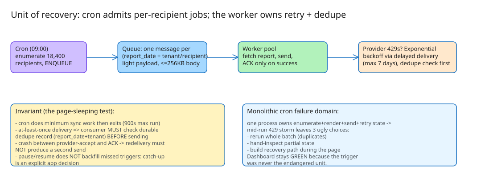

# Cron + Queue Fanout: The Real Unit of Recovery for Bulk Email Retries

A green scheduling dashboard cannot answer the question that wakes someone up: **what page fired, and which deliveries are recoverable?** The lesson generalizes beyond email digests: the unit a scheduler tracks (a run) is rarely the unit an operator needs to recover (one recipient). Use cron only to **admit** work; let a queue-backed worker **execute** it.

## The monolithic-cron failure domain

Scenario: Monday's support digest selects 18,400 recipients. The 09:00 scheduled run completes 11,900 deliveries before the email provider starts returning HTTP 429. If one scheduled process owns enumeration, rendering, sending, and retry state, every recovery option is bad:

- restart the whole run → duplicate emails to the 11,900,
- hand-inspect partial application state mid-page,
- build a second recovery path *during* the incident.

And the dashboard may still show success — **the trigger was never the endangered unit**. A single scheduled run is acceptable only while the whole list fits comfortably inside the execution window and rerunning the batch is harmless.

## The invariant: one report-date + one recipient = one recoverable job

- **Cron's job**: do the minimum synchronous work to establish a run, publish lightweight per-recipient jobs, then exit. Respect platform limits (e.g. 900-second maximum cron execution — anything that can outlive it must continue in workers).
- **Queue's job**: carry one message per `(report_date, recipient/tenant)` pair. Keep the payload a *reference* (tenant ID, recipient reference, report date) — not a report archive (typical managed-queue body caps around 256 KB; the report stays in its system of record).
- **Worker's job**: claim a job, fetch/build the report, attempt delivery, **acknowledge only on success**. Owns retry timing and idempotency.

Because queue delivery is at-least-once, redelivery is *expected* behavior — the consumer makes it boring by checking a **durable dedupe record keyed on report-date + tenant** before sending. Backoff lives in the worker (delayed re-delivery, with platform maximums such as 7 days); page only on exhausted delivery attempts or growing oldest-message age, never on every transient 429.

## Acceptance tests before you trust it

1. **Crash window test**: kill a worker after the provider accepted the message but before the queue ACK is recorded. When the job redelivers, the dedupe key must prevent a second send.
2. **Throttle test**: rate-limit the provider, verify exponential backoff, and confirm remaining recipients stay recoverable without rerunning completed ones.
3. **Pause test**: pause and resume the schedule — missed triggers are **not backfilled** during a pause, so catch-up must be an explicit application decision, not an assumption hidden in cron.

## Design constraints worth checking in any hosted scheduler/queue

- The cron→worker boundary needs a reachable target: hosted cron tasks and push subscriptions typically require **public HTTPS endpoints**; a private-only worker endpoint receives nothing.
- If the ingress uses HMAC authentication, note that **authentication and queue dedupe solve different problems** — neither substitutes for the other.
- Compare alternatives by their *recovery contract* (what happens to an in-flight job on crash/restart), not by product features.

## References

- [Queue Fanout Beats Monolithic Cron for Large Recipient List Email Retries — DEV.to](https://dev.to/darkveilcorvyn26/queue-fanout-beats-monolithic-cron-for-large-recipient-list-email-retries-45m2) (original source; note the post leans on one vendor's cron/queue product — the pattern above is vendor-neutral)
- [RFC 2104 — HMAC](https://www.rfc-editor.org/rfc/rfc2104)

Related: [[How-to-Choose-Between-Orchestration-and-Choreography]], [[How-to-Manage-Workflow-State-in-Choreography]]
