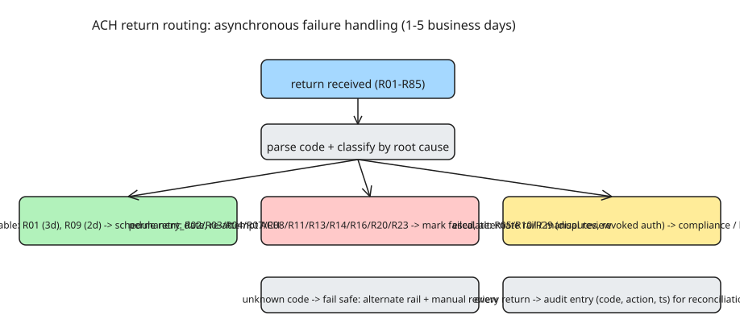

# ACH Return Codes (R01–R85): Decoding and Routing Asynchronous Payment Failures

When an ACH debit or credit fails, the originating bank receives a **return code** — a two-character alphanumeric defined by **Nacha** (the National Automated Clearing House Association). As a developer building payment infrastructure, you must decode these codes quickly and route the failure appropriately. A mishandled return can orphan a payout, frustrate the end user, and create reconciliation chaos.

## Why ACH returns are a different beast than card declines

- ACH transactions **settle in batches, typically overnight**.
- A return comes back **1–5 business days** after the initial debit/credit attempt.
- Unlike card declines (milliseconds), ACH returns are **asynchronous** — your system must be built to **receive, parse, and act on them after the original request has long left memory**.
- Consequence: the *request path* and the *settlement path* are separate systems. The payout state machine must survive days of nothing happening, then handle an out-of-band correction.

Returns fall into a few buckets:

| Bucket | Codes (common ones) |
|---|---|
| Insufficient funds / account issues | R01, R03, R04, R09 |
| Authorization / consumer disputes | R02, R10, R29 |
| Routing / format errors | R03, R05, R07 |
| Account closed / no longer valid | R03, R04 |

(Note: some codes appear in multiple buckets — the *root cause* decides the handling, not the bucket label.)

## Common return codes and handling strategy

| Code | Meaning | Root cause | Retry? |
|---|---|---|---|
| **R01** | Insufficient funds | Account balance too low | Yes (after 1–3 days) |
| **R02** | Account closed by institution | Bank closed the account | No |
| **R03** | No account / unable to locate | Bad routing or account number | No |
| **R04** | Invalid account number structure | Malformed account digits | No |
| **R05** | Unauthorized user / consumer dispute | Receiver claims no authorization | No (escalate) |
| **R07** | Authorization revoked by customer | Receiver revoked consent | No |
| **R09** | Uncollected funds | Funds not yet available | Yes (after 2–3 days) |
| **R10** | Customer advises not authorized | Consumer disputes the transaction | No (escalate) |
| **R29** | Corporate customer advises not authorized | Business disputes the transaction | No (escalate) |

This covers the most common production codes; the full Nacha set runs to R85.



## Building a return handler

Production-ready pattern for ingesting and routing ACH returns:

```python
import json
from datetime import datetime, timedelta
from enum import Enum

class ReturnAction(Enum):
    RETRY = "retry"
    ESCALATE = "escalate"
    MARK_FAILED = "mark_failed"
    ROUTE_ALTERNATE = "route_alternate"

def handle_ach_return(return_code, original_payout):
    """
    Decode an ACH return and determine next action.

    Args:
        return_code: str, e.g., "R01"
        original_payout: dict with payout_id, amount, recipient_account

    Returns:
        dict with action, retry_date (if applicable), notes
    """
    # Codes that suggest retry after N days
    retryable = {
        "R01": 3,  # Insufficient funds; retry in 3 days
        "R09": 2,  # Uncollected funds; retry in 2 days
    }

    # Codes that indicate permanent failure
    permanent_fail = {
        "R02", "R03", "R04", "R07", "R08", "R11", "R13", "R14", "R16", "R20", "R23"
    }

    # Codes requiring immediate escalation
    escalate = {
        "R05", "R10", "R29"
    }

    result = {
        "payout_id": original_payout["payout_id"],
        "return_code": return_code,
        "timestamp": datetime.utcnow().isoformat(),
        "action": None,
        "retry_date": None,
        "notes": "",
    }

    if return_code in retryable:
        result["action"] = ReturnAction.RETRY.value
        retry_days = retryable[return_code]
        result["retry_date"] = (datetime.utcnow() + timedelta(days=retry_days)).isoformat()
        result["notes"] = f"Retryable return; will re-attempt ACH on {result['retry_date']}"

    elif return_code in permanent_fail:
        result["action"] = ReturnAction.MARK_FAILED.value
        result["notes"] = f"Permanent failure (code {return_code}). Consider alternate rail or manual review."

    elif return_code in escalate:
        result["action"] = ReturnAction.ESCALATE.value
        result["notes"] = f"Dispute/authorization return (code {return_code}). Route to compliance."

    else:
        result["action"] = ReturnAction.ROUTE_ALTERNATE.value
        result["notes"] = f"Unhandled code {return_code}. Default: alternate rail + manual review."

    return result
```

## Design points that make or break the handler

1. **Classify by root cause, not by code alone** — the same code can have different recovery semantics depending on context (e.g., R03 routing error vs account gone).
2. **Schedule, don't poll** — retryable returns (R01/R09) get an explicit `retry_date` a few days out; the original request is gone, so nothing "remembers" the payout except your own store.
3. **Escalation is a first-class action**, not an exception — disputes (R05/R10/R29) need humans/compliance, not retries.
4. **Unknown codes fail safe** — default to alternate rail + manual review rather than silently dropping the return.
5. **Reconciliation is downstream** — every return must produce an audit trail entry (code, action, timestamp) or money reconciliation breaks.

## References

- [ACH Return Codes Explained: R01–R85 and How to Handle Them in Production (DEV.to)](https://dev.to/payout_rail/ach-return-codes-explained-r01-r85-and-how-to-handle-them-in-production-23l5)
