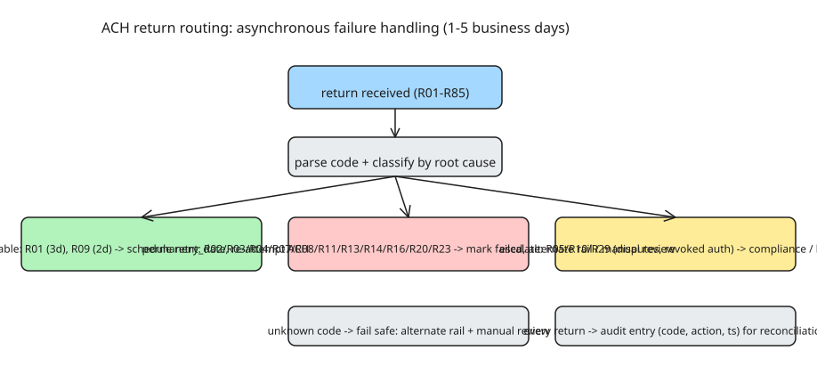

# ACH Return Codes (R01–R85): Decoding and Routing Asynchronous Payment Failures

When an ACH debit or credit fails, the originating bank receives a **return code** — a two-character alphanumeric defined by **Nacha** (the National Automated Clearing House Association). As a developer building payment infrastructure, you must decode these codes quickly and route the failure appropriately. A mishandled return can orphan a payout, frustrate the end user, and create reconciliation chaos.

## Why ACH returns are a different beast than card declines

- ACH transactions **settle in batches, typically overnight**.
- A return comes back **1–5 business days** after the initial debit/credit attempt.
- Unlike card declines (milliseconds), ACH returns are **asynchronous** — your system must be built to **receive, parse, and act on them after the original request has long left memory**.
- Consequence: the *request path* and the *settlement path* are separate systems. The payout state machine must survive days of nothing happening, then handle an out-of-band correction.

Returns fall into a few buckets:

| Bucket | Codes (common ones) |
|---|---|
| Insufficient funds / account issues | R01, R03, R04, R09 |
| Authorization / consumer disputes | R02, R10, R29 |
| Routing / format errors | R03, R05, R07 |
| Account closed / no longer valid | R03, R04 |

(Note: some codes appear in multiple buckets — the *root cause* decides the handling, not the bucket label.)

## Common return codes and handling strategy

| Code | Meaning | Root cause | Retry? |
|---|---|---|---|
| **R01** | Insufficient funds | Account balance too low | Yes (after 1–3 days) |
| **R02** | Account closed by institution | Bank closed the account | No |
| **R03** | No account / unable to locate | Bad routing or account number | No |
| **R04** | Invalid account number structure | Malformed account digits | No |
| **R05** | Unauthorized user / consumer dispute | Receiver claims no authorization | No (escalate) |
| **R07** | Authorization revoked by customer | Receiver revoked consent | No |
| **R09** | Uncollected funds | Funds not yet available | Yes (after 2–3 days) |
| **R10** | Customer advises not authorized | Consumer disputes the transaction | No (escalate) |
| **R29** | Corporate customer advises not authorized | Business disputes the transaction | No (escalate) |

This covers the most common production codes; the full Nacha set runs to R85.

## Return timing: when the RDFI must act

The handler's clock is set by Nacha, not by your payout system:

- **Standard returns** (R01–R04): the RDFI must process them within **2 banking days** of the settlement date.
- **Authorization-related returns** (R05, R07, R10, R11): can occur up to **60 calendar days** after the original transaction. R07 additionally requires the customer to sign an affidavit.

Flow direction matters: the **RDFI** (receiving bank) assigns the return code and sends it back to the **ODFI** (originating bank), which relays it to you. If the ODFI believes a return was improper, it can challenge it with a **dishonored return** — the R61–R79 family exists precisely for defects in the return entry itself (misrouted, untimely, wrong trace number, duplicate).

**Returns vs. reversals** — a common confusion:

| | ACH return | ACH reversal |
|---|---|---|
| What | A payment the RDFI could not process | A correction requested against a *completed* payment |
| Who initiates | The RDFI | The ODFI / originator |
| When | 2 banking days to 60 days, depending on code | Must be requested within 24 hours of identifying the error |

## The complete code catalog (R01–R85)

The handler above covers the common production codes. Full grouped catalog (verified against the Nacha list):

- **R01–R10 — the codes you will actually see:** R01 insufficient funds · R02 account closed · R03 no account / unable to locate · R04 invalid account number · R05 unauthorized debit to a consumer account · R06 returned per ODFI request · R07 authorization revoked by customer · R08 payment stopped (customer stop-payment) · R09 uncollected funds · R10 customer advises originator not known / not authorized.
- **R11–R20 — terms, accounts, file edits:** R11 entry not per authorization terms · R12 account sold to another institution · R13 invalid ACH routing number · R14 representative payee deceased · R15 beneficiary deceased · R16 account frozen (legal action / bank policy) · R17 file record edit criteria · R18 improper effective entry date · R19 amount field error · R20 non-transaction account.
- **R21–R30 — entry & format errors:** R21 invalid company identification · R22 invalid individual ID number · R23 credit entry refused by receiver · R24 duplicate entry · R25 addenda error · R26 mandatory field error · R27 trace number error · R28 routing-number check-digit error · R29 corporate customer advises not authorized · R30 RDFI not participant in check truncation.
- **R31–R40 — RDFI & check-related:** R31 permissible return entry (CCD/CTX only) · R32 RDFI non-settlement · R33 return of XCK entry · R34 limited-participation DFI · R35 return of improper debit entry · R36 return of improper credit entry · R37 source document presented for payment · R38 stop payment on source document · R39 improper source document · R40 return of ENR entry by federal agency.
- **R41–R50 — data validation:** R41 invalid transaction code · R42 routing number / check-digit error (non-participant) · R43 invalid DFI account number · R44 invalid individual ID number · R45 invalid individual / company name · R46 invalid representative payee indicator · R47 duplicate ENR enrollment · R50 state law affecting RCK acceptance.
- **R51–R69 — RCK/BOC/ARC & return-entry defects:** R51–R57 RCK/BOC/ARC presentation and eligibility rules · R58 payee deceased · R59 payee account closed · R60 entry settled prior to return · R61–R69 defects in the return entry itself (misrouted return, incorrect trace number, incorrect dollar amount, duplicate return, untimely return, field errors).
- **R70–R85 — dishonored returns & IAT:** R70 permissible return entry not accepted · R71 misrouted dishonored return · R72 untimely dishonored return · R73 timely original return · R74 corrected return · R75 original return not a duplicate · R76 no errors found · R77/R78 non-acceptance of R62/R68 dishonored returns · R79 incorrect data in return entry · R80–R85 International ACH (IAT) errors: coding error, gateway not an IAT participant, invalid foreign DFI, foreign DFI unable to settle, entry not processed by gateway, outbound international payment incorrectly coded as domestic.

## Nacha enforcement thresholds

Returns are not only a per-transaction problem — Nacha enforces **aggregate return rates over a rolling 60-day window** (total returns ÷ total originations):

| Threshold | Applies to | Exceeding it |
|---|---|---|
| **0.5%** unauthorized returns | R05, R07, R10, R11, R29 | graduated enforcement actions |
| **3%** administrative returns | R02, R03, R04 | signal of poor data hygiene; enforcement |
| **15%** overall return rate | all ACH debit return codes | can lead to suspension of ACH origination privileges |

Handler implication: the audit trail (design point 5) must let you compute all three rates; set internal warning alerts *below* the limits (e.g. 0.3% unauthorized, 2% administrative) so you can course-correct before enforcement.

### The unauthorized cluster: R07 vs. R10 vs. R11 vs. R29

These four are the fraud-sensitive codes — and they are **not equally severe**:

- **R07** — prior authorization *existed* and was later revoked (e.g. canceled subscription). The originator must stop until a new consumer authorization is obtained.
- **R11** — the payment does not match the *terms* of the original authorization (amount, frequency, or scope drifted).
- **R10 / R29** — the customer (consumer / corporate) claims **no authorization ever existed** — the strongest dispute type and the strongest fraud indicator.

For R10/R11 the RDFI may require a **Written Statement of Unauthorized Debit (WSUD)** — a sworn statement from the account holder — before processing the return. Treat each WSUD as a serious compliance signal; multiple WSUDs usually point to a process failure in how you capture and store authorizations.

**Never re-present after an unauthorized return** — resubmitting after R05/R07/R10/R29 is itself a NACHA Operating Rules violation; the dispute moves directly between originator and customer.

## Prevention inputs (upstream of the handler)

- **Account validation before paying** — micro-deposit verification (1–2 business days) or instant verification services that check directly against the account holder's bank — catches R03/R04 before they happen.
- **Prenotes** — a zero-dollar test transaction validates new account details in 3–4 business days without moving money.
- **Authorization records** — signed forms or electronic consent with Nacha-compliant language (amount, frequency, terms), a prompt revocation process, and quarterly audits of authorization documentation for every active recurring debit.



## Building a return handler

Production-ready pattern for ingesting and routing ACH returns:

```python
import json
from datetime import datetime, timedelta
from enum import Enum

class ReturnAction(Enum):
    RETRY = "retry"
    ESCALATE = "escalate"
    MARK_FAILED = "mark_failed"
    ROUTE_ALTERNATE = "route_alternate"

def handle_ach_return(return_code, original_payout):
    """
    Decode an ACH return and determine next action.

    Args:
        return_code: str, e.g., "R01"
        original_payout: dict with payout_id, amount, recipient_account

    Returns:
        dict with action, retry_date (if applicable), notes
    """
    # Codes that suggest retry after N days
    retryable = {
        "R01": 3,  # Insufficient funds; retry in 3 days
        "R09": 2,  # Uncollected funds; retry in 2 days
    }

    # Codes that indicate permanent failure
    permanent_fail = {
        "R02", "R03", "R04", "R07", "R08", "R11", "R13", "R14", "R16", "R20", "R23"
    }

    # Codes requiring immediate escalation
    escalate = {
        "R05", "R10", "R29"
    }

    result = {
        "payout_id": original_payout["payout_id"],
        "return_code": return_code,
        "timestamp": datetime.utcnow().isoformat(),
        "action": None,
        "retry_date": None,
        "notes": "",
    }

    if return_code in retryable:
        result["action"] = ReturnAction.RETRY.value
        retry_days = retryable[return_code]
        result["retry_date"] = (datetime.utcnow() + timedelta(days=retry_days)).isoformat()
        result["notes"] = f"Retryable return; will re-attempt ACH on {result['retry_date']}"

    elif return_code in permanent_fail:
        result["action"] = ReturnAction.MARK_FAILED.value
        result["notes"] = f"Permanent failure (code {return_code}). Consider alternate rail or manual review."

    elif return_code in escalate:
        result["action"] = ReturnAction.ESCALATE.value
        result["notes"] = f"Dispute/authorization return (code {return_code}). Route to compliance."

    else:
        result["action"] = ReturnAction.ROUTE_ALTERNATE.value
        result["notes"] = f"Unhandled code {return_code}. Default: alternate rail + manual review."

    return result
```

## Retry policy, user notification, and monitoring (merged from companion guide)

The companion DEV.to guide adds the operational side of the handler — persist the raw return, cap retries, and never auto-retry fraud:

```python
RETRYABLE = {"R01", "R50"}
PERMANENT = {"R03", "R04", "R05", "R07", "R14", "R20", "R29"}
FRAUD = {"R10"}
MAX_RETRIES = 3

def handle_ach_return(payment, return_code, reason):
    # Always persist the code + reason — your future self (and
    # your support team) need the raw bank message.
    payment.ach_returns.append({"code": return_code, "reason": reason, "at": now()})

    if return_code in RETRYABLE:
        if payment.ach_retries < MAX_RETRIES:
            payment.ach_retries += 1
            schedule_retry(payment, business_days=3)
            notify_user("Payment couldn't be completed (insufficient funds). "
                        "We'll retry in ~3 business days.")
        else:
            mark_failed(payment, "retries_exhausted")
            switch_collection_method(payment)
            notify_user("We couldn't collect this payment. Please update your bank account.")
    elif return_code in FRAUD:
        freeze(payment)                # never auto-retry
        alert_risk_team(payment, return_code)
        notify_user("We paused this payment for your security. Contact support.")
    elif return_code in PERMANENT:
        mark_failed(payment, f"return_{return_code}")
        prompt_account_verification(payment)
    else:
        # Unknown code: log, alert, treat as permanent.
        log_unexpected_return_code(return_code)
        mark_failed(payment, f"unknown_return_{return_code}")
```

Operational best practices:

1. **Store code + reason, not just success/fail** — the NACHA reason text and the provider's raw payload are the only evidence when a user disputes a failed payment.
2. **Cap retries (2–3) and only for the retryable class** — uncapped R01 retry loops hammer a genuinely empty account.
3. **Notify the user at each transition** — silent failures are the #1 support-ticket driver for ACH.
4. **Monitor code patterns** — an R01 spike means paydays shifted (change the retry schedule); an R05/R04 spike means onboarding accepts bad account numbers (add micro-deposit or Plaid verification); any R10 means check fraud filters.
5. **Offer an alternate rail for permanent failures** — debit card, wallet, or manual payment.

Pitfalls:

- **Treating a return as an API error** — it's an asynchronous event days later via webhook; the payment state machine needs a `returned` state, not an exception path.
- **Auto-retrying R10 (fraud)** — every retry is a fresh fraud attempt on the customer's account.
- **No default branch for unknown codes** — NACHA has ~85 codes; you will meet ones you haven't coded for.
- **Business-day math** — "retry in 3 days" from a Friday lands on Monday; use a business-day scheduler, not `+3 * 86400`.

Note on webhook delivery: returns arrive via your payment provider's webhook (Plaid, Stripe Treasury, a bank API) — classify them as events, and treat the `returned` transition as idempotent (webhooks can duplicate).

## Design points that make or break the handler

1. **Classify by root cause, not by code alone** — the same code can have different recovery semantics depending on context (e.g., R03 routing error vs account gone).
2. **Schedule, don't poll** — retryable returns (R01/R09) get an explicit `retry_date` a few days out; the original request is gone, so nothing "remembers" the payout except your own store.
3. **Escalation is a first-class action**, not an exception — disputes (R05/R10/R29) need humans/compliance, not retries.
4. **Unknown codes fail safe** — default to alternate rail + manual review rather than silently dropping the return.
5. **Reconciliation is downstream** — every return must produce an audit trail entry (code, action, timestamp) or money reconciliation breaks.

## References

- [ACH Return Codes Explained: R01–R85 and How to Handle Them in Production (DEV.to)](https://dev.to/payout_rail/ach-return-codes-explained-r01-r85-and-how-to-handle-them-in-production-23l5)
- [ACH Return Codes Explained: R01 to R85 (Ramp)](https://ramp.com/blog/ach-return-codes) — full code catalog, return timing, Nacha enforcement thresholds, WSUD
- [ACH Return Codes: Complete Reference Guide (GoACH)](https://goach.com/blog/ach-return-codes/) — retry eligibility and the no-re-present rule for unauthorized returns
- [ACH Return Codes: The Complete R01 to R85 List Explained (eco.com)](https://eco.com/support/en/articles/17190468-ach-return-codes-the-complete-r01-to-r85-list-explained) — R07/R10 Nacha-rule detail
- [ACH Return Codes Explained: A Developer's Guide to R01–R85 and Error Handling (DEV.to, merged companion article)](https://dev.to/payout_rail/ach-return-codes-explained-a-developers-guide-to-r01-r85-and-error-handling-37l1)
- Related KB note: [[How to Classify HTTP Errors by Retry Eligibility]] (the retryable vs permanent classification pattern, applied here to asynchronous bank returns instead of synchronous responses)
- [ACH Return Codes R01–R33 (VeriCheck)](https://www.vericheck.com/ach-return-codes/) — 60-day return window and affidavit requirement for R07
