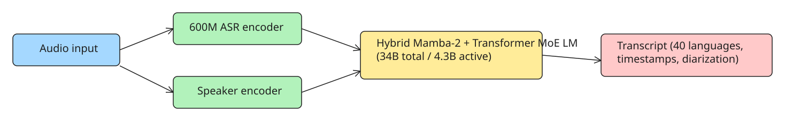

# Running Nemotron 3.5 Transcribe Locally (vLLM, SGLang-Omni, Transformers)

> **Sourcing note:** The DEV.to article this note is based on is a syndicated **Korean-language** version (originally apidog.com content; the commands are language-neutral). The canonical sources are the [Hugging Face model card](https://huggingface.co/nvidia/NVIDIA-Nemotron-3.5-Transcribe-30B-A4B) and [NVIDIA's launch post](https://huggingface.co/blog/nvidia/nemotron-transcribe-granary); the run commands below were copied from the model card (checked 2026-10-29). A web check confirmed the model card exists with BF16/FP8/NVFP4 variants (the BF16 checkpoint is ~67.5 GB) and a companion **DFlash2** draft model that must be served alongside when using DFlash2 speculative decoding.

## Model overview

**Nemotron 3.5 Transcribe** (NVIDIA, released 2026-10-28) is an offline speech-to-text model for recorded audio:

- Transcribes **40 languages**; the top open-weights model on the Hugging Face Open ASR Leaderboard as of Oct 28 (ahead of Qwen3-ASR, Granite Speech, Canary-Qwen, Voxtral, Whisper).
- **34B total parameters, ~4.3B active per token** — a 30B-A4B mixture-of-experts hybrid **Mamba-2 + Transformer** language model, fed by a **600M-parameter ASR encoder** and a separate **speaker encoder** (used for diarization).
- Licensed under **OpenMDW-1.1** — commercial and non-commercial use allowed (read the attribution conditions in the license text before shipping a product).
- **BF16, FP8, and NVFP4** weights were all published at launch.
- It is an **offline** model for recorded files. For real-time audio, NVIDIA ships a separate Nemotron 3.5 ASR Streaming model.



## Why run it locally

- **No per-minute billing** — at hosted rates (~$0.002/min), 10,000 hours of audio would cost ~$1,200; on your own GPU you only pay electricity.
- **Privacy** — client calls, medical dictation, and legal recordings never leave your network.
- **Full feature set** — the vLLM path supports word timestamps, speaker diarization, translation, and context prompting; some hosted endpoints only expose a subset of these.
- **Fine-tuning** — NVIDIA's launch post shows a medical-domain fine-tune dropping WER from 30.8% to 11.8%, which is only possible with the weights in hand.

## Hardware compatibility (from the model card)

| GPU | Precision | Runtime |
| --- | --- | --- |
| H100, H200 | BF16, FP8 | vLLM 0.32.0, Transformers, SGLang-Omni 0.2.0 (H100) |
| A100 80 GB | BF16 | vLLM 0.32.0, Transformers |
| L40S 48 GB | FP8 | vLLM 0.32.0, Transformers |
| B200, GB200, GB300 (DGX Station) | BF16, FP8, NVFP4 | vLLM 0.32.0, Transformers |
| DGX Spark (GB10), Jetson Thor | BF16, FP8, NVFP4 | vLLM 0.32.0, Transformers |
| RTX PRO 6000 Blackwell Server | BF16, FP8, NVFP4 | vLLM, Transformers, SGLang-Omni, GGML |
| RTX 5090 (32 GB) | NVFP4 only | vLLM 0.32.0, Transformers, GGML |

Notes:

- NVIDIA's reference target is **one H100 80 GB in BF16**.
- 24 GB cards such as the **RTX 4090 are not on the list** — the smallest supported consumer card is the RTX 5090 (NVFP4 only). **Apple Silicon is not supported** (no official runtime as of 2026-10-29).
- OS: **Linux, or Windows via WSL2**. GGML also runs on native Windows; the NeMo-Speech.cpp local build is still "coming soon" per the launch post.

### Checkpoint selection

Pick the checkpoint that matches your card:

- `nvidia/NVIDIA-Nemotron-3.5-Transcribe-30B-A4B` — **BF16** (~67.5 GB): H100/H200/A100 80 GB, B200/GB200/GB300, DGX Spark/Jetson Thor, RTX PRO 6000.
- [`nvidia/NVIDIA-Nemotron-3.5-Transcribe-30B-A4B-FP8`](https://huggingface.co/nvidia/NVIDIA-Nemotron-3.5-Transcribe-30B-A4B-FP8) — for tighter VRAM (e.g. L40S 48 GB) while keeping the same runtimes.
- [`nvidia/NVIDIA-Nemotron-3.5-Transcribe-30B-A4B-NVFP4`](https://huggingface.co/nvidia/NVIDIA-Nemotron-3.5-Transcribe-30B-A4B-NVFP4) — Blackwell-only precision: RTX 5090 32 GB, RTX PRO 6000, B-series/DGX Spark/Jetson Thor.

## Option 1: vLLM server (recommended)

Full features — batching, 1-hour files, speculative decoding, word timestamps — behind an OpenAI-compatible endpoint. Requires **vLLM 0.32.0** plus the vLLM plugin from the latest NeMo Speech main branch.

### Install

The model card uses `uv` and Python 3.13:

```bash
git clone https://github.com/NVIDIA-NeMo/Speech.git nemo-speech
cd nemo-speech
uv venv --python 3.13 .venv
UV_PROJECT_ENVIRONMENT=$PWD/.venv uv sync --extra asr --extra vllm --locked --no-install-project
uv pip install --python .venv/bin/python --no-deps -e .
uv pip install --python .venv/bin/python --no-deps av==19.0.2
uv pip install --python .venv/bin/python --no-deps opencv-python-headless==5.0.0.93
source .venv/bin/activate
hf download nvidia/NVIDIA-Nemotron-3.5-Transcribe-30B-A4B --local-dir ./NVIDIA-Nemotron-3.5-Transcribe-30B-A4B
```

PyAV (`av`) lets vLLM decode M4A and other compressed formats without system FFmpeg; OpenCV is needed by vLLM but missing from NeMo's dependency set, hence the extra pins.

### Start the server

```bash
export VLLM_PLUGINS=nemo_speechlm
export VLLM_MAX_AUDIO_DECODE_DURATION_S=3600
export VLLM_MAX_AUDIO_CLIP_FILESIZE_MB=180
export VLLM_USE_V2_MODEL_RUNNER=0
vllm serve ./NVIDIA-Nemotron-3.5-Transcribe-30B-A4B \
  --served-model-name nvidia/NVIDIA-Nemotron-3.5-Transcribe-30B-A4B \
  --trust-remote-code --dtype bfloat16 --gpu-memory-utilization 0.94 \
  --max-model-len 65536 --max-num-batched-tokens 4096 --max-num-seqs 192 \
  --enable-chunked-prefill --no-enable-prefix-caching \
  --use-replayssm --mamba-backend flashinfer --mamba-cache-mode none \
  --mm-processor-cache-gb 0 --no-async-scheduling \
  --limit-mm-per-prompt '{"audio":{"count":6,"length":120000000}}' \
  --speculative-config '{"method":"mtp","num_speculative_tokens":8}' \
  --reasoning-parser nemotron_v3 \
  --trust-request-mm-kwargs \
  --middleware nemo.collections.speechlm2.vllm.salm.ctc_serving.ctc_timestamp_middleware
```

Flags worth understanding:

- `VLLM_MAX_AUDIO_DECODE_DURATION_S=3600` raises vLLM's audio limit from 600 s to one hour. Skip it and long files fail.
- `VLLM_USE_V2_MODEL_RUNNER=0` keeps the V1 runner, which word timestamps require.
- `--speculative-config` enables multi-token prediction (MTP8 = 8 draft tokens). NVIDIA measured batch-English RTFx on H100 of 270 (MTP8) vs 410 (MTP2) — if throughput matters more than latency, try `"num_speculative_tokens":2`.
- `--middleware ...ctc_timestamp_middleware` plus `--trust-request-mm-kwargs` lets individual requests ask for word timestamps.
- The tuning targets an **80 GB H100**. On other cards lower `--gpu-memory-utilization`, `--max-model-len`, or `--max-num-seqs`.

The server listens on `127.0.0.1:8000`; add `--host 0.0.0.0` to accept connections from other machines.

### Send a file

```python
import base64
from openai import OpenAI

client = OpenAI(base_url="http://127.0.0.1:8000/v1", api_key="EMPTY")  # vLLM accepts any key
audio = base64.b64encode(open("standup.wav", "rb").read()).decode()

response = client.chat.completions.create(
    model="nvidia/NVIDIA-Nemotron-3.5-Transcribe-30B-A4B",
    messages=[{"role": "user", "content": [
        {"type": "text", "text": "Transcribe the following audio."},
        {"type": "audio_url", "audio_url": {"url": f"data:audio/wav;base64,{audio}"}},
    ]}],
    temperature=0,
    extra_body={"chat_template_kwargs": {"enable_thinking": False}, "skip_special_tokens": False},
)
print(response.choices[0].message.content)
```

Swap the text instruction for the task you want. For a meeting with multiple speakers:

```text
Transcribe verbatim, including fillers. Write numbers as spoken, without punctuation or capitalization. Start every speaker turn with <spk:0>, <spk:1>, etc. Keep one stable tag per speaker. Output only the speaker-tagged transcript.
```

Word timestamps have request rules: **one recording per request, `stream=false`, `n=1`** — the response then includes a `ctc_timestamps` object with the word, second-level start/end times, and speaker tag.

## Option 2: SGLang-Omni (plain transcription only)

If you only need text from whole files, **SGLang-Omni 0.2.0** is simpler and needs no NeMo. Validated on one H100 80 GB and one RTX PRO 6000 Blackwell with BF16 or FP8 checkpoints:

```bash
sgl-omni serve \
  --model-path nvidia/NVIDIA-Nemotron-3.5-Transcribe-30B-A4B \
  --model-name nemotron-transcribe \
  --mem-fraction-static 0.85 \
  --port 8000

curl http://localhost:8000/v1/audio/transcriptions \
  -F model=nemotron-transcribe \
  -F file=@audio.wav
```

The `/v1/audio/transcriptions` path matches the shape of OpenAI's Whisper API, so existing Whisper client code usually only needs a new base URL. Trade-off: this integration has **no word timestamps, no speaker labels, no translation, no speculative decoding**.

## Option 3: Transformers (scripts)

For notebooks and one-off jobs, run in-process with Hugging Face Transformers installed from source:

```bash
pip install git+https://github.com/huggingface/transformers
```

```python
from transformers import AutoModelForMultimodalLM, AutoProcessor

model_id = "nvidia/NVIDIA-Nemotron-3.5-Transcribe-30B-A4B"
processor = AutoProcessor.from_pretrained(model_id)
model = AutoModelForMultimodalLM.from_pretrained(model_id, device_map="auto")

prompt = ("Transcribe the following audio, keeping all words, code-switching, "
          "and verbal fillers. Put speaker tags <spk:0> <spk:1> <spk:2> <spk:3> on the transcription.")
inputs = processor.apply_transcription_request(["podcast.mp3"], prompt)
outputs = model.generate(**inputs, max_new_tokens=4096)
print(processor.decode(outputs[:, inputs.input_ids.shape[1]:], skip_special_tokens=False))
```

Easiest to start, slowest at scale. Raise `max_new_tokens` for long files — a dense hour can generate ~20,000 tokens.

## How fast is it?

- Headline number (RTX PRO 6000 Blackwell, NVFP4 + DFlash2 speculative decoding): **2,238 s of audio per second**, 0.13 s to return a 30 s clip. Caveat: that figure comes from the optimized NIM whose serving changes are not yet open source; the model card expects the open vLLM integration to be about **2x slower**.
- BF16 batch-English RTFx on H100 (audio seconds processed per compute second):

| Speculative decoding | RTFx |
| --- | --- |
| MTP2 | 410 |
| DFlash2, K=7 | 340 |
| MTP8 | 270 |
| DFlash2, K=15 | 260 |

Even the slowest row processes an hour of audio in under 15 s of GPU time in batch. If you want the DFlash2 draft model: vLLM 0.32.0 needs a small patch from the model card, DFlash2 **disables word timestamps**, and it must not be used together with MTP.

## Common mistakes

| Symptom | Fix |
| --- | --- |
| Long files cut off at 10 minutes | You skipped `VLLM_MAX_AUDIO_DECODE_DURATION_S=3600` |
| No timestamps in the response | Check `VLLM_USE_V2_MODEL_RUNNER=0`, the `--middleware` flag, and that the request has one recording with `stream=false` |
| OOM on a smaller card | Switch to FP8 or NVFP4 checkpoints and lower `--max-num-seqs` |
| Repeated phrases at the end of transcripts | The model card recommends a generation-loop guardrail: cap `max_tokens` and truncate the repetition |
| Names misspelled | Add `Context terms: <names>` to the prompt |
| Background voices land in the transcript | Use the model card's experimental near-field prompt (NVIDIA's tests dropped WER on mixed audio from 27.32% to 4.78%) |

## Quick FAQ

- **RTX 4090?** Not on NVIDIA's compatibility list; the smallest supported consumer card is the RTX 5090 (NVFP4).
- **Mac?** No official Apple Silicon runtime as of 2026-10-29.
- **Commercial use?** OpenMDW-1.1 allows it; read the license's attribution terms first.
- **Real-time audio?** No — recorded files only; use the separate Nemotron 3.5 ASR Streaming model.
- **vLLM vs SGLang-Omni?** NVIDIA publishes no direct comparison. Use vLLM for timestamps/diarization/translation, SGLang-Omni for the simplest text-only server.

## Status check (2026-10-29)

- **NeMo-Speech.cpp now integrates Nemotron 3.5 Transcribe** — the `NVIDIA/NeMo-Speech.cpp` repo's SALM docs were updated (PR #84) to use Nemotron 3.5 Transcribe as the reference model. The lightweight C++ runtime (GGML-based) streams audio in 160 ms chunks and runs up to ~67× real-time, which matters if you want local inference without a GPU or a full Python stack. The "coming soon" local-C++ path from launch time is now shipping.
- **NVIDIA's official model page** is at [research.nvidia.com/labs/nemotron/NVIDIA-Nemotron-3.5-Transcribe](https://research.nvidia.com/labs/nemotron/NVIDIA-Nemotron-3.5-Transcribe/) — use it alongside the HF model card for the canonical specs and fine-tuning workflow (medical-domain fine-tune example already covered above).
- Third-party coverage (MarkTechPost, 2026-10-28) confirms the launch details; no breaking API changes to the commands above were reported.

## References

- [Nemotron 3.5 Transcribe local execution guide (DEV.to, Korean syndication)](https://dev.to/rihpig/nemotron-35-transcribe-rokeol-silhaeng-bangbeob-gpu-hanaro-1sigan-pail-api-biyong-eobsi-1bll) — the source article this note was extracted from
- [Hugging Face model card: nvidia/NVIDIA-Nemotron-3.5-Transcribe-30B-A4B](https://huggingface.co/nvidia/NVIDIA-Nemotron-3.5-Transcribe-30B-A4B) — canonical commands, checkpoint list, RTFx numbers
- [NVIDIA launch post (Granary)](https://huggingface.co/blog/nvidia/nemotron-transcribe-granary) — release details and the medical fine-tune example
- [FP8 checkpoint: nvidia/NVIDIA-Nemotron-3.5-Transcribe-30B-A4B-FP8](https://huggingface.co/nvidia/NVIDIA-Nemotron-3.5-Transcribe-30B-A4B-FP8)
- [NVIDIA Nemotron 3.5 Transcribe — official research page](https://research.nvidia.com/labs/nemotron/NVIDIA-Nemotron-3.5-Transcribe/)
- [NeMo-Speech.cpp — lightweight C++ runtime (GGML), Nemotron 3.5 Transcribe integration](https://github.com/NVIDIA/NeMo-Speech.cpp)
