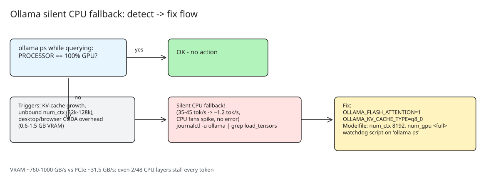

# How to Detect and Prevent Silent CPU Fallback (CUDA Spillover) in Ollama

**Symptom:** a 14B/32B model runs at 35–45 tok/s on the first prompt, then on the third turn — after you paste a 3,000-token function definition or log trace — generation collapses to ~1.2 tok/s and the CPU fans spike. No error, no OOM: Ollama has **silently offloaded transformer layers from VRAM to system RAM**. This note covers how to confirm it and how to config-lock models into GPU memory.



## Why it happens (the physics)

Ollama's runner (built on llama.cpp) partitions layers between GPU VRAM and system RAM whenever the model + runtime allocations don't fit contiguously in VRAM — **without raising an error**:

| Memory domain | Bus | Bandwidth | Consequence |
| --- | --- | --- | --- |
| GPU VRAM (GDDR6X) | On-die memory bus | ~760–1,008 GB/s | sub-µs tensor transfers |
| System RAM (DDR4/5) | PCIe Gen4/5 x16 (~31.5 GB/s practical) | ~38–64 GB/s | every layer transition stalls on PCIe copies |

VRAM is 15–25× faster; if even **2 of 48 layers** sit in RAM, every autoregressive token crosses the PCIe bottleneck at each transition. Four hidden triggers:

1. **Dynamic KV-cache growth** — long conversations expand the KV cache (multi-GB), the CUDA allocator fails, and layers/activations spill to host RAM.
2. **Unbound context window** — modern GGUF defaults of `num_ctx` 32,768–128,000 make Ollama pre-allocate multi-GB context structures before the first token. (Server-side default is `OLLAMA_CONTEXT_LENGTH=4096` per the official FAQ; GGUF model metadata can push the effective value far higher — check the model card, not the default.)
3. **Competing CUDA contexts** — display servers (Xorg/Wayland/DWM) and GPU-accelerated browsers consume 0.6–1.5 GB of VRAM that Ollama may not account for.
4. **Linux suspend/resume** — per the official GPU docs, after a suspend/resume cycle Ollama can fail to rediscover the NVIDIA GPU and silently fall back to CPU; the documented workaround is reloading the driver: `sudo rmmod nvidia_uvm && sudo modprobe nvidia_uvm`. If a fallback appears right after waking the machine, this is the cause — not VRAM pressure.

## Step 1 — Detect it in real time

**A. Process state** (while a query is running):

```bash
ollama ps
# NAME               ID            SIZE    PROCESSOR       UNTIL
# qwen2.5-coder:14b  b38006e8e6e5  9.0 GB  68%/32% CPU/GPU 4m52s
```

Anything other than **`100% GPU`** in the PROCESSOR column = active silent fallback.

**B. Daemon logs** (exact layer allocation at model init):

```bash
# Linux (systemd)
journalctl -u ollama --no-pager -n 50 | grep -E "load_tensors|offloaded"

# macOS
cat ~/.ollama/logs/server.log | grep -E "load_tensors|offloaded"

# Windows (PowerShell)
Get-Content "$env:LOCALAPPDATA\Ollama\server.log" -Tail 100 | Select-String -Pattern "offload"
```

Look for lines like:

```
llm_load_tensors: offloaded 34/48 layers to GPU
llm_load_tensors:   14 layers remaining on CPU
llm_load_tensors: VRAM used: 7842 MB, CPU RAM used: 3120 MB
```

## Step 2 — Halve KV-cache VRAM with 8-bit quantization

Default KV cache is FP16; `q8_0` cuts its footprint ~50% with negligible quality loss (requires Flash Attention):

```bash
# Linux / macOS
export OLLAMA_FLASH_ATTENTION=1
export OLLAMA_KV_CACHE_TYPE=q8_0

# Windows (persistent machine-level env vars)
[System.Environment]::SetEnvironmentVariable('OLLAMA_FLASH_ATTENTION', '1', 'Machine')
[System.Environment]::SetEnvironmentVariable('OLLAMA_KV_CACHE_TYPE', 'q8_0', 'Machine')
```

Restart the Ollama service after setting. Official-docs notes: Ollama now enables Flash Attention **automatically** when the backend/device supports it (`OLLAMA_FLASH_ATTENTION=1` forces it on, `=0` disables); `OLLAMA_KV_CACHE_TYPE` defaults to `f16` and quantized K/V cache is documented as working *with Flash Attention enabled*. On macOS app installs, environment variables must be set via `launchctl` (the app does not read your shell profile) — a common reason these flags silently don't apply.

## Step 3 — Lock context and layer offload in a Modelfile

Never leave `num_ctx` unbound near your VRAM ceiling:

```dockerfile
FROM qwen2.5-coder:14b-instruct-q4_K_M

# Pin context window to guarantee deterministic VRAM headroom
PARAMETER num_ctx 8192
# Pin GPU layer offload count (48 = full offload for this model)
PARAMETER num_gpu 48
PARAMETER temperature 0.2
PARAMETER top_p 0.95
```

```bash
ollama create qwen14b-locked -f ./Modelfile
ollama run qwen14b-locked
```

## Step 4 — Watchdog: alert on CPU spillover

```bash
#!/usr/bin/env bash
# ollama-watchdog.sh - detect and alert on CPU fallback
while true; do
  PROCESSOR=$(ollama ps | awk 'NR>1 {print $4}')
  if [[ "$PROCESSOR" =~ "CPU" ]]; then
    echo "[ALERT] Silent CPU Fallback Detected: $PROCESSOR"
    notify-send "Ollama Fallback" "Model running on CPU: $PROCESSOR"
  fi
  sleep 5
done
```

Run it in the background during long sessions (or convert the alert branch to `systemctl restart ollama` for auto-recovery — note this kills in-flight requests).

## Decision checklist

- `ollama ps` shows `100% GPU`? → done.
- No → quantize KV cache (Step 2), pin `num_ctx` + `num_gpu` (Step 3).
- Still spilling at long context → the model is too big for your VRAM at that context length; drop `num_ctx`, use a smaller quant, or accept CPU layers knowingly.
- Free VRAM stolen by desktop/browser? → close GPU-accelerated apps or reserve headroom in `num_ctx`.

## References

- [Original article — Silent CPU Fallback in Ollama: How to Detect and Prevent CUDA Spillover](https://dev.to/thezerodollardev/silent-cpu-fallback-in-ollama-how-to-detect-and-prevent-cuda-spillover-56lc)
- [Canonical post with companion benchmarks — The Zero-Dollar Dev](https://thezerodollardev.blogspot.com/2026/11/silent-cpu-fallback-in-ollama-how-to.html)
- [Ollama official FAQ — ollama ps PROCESSOR column, context size, Flash Attention & KV-cache env vars](https://docs.ollama.com/faq)
- [Ollama official GPU docs — GPU selection, CUDA_VISIBLE_DEVICES, Linux suspend/resume CPU fallback](https://docs.ollama.com/gpu)
- Sibling notes: `howto-check-model-sizes-gpu-memory.md`, `explanation-what-ollama-is-and-standardization-gap.md`
