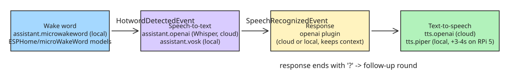

# Building a Reliable Self-Hosted Voice Assistant Pipeline with microWakeWord and Silero VAD

A practical rebuild of a self-hosted (Platypush-based) voice assistant that fixes the two chronic failure modes of DIY pipelines: **wake-word false positives/negatives** and **end-of-speech detection** in noisy environments with cheap microphones. The same design principles apply to any custom pipeline (Home Assistant, Wyoming, or your own Python stack).

## The pipeline architecture



## Step 1 — Replace openWakeWord with microWakeWord

`openWakeWord` pre-trained models are frozen `v0.1` files from 2023, mostly trained on synthetic speech — expect false positives on background noise and false negatives unless you are close to the mic. `microWakeWord` (the engine behind ESPHome and Home Assistant Voice) is actively maintained, and built-in models (`okay_nabu`, `hey_jarvis`, `hey_mycroft`, `alexa`) ship with the `pymicro-wakeword` Python package — no download step.

```yaml
assistant.microwakeword:
  models:
    - alexa
```

Design details worth copying:

- Without an explicit `detection_threshold`, each model uses the `probability_cutoff` from its own manifest (e.g. `0.9` for `alexa`) — the value the model was validated against.
- Models already smooth output over a sliding window, so `patience_frames` defaults to `0` (unlike openwakeword, which needs it).
- The audio thread never touches the TFLite interpreter directly: frames (plus a reset marker) are queued to the main thread, because `MicroWakeWord.reset()` reloads the interpreter and is not safe to call concurrently.
- The plugin releases the audio device when another assistant plugin starts a conversation and re-acquires it afterwards.
- Custom models: drop a microWakeWord JSON manifest (with its `.tflite` model) into the plugin's models directory and reference it by name.

## Step 2 — Fix end-of-speech detection with a reworked VAD layer

The old implementation used a per-frame boolean from WebRTC VAD; a *single* frame classified as speech reset the silence timer, so with background noise conversations only ended at the maximum duration. The `AudioPreprocessor` fixes:

1. **Silero VAD as primary backend** (via `onnxruntime`, no PyTorch needed), with WebRTC VAD and a plain RMS detector as fallbacks:
   ```yaml
   assistant.openai:
     # auto = silero -> webrtc -> energy, depending on what's installed
     vad_backend: auto
   ```
2. **Hysteresis + sliding window**: a frame becomes speech above the VAD threshold and *stays* speech until its score drops by a margin; per-frame decisions are smoothed by majority vote over a 0.5 s window. One noise burst can no longer keep a conversation alive.
3. **Adaptive noise floor**: background level tracked over time; frames not louder than `noise_floor_factor` (default `2.0`, ~6 dB) times the floor are never speech.

Measured effect on a synthetic benchmark (TTS phrases + babble/burst noise): conversations used to stay open 6–10 s after speech ended; the new pipeline closes 1.0–1.6 s after the last word (`conversation_end_timeout` + smoothing lag).

## Step 3 — Wire events with hooks (skip the LLM for local commands)

```python
from platypush import run, when
from platypush.message.event.assistant import HotwordDetectedEvent, SpeechRecognizedEvent

@when(HotwordDetectedEvent)
def on_hotword(**_):
    run('assistant.openai.start_conversation')

@when(SpeechRecognizedEvent, phrase='play (the)? music')
def play_music():
    run('music.mpd.play')
```

Regex phrases let home-automation commands execute locally without an LLM round-trip. If the LLM response ends with `?`, the conversation continues with a follow-up round.

## Latency trade-off (RPi 5)

| TTS backend | Runs | Added latency |
|---|---|---|
| `tts.openai` | cloud | baseline |
| `tts.piper` | local | ~3–4 s extra (response → audio) |

## Takeaways for any custom voice stack

- Wake-word quality is an engine-selection problem first, tuning second: prefer engines with actively maintained, real-audio-trained models.
- End-of-speech is where cheap-mic pipelines die: use a neural VAD (Silero), hysteresis, majority-vote smoothing, and an adaptive noise floor — not raw per-frame booleans.
- Keep a fully-local fallback path (`assistant.vosk` + `tts.piper`) even if your default is cloud STT/TTS.

## References

- [Rebuilding my local voice assistant pipeline — Platypush blog](https://blog.platypush.tech/article/Rewriting-my-voice-assistant-pipeline) (original article)
- [microWakeWord on GitHub](https://github.com/kahrendt/microWakeWord)
- [ESPHome micro-wake-word-models repository](https://github.com/esphome/micro-wake-word-models)
- [Silero VAD on GitHub](https://github.com/snakers4/silero-vad)
- [One voice detector to rule them all — The Gradient](https://thegradient.pub/one-voice-detector-to-rule-them-all/)
- [The Home Assistant approach to wake words](https://www.home-assistant.io/voice_control/about_wake_word/)
