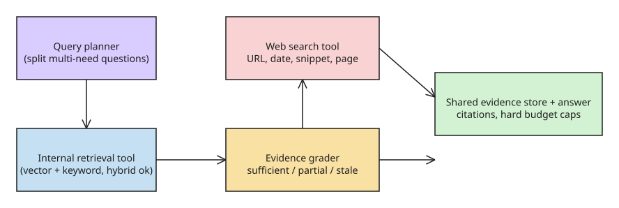

# How to Build an Agentic RAG Pipeline with Real-Time Web Search

A fixed RAG pipeline fails the moment the answer is not in the indexed corpus
(a release announced yesterday, a changed regulation, a new competitor). An
agentic pipeline turns retrieval into a **tool the agent can call, evaluate,
and call again**, and adds web search as an evidence source invoked under
defined conditions — neither a permanent first step nor an unstructured last
resort.

## Goal

Answer questions that may need internal knowledge, real-time web knowledge, or
both — with citations, bounded cost, and a defined stopping condition.

## Step 1: Expose internal retrieval and web search as separate tools

- Internal retrieval tool: returns document text plus document ID, collection,
  section, and retrieval score.
- Web search tool: returns title, URL, snippet, source, publication date, and
  (when needed) extracted page content.

Keep the tools separate so routing is visible: you can tell whether the agent
searched the web unnecessarily, ignored a useful internal document, or relied
on a snippet when the full page was required. Tools should retrieve
information, not generate final answers — a search tool that silently
summarizes severs the link between evidence and later claims.

## Step 2: Add a router and an evidence grader

The router decides where search starts: internal policy questions go to the
knowledge base; questions containing "latest", "today", "current price" are
likely to need the web; some questions need both (internal docs for how a
product works + web search for a newly disclosed dependency vulnerability).

After internal retrieval, the evidence grader checks whether results can
support the answer — coverage, freshness, and direct support, not just
embedding similarity. Distinguish the failure modes: nothing retrieved,
off-topic, relevant-but-incomplete, or too old. The grader can be a structured
output — `sufficient` / `partial` / `irrelevant` / `stale` plus a short
explanation — routed through predefined edges (this is the
[Corrective RAG](https://arxiv.org/abs/2401.15884) and adaptive-RAG pattern;
LangGraph's [agentic RAG guide](https://docs.langchain.com/oss/python/langgraph/agentic-rag)
shows the same stage separation).

```
User query
  ↓
Intent and query planner
  ↓
Internal vector search
  ↓
Evidence grader
  ├── Sufficient ────────────→ Answer with citations
  └── Missing, weak or stale
        ↓
   Web Search API
        ↓
  Extract, normalise, deduplicate
        ↓
  Optional follow-up search
        ↓
  Answer with citations
```

## Step 3: Normalize internal and web evidence into one schema

Vector DBs and web search APIs return different shapes. Convert both into a
shared evidence structure so sources can be compared, deduplicated, and cited:

```json
{
  "source_type": "internal | web",
  "title": "Source title",
  "url_or_document_id": "Source identifier",
  "published_at": "Publication or update date",
  "content": "Relevant source passage",
  "relevance_score": 0.86,
  "supported_claims": ["Claim supported by this source"]
}
```

Every evidence item needs a stable identity and a traceable origin. Web results
need deduplication **by underlying source**, not just by URL — several pages
often repeat the same press release. Snippets may be enough to decide which
pages deserve inspection, but not enough to support important claims: fetch
the page and preserve the relevant passage.

## Step 4: Define search and stopping rules

Follow-up searches are justified when a key subquestion has no supporting
evidence, two credible sources disagree, results are outdated, or a new term
appears that needs investigation. Stop when every important claim has at least
one suitable source, the requested topics are covered, and another query is
unlikely to change the conclusion.

Hard limits are mandatory in production: cap the number of searches, inspected
pages, tokens, elapsed time, or API spend. The agentic path costs extra model
calls and latency ([NVIDIA's Agentic RAG Blueprint](https://docs.nvidia.com/rag/latest/agentic-rag.html)
makes this trade-off explicit).

## Step 5: Evaluate the pipeline, not just the answer

- **Retrieval relevance**: did internal search find the right documents?
- **Fallback precision**: was web search called only when it added value? If
  every question hits the web, the router is doing no useful work.
- **Groundedness**: is the answer supported by the collected evidence?
- **Citation correctness**: does each cited source actually support the
  particular claim attached to it?
- **Operational metrics**: capture queries, routing decisions, retrieved
  sources, grader outputs, retries, and stopping reasons.

The evaluation set should include: simple internal questions; current questions
requiring the web; questions needing both; and questions with **no reliable
answer** — the last tests whether the system stops and acknowledges
uncertainty instead of searching indefinitely.

## Step 6: Decide when plain RAG is still the right answer

If the knowledge base is stable, questions are predictable, and one retrieval
step usually suffices, a basic RAG pipeline is faster, cheaper, and easier to
evaluate. Agentic RAG is not the default architecture — it is the right choice
when evidence freshness or multi-source reasoning is a core requirement.



## References

- [Original post (DEV.to, cloudsway)](https://dev.to/cloudsway/how-to-build-an-agentic-rag-pipeline-with-real-time-web-search-2k1l)
- [Microsoft: agentic RAG architecture guidance](https://learn.microsoft.com/en-us/azure/architecture/ai-ml/guide/rag/rag-agentic)
- [LangGraph: agentic RAG guide](https://docs.langchain.com/oss/python/langgraph/agentic-rag)
- [Corrective RAG paper](https://arxiv.org/abs/2401.15884)
- [NVIDIA Agentic RAG Blueprint](https://docs.nvidia.com/rag/latest/agentic-rag.html)
- [IBM Developer: Building an agentic RAG pipeline](https://developer.ibm.com/articles/agentic-rag-pipeline/)

## Further Reading

- [Next-Generation Agentic RAG with LangGraph (2026 Edition)](https://medium.com/@vinodkrane/next-generation-agentic-rag-with-langgraph-2026-edition-d1c4c068d2b8) — current LangGraph idioms for the rewrite-retrieve loop: grader nodes, tool-calling agents with bounded iteration, and conditional edges instead of hand-rolled loops.
- [Agentic RAG in 2026: Patterns, Code, Observability](https://futureagi.com/blog/agentic-rag-systems-2025/) — pattern catalog (router, self-RAG, corrective-RAG variants) plus the observability point this note under-emphasizes: agentic loops need per-iteration trace instrumentation to debug why retrieval was re-invoked.
- [agentic-rag-for-dummies (GitHub, GiovanniPasq)](https://github.com/GiovanniPasq/agentic-rag-for-dummies) — compact modular reference implementation of the same architecture (retrieval-as-tool + grader + web-search fallback) worth diffing against your own pipeline.

## Status check (2026-11-10)

Re-verified ~10 weeks after publication: the LangGraph agentic-RAG docs path (`docs.langchain.com/oss/python/langgraph/agentic-rag`) is current and the corrective-RAG arXiv reference is unchanged; architecture guidance in this note still matches the maintained LangChain/LangGraph recommendation (retrieval as a tool the agent decides to call, with a grader gate before answering).

## Related
- [[explanation-agent-guardrail-stack]]
- [[explanation-claude-unified-memory-architecture]]
- [[explanation-lemmalog-datalog-memory-for-llm-agents]]
