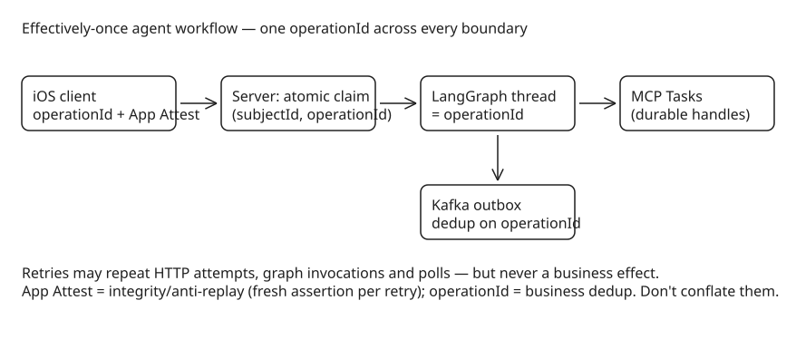

# Building Effectively-Once Agent Workflows — iOS Retries, LangGraph Resume, MCP Tasks, Kafka and App Attest

A mobile request can fail without the server-side work failing: an iOS app may time out, lose the response after a POST has reached the service, or retry after connectivity changes while the original execution is still progressing. Apple's `URLSession` retries some requests on connection loss, and `waitsForConnectivity` lets the system continue a request when connectivity returns. The dangerous state is therefore not "request failed" but **"completion is unknown"** — if that request starts an agent that charges an account, reserves inventory, or invokes an MCP tool, a second submission becomes a second side effect.

The practical target is **effectively-once**: retries are expected, but every effect is guarded by a stable operation identity and converges on one committed outcome. "Exactly once" across iPhone → HTTP → agent runtime → MCP server → Kafka → database → external API is too strong; even Kafka's exactly-once guarantees do not atomically include arbitrary remote tool effects.

## Step 1 — Make the retry boundary the transaction boundary

Create a durable **`operationId`** on the client when an action becomes durable local intent, persist it, and reuse it across transport retries. Transport material (server challenges) may change; the business ID must not. The server treats `(subjectId, operationId)` as a uniqueness boundary and stores a canonical payload hash with it:

```sql
INSERT INTO agent_operation(subject_id, operation_id, payload_hash, status)
VALUES (:subject, :operationId, :payloadHash, 'ACCEPTED')
ON CONFLICT (subject_id, operation_id) DO NOTHING;
```

- Conflict + **same** payload hash → return the existing operation.
- Conflict + **different** hash → reject key reuse.
- The record must exist **before** agent execution starts, and the accepted response should expose the durable operation identity so the client can resume against it.

## Step 2 — Let LangGraph resume without repeating effects

LangGraph persistence saves state at super-step boundaries; after a failure, an affected node runs again from the beginning, which is why official guidance requires **idempotent node logic**. Map one stable business operation to one stable graph thread and pass the same `operationId` into every effectful tool boundary:

```python
config = {"configurable": {"thread_id": operation_id}}
result = graph.invoke(
    {"operation_id": operation_id, "command": command},
    config
)
```

Checkpointing reduces recomputation but does **not** replace downstream idempotency — a reservation can succeed before its task result is durably checkpointed. The functional API therefore recommends idempotent tasks:

```python
@task
def reserve_inventory(operation_id, sku, quantity):
    return mcp.call_tool("reserve_inventory", {
        "operationId": operation_id,
        "sku": sku,
        "quantity": quantity
    })
```

The significant property is not the decorator: the business identity crosses the graph boundary and reaches the tool implementation, so a downstream inventory service can return a previously committed reservation instead of creating another one.

## Step 3 — Use MCP Tasks as durable handles, not dedup keys

In the **July 28, 2026 protocol revision**, MCP Tasks moved into the `io.modelcontextprotocol/tasks` extension: a server returns a durable task handle; the client polls with `tasks/get`, provides input with `tasks/update`, or cancels with `tasks/cancel`. The task is durably created **before** its handle is returned, so polling survives disconnects.

But durability of result retrieval does not deduplicate *creation*: task IDs are server-generated. If the server creates task A, the response disappears, and the original `tools/call` is resent, a naïve implementation creates task B. Therefore:

- The business `operationId` must be part of the tool arguments (or equivalent application metadata).
- Task creation must first look up an existing operation; for the same `(subject, operationId, payloadHash)` return the **existing** task handle and later the stored terminal result.
- Cancellation is cooperative in MCP — make it idempotent too.

## Step 4 — Keep Kafka guarantees inside Kafka

Kafka is most valuable *after* the operation has been claimed: a database transaction can persist operation state with an outbox row carrying the same ID. Producer idempotence suppresses duplicates from producer retries; consumers still deduplicate on the operation ID at application level. Kafka transactions atomically cover Kafka writes but do **not** extend over an MCP server or payment API.

Preserve causality in the event contract instead of inventing new identities per hop:

```json
{
  "operationId": "8E7B6D9E-...",
  "type": "AgentToolCompleted",
  "tool": "reserve_inventory",
  "status": "SUCCEEDED"
}
```

A consumer can enforce uniqueness on `(consumerName, operationId, eventType)` or make the state transition conditional. Kafka delivery guarantees and application idempotency then reinforce each other instead of being treated as interchangeable. (See also: idempotent producer and producer transactions.)

## Step 5 — Bind retry identity to App Attest without blocking legitimate retries

App Attest addresses a different failure mode: whether the request comes from a legitimate app instance, and whether signed material was replayed or altered. Apple's current guidance uses **server-provided challenges** and requires the server to validate a strictly increasing assertion counter (an anti-replay signal). Assertions are generated locally on-device after key attestation — no round trip to Apple's servers per request.

The App Attest assertion must **not** become the business idempotency token: a legitimate retry obtains fresh challenge material and generates a fresh assertion while retaining the original `operationId`. Bind the data hashed for the assertion to the server challenge, operation ID, and canonical payload hash:

```swift
let payloadHash = SHA256.hash(data: body)
let clientData = challenge + operationID.data + Data(payloadHash)
let clientDataHash = Data(SHA256.hash(data: clientData))

let assertion = try await service.generateAssertion(
    keyID,
    clientDataHash: clientDataHash
)
```

Server-side order of checks: verify App Attest → confirm the challenge binds operation ID and payload → perform the idempotency lookup. A fresh assertion retries the same operation; a replayed assertion fails anti-replay validation; an altered payload fails the hash check.

## The composition property

Effectively-once behavior does not come from asking iOS to retry less often or labeling a Kafka pipeline "exactly once". It comes from:

1. Carrying **one durable business identity** across every retry and boundary,
2. Claiming that identity **atomically before execution**,
3. Making LangGraph effects **idempotent under resume**,
4. Using MCP Tasks as **durable result handles** rather than creation-time dedup keys,
5. Restricting Kafka's exactly-once guarantees to **Kafka's transactional domain**, and
6. Using App Attest to prove **request integrity** without confusing anti-replay state with business deduplication.

When those boundaries align, a lost mobile response can cause another HTTP attempt, another graph invocation, or another poll — but not another business effect.



## Practical takeaways

1. Generate and persist the `operationId` **before** the first network attempt; never derive it from transport material.
2. Claim the operation atomically (`INSERT ... ON CONFLICT DO NOTHING`) before any agent execution starts — the claim is your transaction boundary.
3. Treat LangGraph checkpoints as recomputation optimization, not correctness: every effectful node must be idempotent under resume.
4. MCP Tasks (July 2026 revision) give you durable handles for long-running tools; deduplication still belongs to your `operationId` lookup at creation time.
5. Keep Kafka exactly-once inside Kafka's transactional domain and carry the same ID through outbox rows and event payloads.

## References

- [DZone: When an iOS Retry Executes an Agent Twice — Building Effectively-Once Tool Workflows](https://dzone.com/articles/prevent-duplicate-agents)
- [MCP Tasks extension (io.modelcontextprotocol/tasks)](https://modelcontextprotocol.io/)
- [LangGraph persistence and checkpointing docs](https://langchain-ai.github.io/langgraph/concepts/persistence/)
