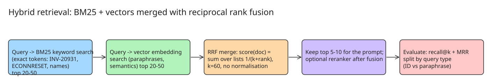

# How to Build Hybrid RAG Retrieval: BM25 + Vector Search Merged with Reciprocal Rank Fusion

Embeddings compress a passage into a few hundred numbers representing what it is *about* — which makes them good at paraphrases and bad at **exact tokens**: a query for invoice `INV-20931`, error `ECONNRESET`, or a person's name returns documents merely *about* invoices, network errors or people. BM25 has the opposite profile. Hybrid search runs both retrievers per query and merges the rankings with **reciprocal rank fusion (RRF)**: `score(doc) = Σ 1/(k + rank)` across lists, `k = 60`. No score normalisation, no training.



## Why each retriever misses what the other catches

| Query type | Vector search | BM25 |
| --- | --- | --- |
| "how do I get my money back" | finds the refund policy | misses it (no shared words) |
| "INV-20931" | returns *any* invoice | finds *that* invoice |
| "ECONNRESET when proxying" | finds network errors generally | finds that error exactly |
| A customer's name | unreliable | exact |

## Step 1 — BM25, and get the tokenizer right

BM25 scores each query term by rarity across the corpus (IDF) and frequency in the document, with diminishing returns (`k1`) and a length penalty (`b`). **The tokenizer matters as much as the formula**: keep hyphenated identifiers like `inv-20931` as one token, or the code splits into two common pieces and the exact-match advantage evaporates.

```python
import math, re
from collections import Counter

def tokenize(text: str) -> list[str]:
    return re.findall(r"[a-z0-9]+(?:-[a-z0-9]+)*", text.lower())

class BM25:
    def __init__(self, docs: dict[str, str], k1: float = 1.5, b: float = 0.75):
        self.docs = {doc_id: tokenize(text) for doc_id, text in docs.items()}
        self.k1, self.b = k1, b
        self.avg_len = sum(len(t) for t in self.docs.values()) / len(self.docs)
        df = Counter(term for tokens in self.docs.values() for term in set(tokens))
        n = len(self.docs)
        self.idf = {term: math.log(1 + (n - f + 0.5) / (f + 0.5))
                    for term, f in df.items()}

    def search(self, query: str, k: int = 10) -> list[str]:
        scores = {}
        for doc_id, tokens in self.docs.items():
            tf = Counter(tokens)
            norm = self.k1 * (1 - self.b + self.b * len(tokens) / self.avg_len)
            score = sum(self.idf.get(t, 0) * tf[t] * (self.k1 + 1) / (tf[t] + norm)
                        for t in tokenize(query) if t in tf)
            if score > 0:
                scores[doc_id] = score
        return sorted(scores, key=scores.get, reverse=True)[:k]
```

In production, use the BM25 built into Postgres full-text search, OpenSearch/Elasticsearch, or a vector DB with sparse vectors — same scoring, no per-query full scan.

## Step 2 — Merge with RRF

BM25 scores and cosine similarities live on different scales, so adding them is meaningless without careful normalisation. RRF sidesteps that by using only **ranks**:

```python
def rrf(rankings: list[list[str]], k: int = 60) -> list[str]:
    scores: dict[str, float] = {}
    for ranking in rankings:
        for rank, doc_id in enumerate(ranking, start=1):
            scores[doc_id] = scores.get(doc_id, 0) + 1 / (k + rank)
    return sorted(scores, key=scores.get, reverse=True)
```

Worked example (query `INV-20931 dispute`, four docs): BM25 ranks `['inv-20931', 'disputes']`; the vector list ranked the exact invoice **last**. After fusion: `['disputes', 'inv-20931', 'refunds', 'shipping']` — the invoice moves from rank 4 to rank 2, inside any reasonable top-k. It doesn't reach rank 1 because the dispute guide ranked well in *both* lists, and RRF rewards cross-list agreement. Whether that's right depends on the question — which is why you measure instead of guessing.

## Step 3 — Tune k, weights, and depth

- **k = 60** is the value from the original RRF paper and a sensible default; smaller k weights the very top of each list more, larger flattens ranks.
- **Weighted RRF** — e.g. `1.5 / (k + rank)` for the BM25 list when users mostly search by ID. Only if evaluation shows it helps.
- **Retrieve more than you return:** top 20–50 from each retriever → fuse → keep top 5–10 for the prompt. A **reranker** belongs *after* fusion, when top-order precision matters most.

## Step 4 — Prove the gain, split by query type

Run the same labelled questions through vector-only, BM25-only and hybrid; compare **recall@k** and **MRR**. Hybrid should lift queries containing names, codes and exact phrases **without hurting** paraphrased ones. If it doesn't reproduce that pattern on your corpus, your tokenization or top-k depths are the first suspects.

## Related

- [[explanation-cited-but-unused-attribution-gaps-rag]] — retrieval quality is the upstream lever for grounded generation.
- [[../llm-serving/howto-retry-llm-api-calls-backoff-jitter-fallback]] — reliability note for the generation side of the same stack.

## References

- [Hybrid search for RAG: BM25 + vectors, merged with reciprocal rank fusion — dev.to (Ali Ahmed)](https://dev.to/quantumbreakz/hybrid-search-for-rag-bm25-plus-vectors-merged-with-reciprocal-rank-fusion-4ap)
- [Original article — aliahmed.si](https://aliahmed.si/blog/hybrid-search-bm25-reciprocal-rank-fusion/)
- [Original RRF paper — Cormack, Clarke & Buettcher (2009)](https://plg.uwaterloo.ca/~gvcormac/cormacksigir09-rrf.pdf)
