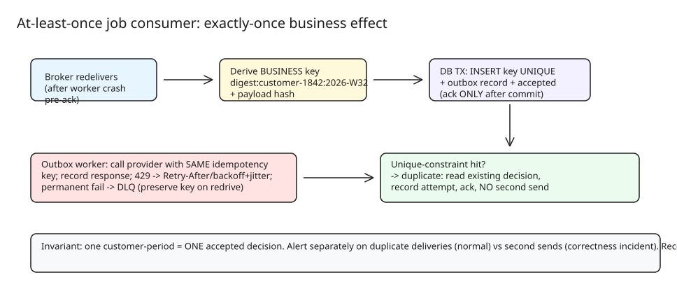

# How to Make At-Least-Once Job Queue Consumers Idempotent: Business Keys, Outbox, Ack-After-Commit

The failure this pattern exists for: a worker finishes sending a customer's weekly
digest, then dies *before* its acknowledgement reaches the broker. The broker
redelivers. That redelivery is **expected**, not exceptional — the dangerous design
is the one with no durable record to decide "did I already do this?" The goal is not
an exactly-once queue (it does not exist across queue + database + external provider);
it is **at-least-once delivery plus exactly-once business effect**, enforced at the
application boundary.



## Step 1 — Define the invariant and the business idempotency key *before* writing the consumer

Write the invariant down first: *one customer, one digest period, one accepted send
decision.* The message may be seen twice; the decision may be recorded once.

The idempotency key must describe the **business command**, not the worker attempt:

```text
digest:customer-1842:2026-W32
```

A queue delivery ID is *not* suitable: each redelivery normally receives a new
delivery ID, while the customer-period intent stays the same. If the produced
content may change between retries, store a **payload hash** alongside the key
(`sha256:weekly-summary-v1`). Same key + different hash must be **rejected or
routed for review** — silently sending different content under one identity makes
reconciliation ambiguous.

## Step 2 — Make the database transaction the authority

In **one transaction**:

1. Insert `(idempotency_key, payload_hash)` under a **unique constraint**.
2. Create the outbox event / durable send record.
3. Mark the command accepted.

**Only after commit** should the consumer acknowledge the queue message. On a
duplicate-key violation: read the existing record, log the repeated delivery as an
attempt, acknowledge without creating another business command.

```sql
-- consumer transaction (PostgreSQL sketch)
BEGIN;
INSERT INTO send_decisions (idem_key, payload_hash, status, created_at)
VALUES ('digest:customer-1842:2026-W32', 'sha256:weekly-summary-v1', 'accepted', now())
ON CONFLICT (idem_key) DO NOTHING;
-- if 0 rows affected → duplicate: SELECT the existing row, ack, done.
INSERT INTO outbox (idem_key, destination, payload) VALUES (...);
COMMIT;
-- ack the queue message only past this point
```

The article's minimal state model (Go; the mutex stands in for transaction
serialization, the map for the unique index — production Node.js workers need the
real database constraint):

```go
type DigestStore struct { accepted map[string]string }

func (s *DigestStore) Accept(key, payloadHash string) (duplicate bool, conflict bool) {
    if previous, exists := s.accepted[key]; exists {
        return previous == payloadHash, previous != payloadHash
    }
    s.accepted[key] = payloadHash
    return false, false
}
```

**Do not put the remote send inside the database transaction.** A local transaction
cannot make a remote side effect exactly-once; wrapping the call only extends the
failure window without extending atomicity. An outbox worker claims the intent,
calls the provider **with the same idempotency key**, records the response, and
retries by response class.

## Step 3 — Respect the provider boundary

- Use a **provider-side idempotency key** when the provider supports one.
- Otherwise persist a send intent and reconcile provider responses before retrying.
- Verify the provider's idempotency contract explicitly — do not infer it from the
  fact that "retry" exists in its SDK.

The strongest honest claim: exactly-once *business effect* where both sides honor the
same idempotency contract, while the transport stays at-least-once.

## Step 4 — Treat retry policy as a scheduling contract

- Transient vs permanent failure need different paths. HTTP **429** → honor
  `Retry-After` when present, else bounded exponential backoff **with jitter**.
- Never retry malformed data forever: after a bounded policy, dead-letter the message
  with failure reason + correlation IDs.
- A DLQ is a holding/inspection boundary, **not** proof the command is safe to
  replay: redrive only after the payload, handler, or dependency is fixed, and
  **preserve the original idempotency key** during redrive.
- Attempt record should retain: delivery ID, idempotency key, payload hash, attempt
  number, status, timestamps, response classification.
- Alert on the **invariant**, with two separate counters: rising *duplicate
  deliveries* is normal during broker/worker disturbance; a second *send* for one
  customer-period is a correctness incident.

## Step 5 — Prove it with fault injection, not happy-path tests

A test that just invokes the handler twice misses all three real boundaries (no
crash, no concurrent transaction, no remote-response ambiguity). Test instead:

1. Kill the worker **after** the send intent commits but **before** the ack →
   redelivery must find the same key + hash, see the provider reference, finish as
   duplicate without a second send.
2. Die **before** the intent commits → the second worker must be *allowed* to create it.
3. Deliver the same key to two concurrent workers.
4. Inject a 429; redrive a dead-lettered message.
5. Change shipment data between attempts → the hash comparison must make the
   difference visible, not quietly mix two weekly snapshots.

Expected result everywhere: one customer-period decision, explainable attempt
history, no second business effect.

## Step 6 — Reconcile by joining four facts

Producer command ⨝ accepted idempotency record ⨝ domain data used to build the
digest ⨝ provider result. An empty queue proves only that messages *left* the queue,
not that every active customer received the intended report. The reconciliation
query should find: missing records, hash conflicts, repeated provider references,
and commands whose final status exceeds the delivery window. Document the key
retention period (legal/privacy/support differ) instead of hiding it in queue settings.

## Design decision table

| Requirement | Design response | Trade-off |
| --- | --- | --- |
| Digest must not be silently lost | Durable queue, ack-after-commit, DLQ | Must operate recovery + storage state |
| No two copies to one customer | Stable customer-period key + unique constraint | Key retention and privacy rules |
| Auditable contents | Payload hash, decision, attempt history, provider reference | More records, data-governance work |
| Dependency rate-limited | Honor `Retry-After`, then bounded backoff | Delivery may arrive late |
| Replay for many consumers | Event-log design or explicit fan-out | More infra than a work queue |

**When NOT to use this:** the workload needs immutable replay for several
independent consumers, long-running workflow joins, or arbitrary historical
reconstruction from the transport — use an event log or workflow system then. Keep
the simple work queue when the job is one bounded command and the durable
application record is the source of truth.

## References

- [DEV.to: Node.js Background Job Queue — At-Least-Once Duplicate Processing](https://dev.to/arthurfinley2291/logistics-digest-nodejs-background-job-queue-at-least-once-duplicate-processing-56jn)
- [AWS SQS: Dead-letter queues](https://docs.aws.amazon.com/AWSSimpleQueueService/latest/SQSDeveloperGuide/sqs-dead-letter-queues.html)
- [MDN: HTTP 429 Too Many Requests](https://developer.mozilla.org/en-US/docs/Web/HTTP/Reference/Status/429)

## Related

- [[howto-idempotent-webhook-handlers-nodejs]] — same correctness family on the inbound (webhook) side: atomic claim, release on failure, stale-claim takeover
