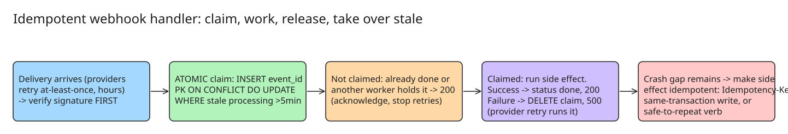

# How to Make Webhook Handlers Idempotent: Atomic Claim, Release on Failure, Take Over Stale Claims

Webhook providers deliver **at least once**: if your endpoint is slow, errors, or the `200` is lost on the way back, Stripe, GitHub, Twilio and voice platforms like Vapi resend the same event — often for hours. A handler that sends an email or charges a card on every delivery will eventually do it twice. The fix is a claim-based idempotent handler: **claim the event ID in the database** via a unique constraint before doing the work, mark it done afterwards, **release the claim if the work fails** so the provider's retry can run it, and **take over claims gone stale** because a worker crashed.



## Why the two obvious fixes don't work

- **"Have I seen this ID? Then insert it."** Two concurrent deliveries can both check, both see nothing, both proceed. Check-and-claim must be **one atomic operation**.
- **Responding `200` before doing the work.** Then a crash loses the event entirely — the provider never retries.

## Step 1 — Claim atomically with a primary key

Let the database arbitrate: the insert either creates the row (you own the event) or conflicts (someone else does). Works identically in SQLite and PostgreSQL.

```js
import { DatabaseSync } from "node:sqlite";

const db = new DatabaseSync("webhooks.db");
db.exec(`CREATE TABLE IF NOT EXISTS webhook_events (
  event_id   TEXT PRIMARY KEY,
  status     TEXT NOT NULL CHECK (status IN ('processing', 'done')),
  updated_at INTEGER NOT NULL
)`);

const STALE_MS = 5 * 60_000;
const claim = db.prepare(`
  INSERT INTO webhook_events (event_id, status, updated_at)
  VALUES (?, 'processing', ?)
  ON CONFLICT (event_id) DO UPDATE SET updated_at = excluded.updated_at
  WHERE webhook_events.status = 'processing'
    AND webhook_events.updated_at < ?`);
const finish  = db.prepare(`UPDATE webhook_events SET status = 'done', updated_at = ? WHERE event_id = ?`);
const release = db.prepare(`DELETE FROM webhook_events WHERE event_id = ? AND status = 'processing'`);

/** Returns the HTTP status to send. */
export async function handleWebhook(event, sideEffect, now = Date.now()) {
  const claimed = claim.run(event.id, now, now - STALE_MS).changes === 1;
  if (!claimed) return 200;   // already done, or another worker holds it: acknowledge so the sender stops retrying
  try {
    await sideEffect(event);
    finish.run(now, event.id);
    return 200;
  } catch (error) {
    release.run(event.id);    // let the sender's retry try again
    return 500;
  }
}
```

The `ON CONFLICT ... WHERE` clause covers the crash case in the same statement: a row still `processing` but untouched for five minutes means the claiming worker is presumed dead, and the new delivery takes it over. A `done` row, or a freshly-`processing` one, is left alone and the delivery is acknowledged.

## Step 2 — Test the three behaviours (passing on Node.js 24)

```js
// Duplicate delivery: one email, not two.
let emails = 0;
const sendEmail = async () => void emails++;
assert.equal(await handleWebhook({ id: "evt_1" }, sendEmail), 200);
assert.equal(await handleWebhook({ id: "evt_1" }, sendEmail), 200);
assert.equal(emails, 1);

// A failure releases the claim, so the provider's retry runs it.
let attempts = 0;
const flaky = async () => { if (++attempts === 1) throw new Error("SMTP timeout"); };
assert.equal(await handleWebhook({ id: "evt_2" }, flaky), 500);
assert.equal(await handleWebhook({ id: "evt_2" }, flaky), 200);
assert.equal(attempts, 2);
```

Plus a stale-claim test: a claim older than `STALE_MS` is taken over; a fresh one held by another worker is not.

## Step 3 — Be honest about "exactly once"

The claim gives **at most once at a time** and **once after success**. One gap remains: the side effect runs, then the process crashes **before** `finish` — after `STALE_MS` a retry takes over and the email goes out again. No database alone closes it, because the email provider is a separate system. Close it by making the **side effect itself idempotent**:

- Pass an **idempotency key** to the downstream API where supported (Stripe's `Idempotency-Key` header — derive it from the event ID so a repeat is recognised).
- When the side effect is a database change, **write the result in the same transaction** as the claim — both commit or both roll back.
- Prefer **idempotent verbs**: "set status to shipped" is safe to repeat; "increment counter" is not.

## Step 4 — Operational hygiene

- **Verify the signature first**, before claiming anything, so forged requests can't fill your table (and don't treat "it came from localhost" as authentication).
- **Respond quickly:** for slow work, claim the event, enqueue it, return `200`; a worker executes with the same claim logic.
- **Use the provider's event ID**, not a hash of the body — retries can differ in fields like delivery timestamps.
- **Delete old rows** after the provider's retry window passes.
- Same pattern applies to **message queues**: brokers redeliver too, so every consumer of a pub/sub pipeline needs a claim.

## Related

- [[../../cloud-infrastructure/llm-serving/howto-retry-llm-api-calls-backoff-jitter-fallback]] — the other side of at-least-once: the caller's retry policy that *creates* the duplicates this note handles.

## References

- [Idempotent webhooks in Node.js: handle every event once, even when it's delivered twice — dev.to (Ali Ahmed)](https://dev.to/quantumbreakz/idempotent-webhooks-in-nodejs-handle-every-event-once-even-when-its-delivered-twice-2a4n)
- [Original article — aliahmed.si](https://aliahmed.si/blog/idempotent-webhooks-nodejs/)
- [Handling duplicate webhook events — Stripe docs](https://docs.stripe.com/webhooks#handle-duplicate-events)
