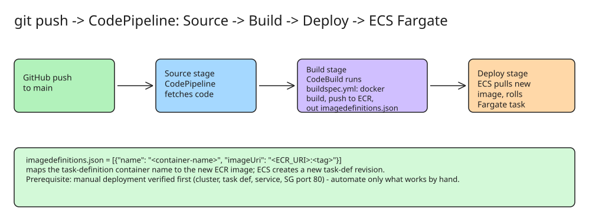

# How to Build a Fully Automated CI/CD Pipeline on AWS (CodePipeline + CodeBuild + ECR + ECS Fargate)

End-to-end recipe for a hands-off pipeline: every `git push` to `main` is built into a Docker image, pushed to ECR, and deployed to a running ECS Fargate service — no console clicks. The demo workload is a static 2048 game (any containerized app works); ~2–3 hours, ~$1 in AWS charges.



## Architecture

GitHub (trigger) → CodePipeline (orchestrator) → CodeBuild (runs `buildspec.yml`) → ECR (private registry) → ECS Fargate (serverless container runtime). S3 holds artifacts passed between stages; IAM scopes each service's access; the build-to-deploy handoff is a small `imagedefinitions.json` file.

## Step 0 — Containerize and verify locally first

```dockerfile
FROM nginx:latest
COPY . /usr/share/nginx/html
EXPOSE 80
CMD ["nginx", "-g", "daemon off;"]
```

```bash
docker build -t myapp .
```

**Golden rule of the pipeline: if it does not work manually, a pipeline only automates the failure.** Test the container on your machine first — problems at this stage are Docker problems, not cloud problems.

## Step 1 — Push the image to ECR

```bash
aws ecr create-repository --repository-name myapp   # via console or CLI
docker tag myapp:latest <ECR_URI>:latest
aws ecr get-login-password --region <region> \
  | docker login --username AWS --password-stdin <ECR_URI>
docker push <ECR_URI>:latest
```

## Step 2 — Deploy manually to Fargate (the known-good baseline)

Four pieces, in order:

1. **Cluster** — create with the *Fargate (serverless)* launch type.
2. **Task definition** — names the container, points at the ECR image URI, maps port 80→80.
3. **Service** — keeps the desired task count (1) running; default VPC, auto-assign public IP.
4. **Security group** — inbound HTTP on port 80, or the browser cannot reach the container.

Open the task's public IP — the app loading confirms image, task definition, networking, and security group are all correct. Keep this deployment as your reference while debugging the pipeline.

## Step 3 — Repository + buildspec (the heart of CI)

Push the app plus a `buildspec.yml` in the repo root. The build stage must produce **`imagedefinitions.json`** as an output artifact — the ECS deploy action requires it to map the task-definition container name to the new ECR image URI:

```yaml
version: 0.2
phases:
  pre_build:
    commands:
      - aws ecr get-login-password --region $AWS_REGION \
          | docker login --username AWS --password-stdin $ECR_URI
      - IMAGE_URI=$ECR_URI:$CODEBUILD_RESOLVED_SOURCE_VERSION
      - docker build -t $IMAGE_URI .
  build:
    commands:
      - docker push $IMAGE_URI
      - printf '[{"name":"<container-name>","imageUri":"%s"}]' $IMAGE_URI > imagedefinitions.json
artifacts:
  files: imagedefinitions.json
```

`imagedefinitions.json` looks like:

```json
[{"name": "myapp-container", "imageUri": "<aws_account>.dkr.ecr.<region>.amazonaws.com/myapp:<git-sha>"}]
```

CodePipeline then creates a **new revision of the service's task definition** with that image and updates the service — this is the actual deployment mechanism (per [AWS docs](https://docs.aws.amazon.com/codepipeline/latest/userguide/file-reference.html)).

## Step 4 — Wire the pipeline

1. Create the pipeline with GitHub as the source (CodePipeline connects via a GitHub app token; poll-on-push to `main`).
2. Source stage → fetches code into S3.
3. Build stage → CodeBuild with the `buildspec.yml`; grant the CodeBuild service role ECR push, S3, and CloudWatch Logs permissions.
4. Deploy stage → ECS action pointing at the cluster/service, consuming `imagedefinitions.json`.
5. Verify: `git push` → watch all three stages go green → the new version is live on the service's URL.

## IAM minimums

| Principal | Needs |
|---|---|
| CodeBuild service role | `ecr:GetAuthorizationToken`, `ecr:BatchCheckLayerAvailability`, `ecr:CompleteLayerUpload`, `ecr:UploadLayerPart`, `ecr:InitiateLayerUpload`, `ecr:PutImage`, S3 artifact read/write, CloudWatch Logs |
| CodePipeline role | Pass role to CodeBuild, ECS Describe/UpdateService, S3 artifact buckets |
| ECS task execution role | `ecr:GetAuthorizationToken` + pull, `logs:CreateLogStream` |

## Pitfalls

- **Container name mismatch:** the `name` in `imagedefinitions.json` must exactly match the container name in the task definition — the classic "deploy succeeded but old image still running" cause.
- **`latest` tag deploys:** tag images with `$CODEBUILD_RESOLVED_SOURCE_VERSION` (git SHA) so rollbacks are possible and ECS actually sees a new digest.
- **Security group forgotten:** Fargate task in a public subnet is still unreachable without inbound 80 in its SG.
- **Patching via console** after the pipeline exists re-introduces drift — all changes must go through `git push`.

## References

- Original article: [Building a Fully Automated CI/CD Pipeline on AWS with Docker, ECR, CodeBuild, CodePipeline and ECS Fargate](https://dev.to/shehzad_ahmad_153/building-a-fully-automated-cicd-pipeline-on-aws-with-docker-ecr-codebuild-codepipeline-and-ecs-189o)
- Upstream project source: [techwithlucy/ztc-projects](https://github.com/techwithlucy/ztc-projects)
- AWS docs: [Tutorial: Amazon ECS standard deployment with CodePipeline](https://docs.aws.amazon.com/codepipeline/latest/userguide/ecs-cd-pipeline.html)
- AWS docs: [Image definitions file reference](https://docs.aws.amazon.com/codepipeline/latest/userguide/file-reference.html)
- Related: [[tutorial-full-stack-app-on-aws-fargate-vue-express-dynamodb]]
