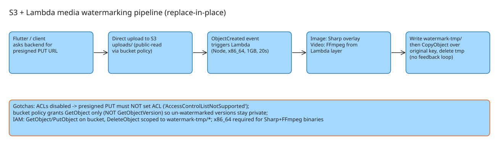

# Serverless Media Watermarking with S3 Event Notifications, Lambda, Sharp, and an FFmpeg Layer

A complete recipe for **watermarking every uploaded image and video automatically**, without touching the client app or the backend: uploads still go straight from the app to S3 via presigned URLs; an S3 `ObjectCreated` event triggers a Lambda that watermarks the object and **replaces it in place under the same key**, so every stored URL keeps working.



## Architecture at a glance

1. Client requests a presigned PUT URL from the backend, uploads directly to `uploads/` in S3.
2. S3 sends `ObjectCreated` to the Lambda function.
3. Lambda downloads the file + a watermark PNG: images (`.jpg/.jpeg/.png/.webp`) go to **Sharp**, `.mp4` goes to **FFmpeg from a Lambda layer**.
4. Lambda writes to a temporary prefix (`watermark-tmp/`), `CopyObject`s over the original key, deletes the temp file — processing is async, every client is covered, the backend stays out of the media path.

Full source: [aws-media-watermark on GitHub](https://github.com/leksyking/aws-media-watermark).

## Step 1 — Bucket with the right security shape

Create a General-purpose bucket (`aws-watermark-demo`) with **ACLs disabled**, **Block public access OFF** (needed for the bucket policy below), **versioning ON**. Make only `uploads/` public:

```json
{
  "Version": "2012-10-17",
  "Statement": [{
    "Sid": "PublicReadUploads",
    "Effect": "Allow",
    "Principal": "*",
    "Action": "s3:GetObject",
    "Resource": "arn:aws:s3:::aws-watermark-demo/uploads/*"
  }]
}
```

Two deliberate details:

- Grant **`s3:GetObject` only, not `s3:GetObjectVersion`** — so the un-watermarked historical versions kept by versioning are *not* publicly readable.
- With ACLs disabled, S3 rejects any request that sets an ACL: if your presigned PUT still sends `ACL: "public-read"` the upload fails with `AccessControlListNotSupported`. Remove the ACL from the presign and rely on the bucket policy — one policy covers the watermarked replacements too.

Upload your transparent watermark PNG to a private key such as `watermark-assets/LeksyMark.png`.

## Step 2 — Least-privilege Lambda role

Attach the managed `AWSLambdaBasicExecutionRole` (CloudWatch logs) plus one inline policy:

```json
{
  "Version": "2012-10-17",
  "Statement": [
    {"Sid": "ReadMediaAndWatermarkAssets", "Effect": "Allow",
     "Action": ["s3:GetObject"], "Resource": ["arn:aws:s3:::aws-watermark-demo/*"]},
    {"Sid": "WriteProcessedMediaAndTemporaryFiles", "Effect": "Allow",
     "Action": ["s3:PutObject"], "Resource": ["arn:aws:s3:::aws-watermark-demo/*"]},
    {"Sid": "DeleteTemporaryProcessingFiles", "Effect": "Allow",
     "Action": ["s3:DeleteObject"], "Resource": ["arn:aws:s3:::aws-watermark-demo/watermark-tmp/*"]}
  ]
}
```

`DeleteObject` is scoped to `watermark-tmp/*` only — the function can never delete originals.

## Step 3 — Function configuration traps

| Setting | Value | Why |
|---|---|---|
| Runtime | Node.js (24.x/26.x) | Sharp + FFmpeg via Docker-built deps |
| Architecture | **x86_64, not ARM64** | Sharp native binaries and the FFmpeg binary are built for Linux x86_64 |
| Memory | **1024 MB** | Default 128 MB is too small even for images; Lambda CPU scales with memory |
| Timeout | 20 s | Video re-encode headroom |
| Region | same as bucket | S3 event → Lambda requires same region |

Create the function **without the S3 trigger** and wire the trigger only after testing, so an untested handler can never touch real uploads.

## Step 4 — Sharp for images, FFmpeg layer for video

- Images: Sharp composites the transparent PNG over the source (`composite` with `gravity`).
- Videos: invoke the FFmpeg binary from a Lambda **layer** (`-i in.mp4 -i watermark.png -filter_complex overlay` style).
- Build both on Windows/any host by running `npm install` **inside AWS's official Lambda container image** — no local Node.js needed; package Sharp into the deployment zip and FFmpeg into the layer with Docker.

## Step 5 — Replace in place without an infinite loop

Write the result to `watermark-tmp/<key>`, then `CopyObject` to the original key, then delete the temp object. The S3 notification filter must match `uploads/` only — writes to `watermark-tmp/` and the watermarked-assets prefix never re-trigger the function.

## Verification

- `aws lambda invoke` with a synthetic `ObjectCreated` payload before wiring the trigger.
- Upload a test JPG and MP4 via presigned URL; confirm the visible watermark and unchanged object key.
- Confirm `watermark-tmp/` is empty afterward (cleanup works) and that old versions are not publicly fetchable.

## See also

- `explanation-aws-lambda-ebpf-rust-flow-logging.md` — another event-driven Lambda pattern in this folder.

## References

- [Watermark Every Upload Automatically with S3, Lambda, Sharp, and FFmpeg — DEV.to](https://dev.to/leksyking/watermark-every-upload-automatically-with-s3-lambda-sharp-and-ffmpeg-118e)
- [aws-media-watermark — full source on GitHub](https://github.com/leksyking/aws-media-watermark)
