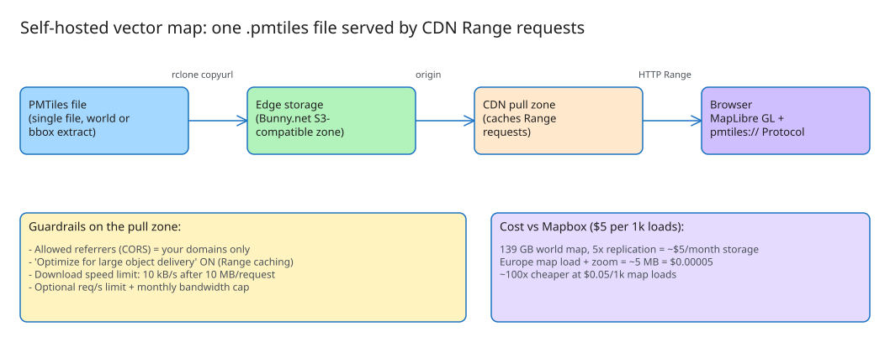

# Self-Hosting Vector Map Tiles with Protomaps PMTiles and Bunny.net

Commercial map APIs get prohibitively expensive when a project goes viral (Mapbox charges **$5 per 1k map loads** past the free tier). **PMTiles** (part of the [Protomaps](https://protomaps.com/) ecosystem) replaces the whole tile-serving backend with **a single file** addressed via HTTP Range requests — any CDN that caches Range requests of large files can serve it, with no server at all.



## Why this works

A `.pmtiles` archive packs all vector tiles (x/y/z) into one file with an internal directory index. The browser asks for byte ranges, not tile URLs. No tile server, no database, no rendering pipeline at request time — just static file serving. (For CDNs that can't do Range caching, like Cloudflare, Protomaps documents an [edge function](https://docs.protomaps.com/deploy/cloudflare) that translates x/y/z paths into Range requests.)

## 1. Get a tiles file

- Whole world: download the latest daily build from the [Protomaps build page](https://maps.protomaps.com/builds/).
- Smaller extract: use the [go-pmtiles CLI](https://github.com/protomaps/go-pmtiles) to [extract a bounding box or zoom-range only](https://docs.protomaps.com/guide/getting-started#_3-extract-any-area) — dramatically smaller files.

## 2. Upload to edge storage (Bunny.net, S3-compatible)

Bunny.net supports Range-request caching, drops the last IP octet by default, and is EU-based. Create a **storage zone with S3 compatibility enabled** — the plain HTTP API upload times out after 15 minutes for large files. Stream the file in with rclone (run inside tmux or from a temporary VPS on flaky connections):

```bash
rclone config create bunnycdn s3 \
  provider=Other \
  access_key_id="<zone-name>" \
  secret_access_key="<storage-key>" \
  endpoint="https://<primary-region>-s3.storage.bunnycdn.com"

rclone copyurl "<build-url>" "bunnycdn:<zone-name>/<filename>.pmtiles" \
  --s3-chunk-size 256M \
  --progress
```

## 3. Configure the pull zone

Point a pull zone at the storage zone as origin, then change three settings:

1. **Security → General → Allowed referrers**: restrict embedding to your own domains.
2. **Caching → "Optimize for large object delivery": ON** — this is what makes Range requests cacheable. Without it you pay origin egress per tile.
3. **Network limits → Download speed limits + Limit after**: cap at 10 kB/s after 10 MB transmitted in a single request. Legitimate browsing never gets near 10 MB; this stops someone from `curl`-ing the whole file and handing you a CDN bill. Optionally add a req/s limit and a monthly bandwidth cap on the pull zone (note real traffic spikes can legitimately reach high req/s).

## 4. Embed with MapLibre GL

```bash
npm install pmtiles
```

```js
import maplibregl from "maplibre-gl";
import { Protocol } from "pmtiles";

let protocol = new Protocol();
maplibregl.addProtocol("pmtiles", protocol.tile);
```

```json
{
  "sources": {
    "protomaps": {
      "type": "vector",
      "url": "pmtiles://https://<cdn-host>/<filename>.pmtiles"
    }
  }
}
```

The `pmtiles://` scheme auto-derives `minzoom`/`maxzoom` for the source. Call `addProtocol` **exactly once** per app lifecycle — in React, put it in a `useEffect` on the root component and `removeProtocol` on cleanup. For raster or terrain tiles change `type` to `"raster"` or `"raster-dem"` (with `"encoding": "terrarium"`). Full details: [Protomaps MapLibre docs](https://docs.protomaps.com/pmtiles/maplibre).

## Cost reality check

Bandwidth to Europe/North America is ~$0.01/GB ($0.005/GB on the Volume network); storage $0.01–0.055/GB/month by replication level. The 139 GB world map at 5-continent replication runs ~**$5/month** in storage. Loading a Europe map and zooming into a city moves ~5 MB → **$0.00005** per visit, with reloads nearly free thanks to local caching. At $0.05/1k map loads that is roughly **100x cheaper than Mapbox** — with the caveat that Mapbox bills a flat fee per visit regardless of heavy users, while you pay per byte.

## Gotchas

- Replication factor mostly matters for cache-miss latency, not durability of a rebuildable artifact.
- Personal-data posture: Bunny drops the last IP octet by default, but any personal data you transmit through the CDN is still processed by them.
- The article's author flags the Bunny link as an affiliate link.

## References

- [Protomaps: Self-hosting map tiles has gotten cheap and easy — Bruce Röttgers](https://bruceroettgers.eu/blog/protomaps/) (original source)
- [PMTiles for MapLibre GL — Protomaps Docs](https://docs.protomaps.com/pmtiles/maplibre)
- [go-pmtiles CLI](https://github.com/protomaps/go-pmtiles)
- [Deploy Protomaps on Cloudflare (edge function for Range requests)](https://docs.protomaps.com/deploy/cloudflare)
- [Serving a custom vector web map with PMTiles — Simon Willison](https://til.simonwillison.net/gis/pmtiles)
