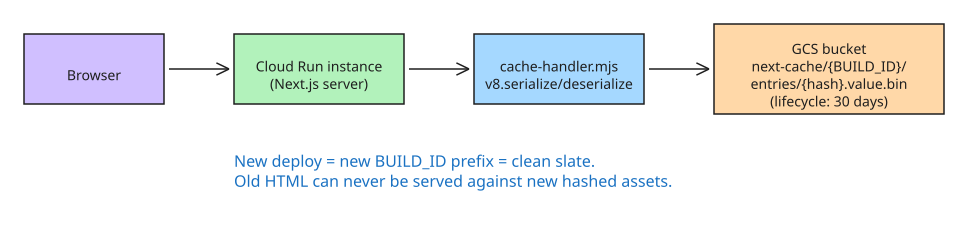

# Fixing Broken Styles After Deploy: Next.js on Cloud Run with a BUILD_ID-Scoped GCS Cache Handler

**Symptom:** deploy succeeds, monitoring is green, but some users get unstyled HTML; hard refresh (Ctrl+Shift+R) fixes it. Classic signature: `/_next/static/chunks/…css` returns 404 while the document returns 200 — **cached HTML outlived the hashed assets it references**. On Cloud Run every deploy is a new filesystem, so this mismatch shows up fast.

## Why serverless makes it worse

- **Ephemeral containers** — old hashed `_next/static` assets vanish with the old revision.
- **Multiple instances** — without shared storage, each container builds its own inconsistent in-memory cache.
- **Cold starts** — a new instance has no warm cache.

Next.js persists four kinds of cache that must be externalized (App Router, via a custom cache handler): full route cache (pre-rendered HTML), fetch cache, image optimization, and cached route handlers. Default location `.next/cache` dies with the container.

## Step 1 — Custom GCS cacheHandler

`cache-handler.mjs` reads/writes entries to Cloud Storage, shared by all instances:

```
gs://bucket/next-cache/{BUILD_ID}/entries/{hash}.value.bin
```

```ts
// next.config.ts
if (isProd) {
  nextConfig.cacheHandler = require.resolve("./cache-handler.mjs");
  nextConfig.cacheMaxMemorySize = 0; // force GCS, not in-memory fallback
}
```

Runtime env: `GCS_BUCKET`, `NEXT_CACHE_PREFIX=next-cache`, `GITHUB_SHA` (build time). The Docker image copies `cache-handler.mjs` next to `server.js` in the standalone output.

**Why binary serialization matters:** early JSON storage silently corrupted pages — Next.js internal structures like `segmentData` contain `Map` objects that deserialize as plain objects. Use Node's **`v8.serialize` / `v8.deserialize`** for route-cache entries (with validation rejecting legacy JSON-shaped entries); image cache entries store raw buffers separately.

## Step 2 — Scope every cache key by BUILD_ID (the bug people miss)

A shared `next-cache/entries/…` prefix works across instances but **fails across deploys**: old cached HTML references `abc123.css` while the new build only has `xyz789.css`. Fix — each deploy reads/writes only under its own prefix:

```
next-cache/a1b2c3d4/entries/…   ← deploy N
next-cache/e5f6g7h8/entries/…   ← deploy N+1 (clean slate)
```

```js
const BUILD_ID = readBuildId();
const CACHE_PREFIX = `next-cache/${BUILD_ID}`;

function readBuildId() {
  try {
    return readFileSync(join(process.cwd(), '.next', 'BUILD_ID'), 'utf8').trim();
  } catch {
    return process.env.GITHUB_SHA?.trim() || 'development';
  }
}
```

⚠️ **Read `.next/BUILD_ID` from the filesystem, don't guess from env vars.** Keying the prefix off `process.env.GITHUB_SHA` at *runtime* silently diverges from the ID `generateBuildId()` baked into asset URLs at *build time* (deploy without the env var, fallback to `development`). Mismatch = stale prefix = broken styles. Keep `generateBuildId` on the same source: `GITHUB_SHA || BUILD_ID || 'development'`.

## Step 3 — Stale browser tabs

GCS scoping fixes the server side only; a tab opened *before* a deploy still navigates with old JS in memory. Add a `BuildIdGuard` client component: on tab focus, send a `HEAD` request, compare the `X-Next-Build-Id` response header to the build ID baked into the current bundle, and auto-reload on mismatch. Production HTML must send that header (with `Cache-Control: private, no-cache, no-store, max-age=0, must-revalidate` on documents, while content-hashed static assets keep `immutable` long cache — safe forever **for that build**).

## Step 4 — Edge vs Node boundary (Next.js 16)

`middleware.ts` still runs on the **Edge runtime**; if the bundler pulls `cache-handler.mjs` (importing `node:crypto`, `@google-cloud/storage`, `node:v8`) into the middleware chunk, deploys crash with `Failed to load external module node:crypto`. Fix: migrate to **`proxy.ts`** (Next.js 16's Node-default request interceptor). Custom cache handlers and GCS clients belong on Node, never in middleware bundles.

## Step 5 — Operational safeguards

1. **Startup logging**: `[cache-handler] GCS cache enabled: gs://bucket/next-cache/{BUILD_ID}/`; warn + in-memory fallback if `GCS_BUCKET` unset (dev only — not multi-instance prod).
2. **Post-deploy CI smoke check** (GitHub Actions): fetch homepage HTML → extract a `/_next/static/…css` reference → assert HTTP 200 → log `X-Next-Build-Id` and `Cache-Control`. Catches "HTML references dead assets" before customers.
3. **GCS lifecycle rule**: delete objects under `next-cache/` after 30 days (old build prefixes accumulate); manual purge: `gcloud storage rm -r "gs://your-bucket/next-cache/**"`.



## Takeaways

1. Treat the container filesystem as ephemeral — externalize everything in `.next/cache`.
2. **Scope cache by BUILD_ID**; read `.next/BUILD_ID`, never trust a loosely-synced env var.
3. Binary (`v8`) serialization for cache values — JSON corrupts `Map`-bearing structures.
4. `cacheMaxMemorySize: 0` makes GCS authoritative instead of a silent per-instance fallback.
5. Verify post-deploy that HTML-referenced CSS returns 200.
6. Plan for stale browser tabs — server cache fixes don't cover long-lived SPA sessions.
7. Keep Node-only APIs (GCS client, `node:v8`, `node:crypto`) out of Edge middleware bundles.

## References

- [Fixing Broken Styles After Deploy: Next.js, Cloud Run, and a Custom GCS Cache Handler (DEV.to / Cusic Digital)](https://dev.to/cusicdigital/fixing-broken-styles-after-deploy-nextjs-cloud-run-and-a-custom-gcs-cache-handler-4am6)
- [Next.js self-hosting caching guide (custom cache handler)](https://nextjs.org/docs/app/guides/self-hosting#configuring-caching)
- Related in KB: [Eradicate slow TTFB with streaming SSR in Next.js](../../programming/frontendjavascript/howto-eradicate-slow-ttfb-with-streaming-ssr-nextjs.md), [Faceted navigation & infinite scroll for crawlers](../../programming/frontendjavascript/howto-nextjs-faceted-navigation-infinite-scroll-crawlable-urls.md)
