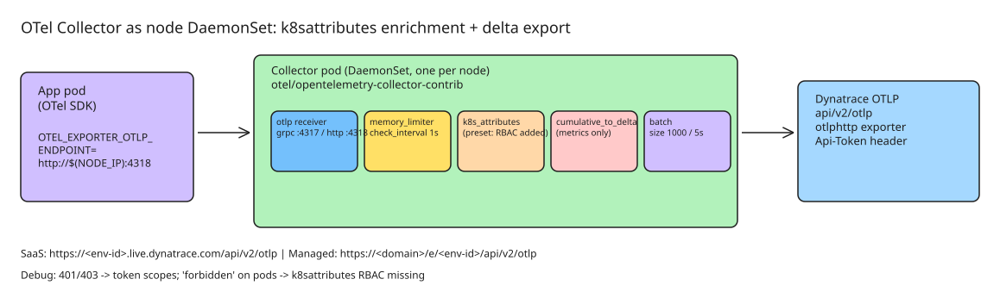

# Deploying the OpenTelemetry Collector as a Kubernetes DaemonSet with k8sattributes for Dynatrace

**Problem:** pods send OpenTelemetry traces, but they arrive in Dynatrace with no pod name, namespace, or node — you cannot tie a latency spike to a specific deployment, and MTTR grows. The fix is a node-local Collector DaemonSet enriched by the `k8sattributes` processor, exporting over OTLP. Applies to both **Dynatrace SaaS** and **Managed** (only the ingest URL changes).



## When to use which deployment mode

| Mode | Shape | Use for |
| --- | --- | --- |
| **DaemonSet** | One Collector per node; pods send to the local node IP | Recommended for `k8sattributes` — each Collector only watches pods on its own node |
| **Deployment** | Pool of Collectors behind a Service | Central gateway, e.g. for sampling |
| **Dynatrace Operator** | Manages OneAgent/ActiveGate — *not* the OpenTelemetry Operator (which manages Collectors + auto-instrumentation) | Both operators can coexist in one cluster |

If OneAgent also runs in the cluster, check duplicate-span avoidance before enabling both paths.

## Prerequisites

- Kubernetes 1.26+, `kubectl`, Helm 3.
- Dynatrace API token with scopes `openTelemetryTrace.ingest`, `metrics.ingest`, `logs.ingest`.
- OTLP URL: SaaS `https://<env-id>.live.dynatrace.com/api/v2/otlp`; Managed `https://<your-domain>/e/<env-id>/api/v2/otlp` (or via ActiveGate).
- Apps already instrumented with an OTel SDK/agent.

## Step 1 — Namespace and Secret (token never in versioned values)

```bash
kubectl create namespace observability
kubectl -n observability create secret generic dynatrace-otlp \
  --from-literal=DT_ENDPOINT='https://<env-id>.live.dynatrace.com/api/v2/otlp' \
  --from-literal=DT_API_TOKEN='dt0c01.XXXX'
```

## Step 2 — values.yaml (Helm chart `open-telemetry/opentelemetry-collector`)

```yaml
mode: daemonset
image:
  repository: otel/opentelemetry-collector-contrib   # contrib image contains k8sattributes + cumulative_to_delta
command:
  name: otelcol-contrib
presets:
  kubernetesAttributes:
    enabled: true            # adds k8sattributes processor + the ClusterRole to read pods/namespaces/ReplicaSets
    extractAllPodLabels: false
extraEnvsFrom:
  - secretRef:
      name: dynatrace-otlp
config:
  receivers:
    otlp:
      protocols:
        grpc: { endpoint: ${env:MY_POD_IP}:4317 }
        http: { endpoint: ${env:MY_POD_IP}:4318 }
  processors:
    memory_limiter: { check_interval: 1s, limit_percentage: 80, spike_limit_percentage: 25 }
    cumulative_to_delta: {}
    batch: { send_batch_size: 1000, timeout: 5s }
  exporters:
    otlphttp/dynatrace:
      endpoint: ${env:DT_ENDPOINT}
      headers: { Authorization: "Api-Token ${env:DT_API_TOKEN}" }
  service:
    pipelines:
      traces:  { receivers: [otlp], processors: [memory_limiter, k8s_attributes, batch], exporters: [otlphttp/dynatrace] }
      metrics: { receivers: [otlp], processors: [memory_limiter, k8s_attributes, cumulative_to_delta, batch], exporters: [otlphttp/dynatrace] }
      logs:    { receivers: [otlp], processors: [memory_limiter, k8s_attributes, batch], exporters: [otlphttp/dynatrace] }
```

The four critical lines:

1. **`image.repository: otel/opentelemetry-collector-contrib`** — the core image lacks `k8sattributes` and `cumulative_to_delta` (confirmed by the official OTel Kubernetes docs: the `kubernetesAttributes` preset is disabled by default for RBAC reasons and requires the Contrib distribution). Dynatrace also publishes its own Collector distribution — check docs.dynatrace.com for which components it ships.
2. **`presets.kubernetesAttributes`** — the chart adds the processor *and* creates the ClusterRole letting the Collector read pods, namespaces, and ReplicaSets.
3. **`cumulative_to_delta`** on the metrics pipeline — Dynatrace's OTLP API expects counters/histograms with **delta temporality**; cumulative points are silently not ingested (gauges have no temporality and pass through). Most OTel SDKs export cumulative by default (a Prometheus-oriented choice), so this processor is mandatory for metrics.
4. **`memory_limiter` first in every pipeline** — it protects the node when the backend slows down.

Naming gotcha: in recent contrib versions the processors are named `k8s_attributes` and `cumulative_to_delta`; the old names (`k8sattributes`, `cumulativetodelta`) remain deprecated aliases, and the chart rewrites them by default (`rewriteDeprecatedComponentNames`). The preset already inserts `k8s_attributes` into pipelines — listing it explicitly makes ordering visible; if your chart version reports a duplicate, remove it.

## Step 3 — Install

```bash
helm repo add open-telemetry https://open-telemetry.github.io/opentelemetry-helm-charts
helm repo update
helm upgrade --install otel-node open-telemetry/opentelemetry-collector \
  -n observability -f values.yaml
```

## Step 4 — Point apps at their node's Collector (Downward API)

```yaml
env:
  - name: NODE_IP
    valueFrom:
      fieldRef: { fieldPath: status.hostIP }
  - name: OTEL_EXPORTER_OTLP_ENDPOINT
    value: "http://$(NODE_IP):4318"
  - name: OTEL_EXPORTER_OTLP_PROTOCOL
    value: "http/protobuf"
```

In DaemonSet mode the chart exposes host port 4318 by default (check the `ports` section of your values); otherwise use the Service it creates.

## Alternative — OpenTelemetry Operator (`OpenTelemetryCollector` CRD)

Declare the Collector as a Kubernetes resource (`apiVersion: opentelemetry.io/v1beta1`, `kind: OpenTelemetryCollector`, `spec.mode: daemonset`). Webhooks need TLS: cert-manager, or the chart's self-signed `admissionWebhooks.autoGenerateCert`. With the Operator you handle yourself what the Helm preset automated:

- inject `K8S_NODE_NAME` via Downward API (`spec.nodeName`) for `filter.node_from_env_var`
- create the ClusterRole + binding to the Collector's ServiceAccount (`auth_type: serviceAccount`)
- explicit `extract.metadata` (`k8s.namespace.name`, `k8s.pod.name`, `k8s.deployment.name`, `k8s.node.name`) and `pod_association: [{sources: [{from: connection}]}]`

Pin a precise image tag in production — never `latest`.

## Verification checklist

1. One DaemonSet pod per node: `kubectl -n observability get pods -o wide`.
2. `kubectl -n observability logs ds/otel-node-opentelemetry-collector | grep -iE "error|refused|401|403"` — `401/403` means token or scopes; `forbidden` on pods means missing `k8sattributes` RBAC.
3. In a Dynatrace Notebook: `fetch spans, from: now() - 30m` and confirm `k8s.pod.name` / `k8s.namespace.name` / `k8s.node.name` attributes are present.
4. Roll out to a test namespace first, validate the DQL query, then expand.

## References

- [OpenTelemetry Collector Kubernetes setup for Dynatrace (DEV.to / span.observer)](https://dev.to/spanobserver/opentelemetry-collector-kubernetes-setup-for-dynatrace-helm-operator-and-k8sattributes-pb3)
- [OpenTelemetry Collector Helm chart — official docs](https://opentelemetry.io/docs/platforms/kubernetes/helm/collector/)
- [k8sattributes processor and the kubernetesAttributes preset — official docs](https://opentelemetry.io/docs/platforms/kubernetes/collector/components/)
- [Dynatrace docs — Configure the OTel Collector (delta temporality requirement)](https://docs.dynatrace.com/docs/ingest-from/opentelemetry/collector/configuration)
- Related in KB: [OpenTelemetry goes GA](../../../explanations/cloudinfrastructure/distributedtracing/explanation-opentelemetry-ga.md), Plan a distributed tracing deployment, Instrument a Python Flask app with the OTel Collector
