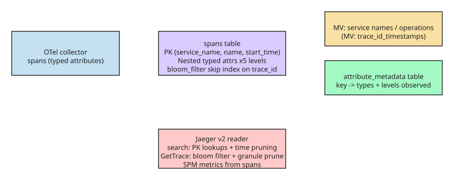

# Storing Jaeger v2 Spans in ClickHouse

Jaeger v2.18.0 ships a native **ClickHouse storage backend** (alpha). This note covers why columnar storage fits trace data, the schema design decisions behind it, and how to get started.

## Why columnar storage for traces

Trace workloads have two hard constraints: store massive volumes of semi-structured event data, then search it quickly across many dimensions (service, operation, tags, duration, time range, trace ID). Row-oriented backends (Cassandra, Elasticsearch) pay indexing overhead and make retention painful.

ClickHouse is a column-oriented OLAP database built for high-throughput append-only ingestion plus fast analytical aggregation. Trace data is repetitive by nature — the same service names, operation names, status codes, and tag keys repeat hundreds of thousands of times. A columnar layout groups identical values together, making them trivial to compress:

- **8.6× compression ratio** on the spans table in Jaeger's benchmarks (≈ 6 GiB reduced to ≈ 722 MiB for 10M spans).
- **>50k spans/sec** sustained ingestion on a single node.
- Trace retrieval ~100 ms; most search queries &lt;50 ms; complex filtered queries ~140 ms (benchmark: 10M spans / 1M traces, single node).

ClickHouse also enables real-time analytics directly on stored spans: Jaeger v2.18 includes native ClickHouse **SPM (Service Performance Monitoring)** methods that compute service-level latency, call rates, and error rates straight from trace data — no external metrics pipeline needed.

## Schema design decisions

The full design space is documented in the [Jaeger ADR 008](https://github.com/jaegertracing/jaeger/blob/v2.18.0/docs/adr/008-clickhouse-storage-schema.md). Key decisions:

### Primary key trade-off (the highest-leverage decision)

In ClickHouse, the primary key is **not a uniqueness constraint** — it defines on-disk sort order and powers a sparse index (one index entry per 8,192-row granule). Two candidates were considered:

| Option | Trace retrieval | Search queries |
| --- | --- | --- |
| Sort by `trace_id` | ~27 ms (single seek + sequential read) | ~880 ms (filters can't use the index at all) |
| Sort by `(service_name, name, start_time)` — **chosen** | ~100 ms | ~140 ms |

The decision came down to an asymmetric trade-off: sorting by `trace_id` makes search terrible, but sorting by (service, operation, time) hurts trace retrieval much less because two cheap mechanisms recover most of the lost performance:

1. A **bloom_filter skip index on `trace_id`** — lets the engine prove a granule can't contain a given ID without reading it.
2. A **`trace_id_timestamps` materialized view** — tells the search path each matching trace's time bounds, so the follow-up GetTraces call can prune partitions and granules.

### Typed attributes via Nested columns

Jaeger v1 tags were always strings; the v2 reader API accepts a typed map (Bool, Int64, Float64, String, plus complex types Bytes/Slice/Map). The schema uses ClickHouse **Nested** columns per primitive type — repeated at span, event, link, resource, and scope level. A Nested column is effectively a mini table inside each row with its own attribute names/values, so attribute filters use the same query semantics as querying a regular table.

Caveat: attribute-only searches are inherently more expensive because they can't fully leverage the primary index (which is optimized around `service`, `operation`, and `time`). Always combine attribute filters with those structural fields to limit scanned data.

### Materialized views for off-sort-order queries

Some Jaeger queries don't fit the spans table's sort order — e.g., the UI needs the full list of known service names/operations, and trace searches need efficient access to time ranges. Rather than expensive table scans, **materialized views** precompute these: in ClickHouse they automatically transform inserts into the source table and write results into optimized target tables (service names, operations, trace-ID timestamp ranges).

### Five levels of attributes

Searching for `http.status_code=200` is ambiguous without context: is "200" a string or an integer? Is it a span-level or resource-level attribute? The same logical key can live under `str_attributes` or `int_attributes` at any of five data levels (resource, scope, span, event, link). Jaeger solves this with a dedicated **`attribute_metadata` table**, populated by materialized views off the spans table. At query time the reader looks up the filter key and only queries the columns for the types and levels actually observed.

## Getting started

ClickHouse support shipped as **alpha in v2.18.0** and remains **experimental** (schema subject to breaking changes) as of the current release, **v2.23.0** (2026-11-05). Two things changed between 2.18 and 2.23:

- **The `storage.clickhouse` feature gate was dropped.** v2.18 required running with `--feature-gates=storage.clickhouse`; from v2.23 the config alone is enough.
- **Supported ClickHouse server version moved from 25.x to 26.x.**

Quick start against the [Jaeger repository](https://github.com/jaegertracing/jaeger) root (v2.23 docs):

1. Start ClickHouse (single node for evaluation; the benchmark used one):
   `docker compose -f docker-compose/clickhouse/docker-compose-lts-march.yml up -d`
   (the official 2.23 docs still reference `docker-compose.yml`, which does not exist at the v2.23.0 tag — only `docker-compose-lts-march.yml` / `docker-compose-lts-august.yml`)
   → ClickHouse on ports 9000 (native) / 8123 (HTTP), database `jaeger`.
2. Run Jaeger with the ClickHouse backend:
   `go run ./cmd/jaeger --config cmd/jaeger/config-clickhouse.yaml`
   (`create_schema: true` auto-creates tables and materialized views on startup; sample config: [config-clickhouse.yaml](https://github.com/jaegertracing/jaeger/blob/v2.23.0/cmd/jaeger/config-clickhouse.yaml), authoritative source: [config.go](https://github.com/jaegertracing/jaeger/blob/v2.23.0/internal/storage/v2/clickhouse/config.go)).
3. Generate test data: `go run ./cmd/tracegen -duration 10s -workers 3 -pause 250ms`, then open the Jaeger UI at http://localhost:16686.
4. For query performance, always combine attribute filters with `service` / `operation` / time-range fields.

Full benchmark methodology, configuration, and query details are in the [benchmarking report](https://github.com/jaegertracing/jaeger/blob/main/internal/storage/v2/clickhouse/BENCHMARKING.md). Read the numbers (50k spans/sec, 8.6× compression) in that context — they come from a specific single-node environment and dataset (v2.18 era).

## Production evidence: Canva

[Canva's migration of Jaeger to ClickStack](https://clickhouse.com/blog/canva-faster-search-lower-costs) (ClickHouse's managed ClickStack service) is the strongest public data point for this backend at scale: **~10× faster trace search and ~70% lower storage cost** versus their previous setup. Their optimizations worth copying:

- **Primary key tuned to actual query patterns.** Jaeger queries filter by `service` + `operation` + time window, so the primary key is ordered accordingly — those filters become direct primary-key lookups instead of full scans.
- **Bloom-filter data-skipping indices** on trace ID and attribute keys/values compensate for the restrictive `ORDER BY` key (ClickHouse can only skip blocks by its sorting key).
- **Attribute reconstruction at query time** via functions like `mapFromArrays`, rather than storing a wide denormalized row per span.

## References

- [How Jaeger hit 8.6× compression on 10 million spans with ClickHouse](https://thenewstack.io/jaeger-clickhouse-storage-backend/) (The New Stack, CNCF-sponsored post by Mahad Zaryab)
- [Jaeger ADR 008: ClickHouse storage schema](https://github.com/jaegertracing/jaeger/blob/v2.18.0/docs/adr/008-clickhouse-storage-schema.md)
- [ClickHouse setup guide for Jaeger v2.23](https://www.jaegertracing.io/docs/2.23/storage/clickhouse/)
- [Benchmarking report](https://github.com/jaegertracing/jaeger/blob/main/internal/storage/v2/clickhouse/BENCHMARKING.md)
