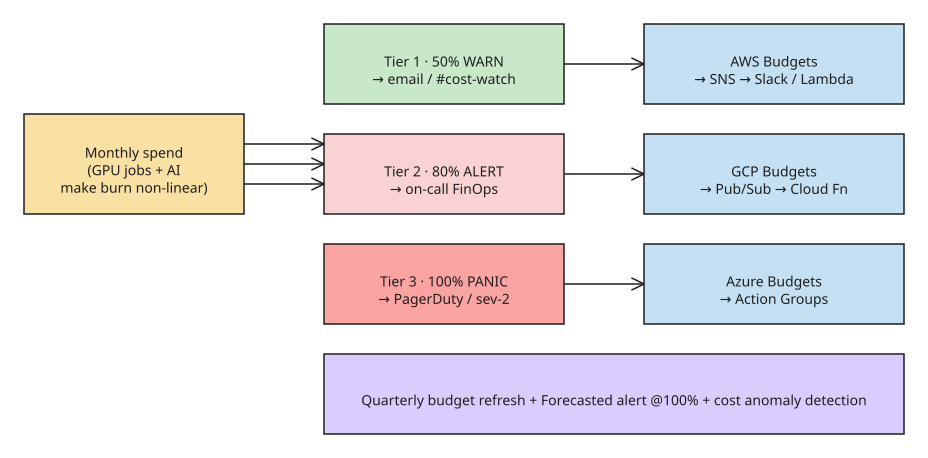

# Cloud Budget Alerts: A Three-Tier Setup for AWS, GCP, and Azure

Most teams set up one budget alert at 100% and call it done. That alert fires on day 28, the day the budget is already blown, leaving no time to act. A setup that actually works uses **three tiers (50% warn, 80% alert, 100% panic)**, each routed to a different channel, repeated in every cloud you actually run workloads in. This note gives the click-by-click setup for AWS, GCP, and Azure, plus the four mistakes that quietly defeat the alerts.

## Why the shape changed in 2026

Two shifts make a single 100% alert even worse than it used to be:

- **AI workloads make the burn rate non-linear.** Pre-2024, a misconfigured S3 lifecycle policy crept 5% onto the month over weeks. Today one forgotten GPU job can eat double-digit percentage of a monthly budget within hours — a `p5.48xlarge` left running over a weekend is roughly $1,150, and a single late-night Bedrock deployment can spend $4,000 in eight hours.
- **Multi-cloud is the median.** Forrester's 2026 cloud survey puts 72% of enterprises in at least two of AWS/GCP/Azure. A budget that only watches AWS misses the half of the bill that lives elsewhere.

The fix is not more dashboards — it is one consistent, tiered alerting setup in each cloud account.

## The three-tier framework

The same thresholds and routing work across all three clouds:

| Tier | Threshold | Route to | Purpose |
|------|-----------|----------|---------|
| Tier 1 · **warn** | 50% | email / Slack `#cost-watch` | Low-noise channel; most months you ignore it. If it fires on day 5, something is off. |
| Tier 2 · **alert** | 80% | on-call FinOps / account owner | The action threshold — is the spend real growth or a misconfiguration? |
| Tier 3 · **panic** | 100% | PagerDuty / sev-2 channel | The budget is gone: stop new resources, freeze the account, or accept the overrun. |

The tiers create **lead time**: by the time you hit 100%, you already had two warnings to act on.

## AWS

AWS Budgets is the native tool — free up to two budgets per account, $0.02 per additional budget per day after that.

1. Open the **Billing console** → **Budgets**.
2. Click **Create budget** → pick **Cost budget**.
3. Set the monthly amount and select **Recurring**.
4. Under **Configure alerts**, add three threshold rules at 50, 80, and 100 percent of **Actual** spend.
5. Add **SNS topics** or email addresses for each tier. SNS is the path to Slack, PagerDuty, or Lambda.
6. Save and verify with a forced low-budget test on a dev account.

What to watch specifically on AWS:
- **Forecasted vs Actual.** The default is Actual, which lags 1–2 days. Add a **Forecasted** alert at 100% to catch the spike earlier.
- **RI / Savings Plan utilization** budgets are separate object types. Budgets only tracks cost — use the dedicated budget types for RI/SP utilization.

## GCP

Google Cloud's budgets page is **Billing → Budgets & alerts**. The setup is similar, but the routing model differs.

1. From the Billing account, **Budgets & alerts → Create budget**.
2. Scope to a project, a set of projects, or the whole billing account.
3. Set the amount (fixed, or based on last month's spend).
4. Add three threshold rules at 50, 80, and 100 percent of **actual** cost; optionally add forecasted thresholds.
5. Under **Manage notifications**, enable **Connect a Pub/Sub topic** so alerts flow into custom routing. Email is the default and the least useful option.
6. Save.

What to watch on GCP:
- **Pub/Sub is the only path to programmatic action.** Email-only setups cannot trigger Cloud Functions or auto-quarantine logic.
- **Project vs billing-account scope.** Multi-project orgs often miss new projects unless the budget sits at the billing-account level.

## Azure

Azure splits the concept into **Cost alerts** (anomaly-style) and **Budgets** (threshold-style). For a tiered setup, use **Budgets**.

1. Open **Cost Management + Billing** in the portal.
2. Navigate to **Budgets** under the subscription or management group.
3. Click **Add**; set the name, amount, and reset period (Monthly).
4. Add three alert conditions at 50, 80, and 100 percent of **Actual** spend.
5. Set the alert recipient as an **action group** — Azure's routing primitive (email, webhook, function, logic app).
6. Save and validate by lowering the budget temporarily.

What to watch on Azure:
- **Management-group budgets** roll up across subscriptions — the better default for orgs with many subs.
- **Action groups must exist before you set the budget.** Half the time, the action group was created later and the early firings went nowhere.

## The four mistakes that defeat alerts

Every "we got blindsided" cost incident comes down to one of these:

1. **Single 100% threshold.** Fires on day 28 with no time to act. Always tier.
2. **Email-only routing.** Goes to one person who is on vacation. Route via SNS, Pub/Sub, or an action group into Slack and PagerDuty.
3. **Budget never refreshed as the account scales.** A $5,000/month budget from launch fires nonstop three months later. Put a quarterly review on the calendar.
4. **Forecast disabled.** Actual-only alerts are reactive. A **Forecasted** alert at 100% catches the spike before it bills.

## Where budget alerts still fall short

The honest part — three limits to plan around:

- **They are not anomaly detection.** A 30% daily spike on a single service can stay under the monthly threshold and never fire. Pair budgets with cost anomaly detection (AWS Cost Anomaly Detection, GCP recommender, Azure Cost Alerts).
- **They lag 1–2 days.** Even Forecasted alerts use yesterday's data. For real-time, you need a tool that reads the billing stream directly.
- **They do not act.** An alert tells you; it does not stop a runaway resource. Wire the top tier to automation — AWS SNS → Lambda, Azure Action Groups → Runbooks, or GCP Pub/Sub → Cloud Functions — so the highest threshold self-corrects (e.g. stop tagged non-prod resources).

## Operating cadence

- **Scope per project** for engineering teams, **per account / billing group** for finance reporting — the two views answer different questions.
- **Treat a Forecasted-only fire as a real anomaly**, not a false alarm: if the spend curve is bending up, Forecasted catches it before the month's Actual closes.
- **Tune quarterly.** Retire alerts that fire constantly for benign reasons; a budget program that is never tuned becomes noise, and noise gets muted.

## References

- [How to set up cloud budget alerts on AWS, GCP, Azure (DEV.to, 2026-06-22)](https://dev.to/muskan_8abedcc7e12/how-to-set-up-cloud-budget-alerts-on-aws-gcp-azure-4ne)
- [AWS Budgets — AWS documentation](https://docs.aws.amazon.com/budgets/latest/UserGuide/what-is-budgets.html)
- [Azure budgets overview — Microsoft Learn](https://learn.microsoft.com/azure/cost-management-billing/budgets/cost-budgets-overview)
- [Google Cloud Billing budgets and budget alerts (documentation)](https://docs.cloud.google.com/billing/docs/how-to/budgets)

## Related

- [[tutorial-full-stack-app-on-aws-fargate-vue-express-dynamodb]]
