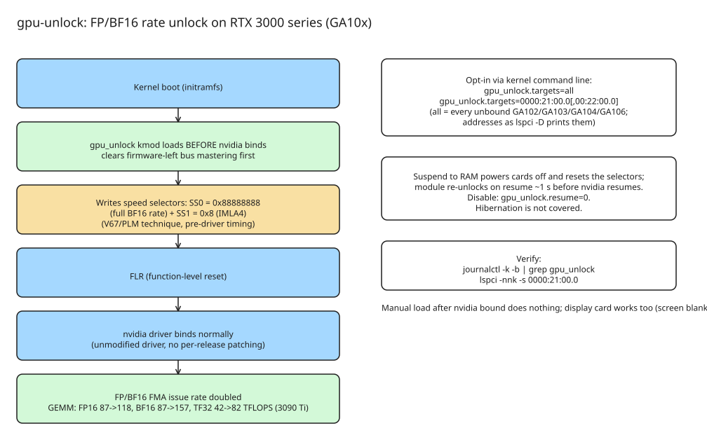

# How to Unlock the FP/BF16 Issue Rate on RTX 3000 Series Cards (gpu-unlock)

Consumer GeForce Ampere cards (GA102/GA103/GA104/GA106) run FP16/BF16 FMA
instruction issue at **half the rate of the identical professional workstation
dies** (e.g. RTX A5000 vs RTX 3090). `gpu-unlock` (v1.0.0, ~4.1k stars) is an
open-source **Linux kernel module** that removes the restriction at boot,
without patching the NVIDIA driver or flashing firmware — so it survives
driver updates without manual re-patching.

**Effect:** doubles the instruction issuing speed of FP/BF16 FMA into FP32
operations. Reported GEMM results on a 3090 Ti (dense 8192³, 450 W, five
sample medians, FP32 accumulation):

| Input | Before | After |
| --- | --- | --- |
| FP16 | 87.46 TFLOPS | 118.39 TFLOPS |
| BF16 | 87.50 TFLOPS | 157.41 TFLOPS |
| TF32 | 42.58 TFLOPS | 82.61 TFLOPS |

Matrix-heavy work speeds up (LLM **prefill +14–36%** across several reports,
plus diffusion and FlashAttention). LLM **decode** (memory-bandwidth-bound)
and INT8 work stay about the same; reports comparing outputs found them
bit-identical before and after.

## How it works

The module combines the CMP unlocker's **V67/PLM technique** with the
pre-driver timing of the UEFI approach. During early initramfs boot, before
the unmodified `nvidia` driver binds the card, it:

1. clears bus mastering that board firmware may have left on (e.g. Supermicro
   X11 does this regardless of option ROM settings),
2. writes the speed selectors — **SS0 = `0x88888888`** (full BF16 rate) and
   the 4-bit **SS1 = `0x8`** (IMLA4),
3. performs **FLR** (function-level reset).

It is neither a UEFI application nor a patched NVIDIA driver. Cards already
bound to a driver or powered down are skipped; loading the module by hand
after `nvidia` bound a card does nothing.

## Install

```shell
git clone https://github.com/Zagitta/gpu-unlock
cd gpu-unlock
make install
```

`make install` detects the distribution via `/etc/os-release` (`ID`, then
`ID_LIKE`) and selects the right installer; explicit targets also exist:
`make install-arch` (makepkg), `make install-deb`, `make install-rpm`
(DNF required). Every build downloads pinned NVIDIA/CachyOS inputs over HTTPS,
checks their SHA-256, and generates firmware only in the build directory and
binary packages (cached in `~/.cache/gpu-unlock/inputs`).

### Opt-in: kernel command line

Append `gpu_unlock.targets=...` to the kernel command line, keeping existing
options:

```shell
gpu_unlock.targets=all                                # every unbound GA10x card
gpu_unlock.targets=0000:21:00.0                       # only this card
gpu_unlock.targets=0000:21:00.0,0000:22:00.0         # comma-separated
```

Addresses are full PCI names as `lspci -D` prints them. Per-distro:

- **GRUB (Debian/Ubuntu/Mint):** inside `GRUB_CMDLINE_LINUX_DEFAULT` in
  `/etc/default/grub`, then `sudo update-grub`
- **GRUB (Arch/CachyOS):** same edit, then `sudo grub-mkconfig -o /boot/grub/grub.cfg`
- **Fedora/RHEL:** `sudo grubby --update-kernel=ALL --args="gpu_unlock.targets=all"`
- **systemd-boot:** append to the `options` line of your boot entry (`bootctl status` shows its location)
- **UKI / generated entries:** add to `/etc/kernel/cmdline` and regenerate boot images (e.g. `sudo mkinitcpio -P`)

The packages put `gpu_unlock` and its firmware in the initramfs and load it
there, **before `nvidia` can bind a card** (mkinitcpio drop-in
`/etc/mkinitcpio.conf.d/zz-gpu-unlock.conf` inserts `gpu_unlock` right before
`nvidia` in `MODULES`; initramfs-tools and dracut have their own drop-ins).
There is deliberately no `softdep nvidia pre:` rule — kmod honours only the
first one it reads and other packages' rules would silently override it.

## Boot sequence



## Suspend/resume behavior

Suspend **to RAM** powers the cards off, which resets the speed selectors.
After resume, the module re-unlocks every card it unlocked at boot **before**
`nvidia` resumes it (its suspend notifier runs just ahead of NVIDIA's;
`NVreg_UseKernelSuspendNotifiers=1` is the default), adding ~1 second to
resume. A card that kept power (suspend to idle) is only re-read. Disable with
`gpu_unlock.resume=0` on the kernel command line (or write `0` to
`/sys/module/gpu_unlock/parameters/resume`). **Hibernation is not covered.**
If a card's firmware never stops, the module logs it and keeps the DMA buffers
until the next power off.

## Verify

```shell
journalctl -k -b | grep gpu_unlock
lspci -nnk -s 0000:21:00.0
```

To stop unlocking: remove `gpu_unlock.targets=` from the kernel command line
(deleting it in the bootloader's edit screen works for a one-off boot).
Removing the packages removes the module and the initramfs drop-ins.

## Tested cards (user reports)

| Chip | Card | PCI ID | Result | BF16 GEMM gain |
| --- | --- | --- | --- | --- |
| GA102 | RTX 3090 Ti | `10de:2203` | Unlocked | +68–80% |
| GA102 | RTX 3090 | `10de:2204` | Unlocked | +25–67% |
| GA102 | RTX 3080 Ti 20 GB (OEM, GA102-250) | `10de:2205` | Unlock completes, BF16 stays at half rate | — |
| GA102 | RTX 3080 10 GB | `10de:2206` | Unlocked | +70–73% |
| GA102 | RTX 3080 20 GB (memory upgrade) | `10de:2206` | Unlocked | +56–59% |
| GA104 | RTX 3070 | `10de:2484` | Unlocked | +73–81% |
| GA104 | RTX 3070 Ti | `10de:2482` | Not tested with this module (worked from a UEFI port on Windows) | — |
| GA106 | RTX 3060 12 GB | `10de:2504` | Unlocked | about +80% |
| GA103 | any | `10de:2414` | No reports yet | — |

Gains are from each report's own benchmark and are not directly comparable —
**power limit matters a lot** (the lowest figure, +25%, is from cards capped
at 225 W). Reports also cover up to four cards in one machine, the display
card (its firmware framebuffer keeps running; screen is blank from the reset
until `nvidia-drm` takes over), and cards passed through to a VM with
vfio-pci.

## Independent cross-check

A separate Medium write-up ([142 TFLOPS in a 3090 Ti](https://inamdaraditya.medium.com/142-tflops-in-a-3090-ti-unlocking-nvidias-factory-half-precision-throttling-without-driver-e30a8f3966d9)) describes the same mechanism as an artificial register lock inside consumer GA102 chips and reports +48.4% dense BF16 GEMM on a 3090 — consistent with the repo's own numbers within benchmark methodology differences.

## Caveats

- The module is GPL-2.0-only; the generated payload derives from the pinned
  CMP reference (NVIDIA firmware remains under its own terms — see
  `firmware/NOTICE.md` and `licenses/`).
- The 3080 Ti OEM variant shows the unlock completing but BF16 staying at
  half rate — verify on your specific card.
- This is a workaround for factory-imposed rate limiting; treat it as a
  performance hack, not a supported configuration.

## References

- [Zagitta/gpu-unlock (GitHub: README, tested-cards table, install docs)](https://github.com/Zagitta/gpu-unlock)
- [gpu-unlock issue #1: 3090 Ti GEMM benchmark thread](https://github.com/Zagitta/gpu-unlock/issues/1)
- [142 TFLOPS in a 3090 Ti: Unlocking NVIDIA's Factory Half-Precision Throttling (Medium, independent write-up)](https://inamdaraditya.medium.com/142-tflops-in-a-3090-ti-unlocking-nvidias-factory-half-precision-throttling-without-driver-e30a8f3966d9)
