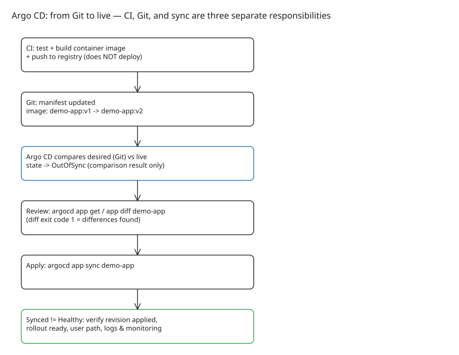

# Argo CD from Git to Live: Review, Sync, and Why Synced Is Not Deployed

A green CI build does not mean your new version is live. Git may request `v2` while the cluster Deployment still references `v1` — the image is in the registry, but the live configuration has not caught up. This note follows one configuration change from Git to the cluster and shows what each step actually proves.



## Step 1 — Separate the three responsibilities

| Responsibility | What happens |
|---|---|
| CI | Test the app, build a container image, publish it to a registry |
| Git | Store the deployment configuration referencing the intended image tag |
| Argo CD | Compare desired configuration with live resources and synchronize |

Kubernetes controllers carry out the rollout after the resource configuration changes. **Argo CD never builds the image** — see the official [CI integration guide](https://argo-cd.readthedocs.io/en/stable/user-guide/ci_automation/).

## Step 2 — Make the drift visible

The desired change in Git looks like:

```diff
- image: registry.example.com/demo-app:v1
+ image: registry.example.com/demo-app:v2
```

Argo CD compares tracked resources against the desired state from its configured source and reports `OutOfSync`. Treat that as a **comparison result only** — it does not distinguish an intended release from an accidental `kubectl edit` or a health problem. The [core concepts](https://argo-cd.readthedocs.io/en/stable/core_concepts/) deliberately separate target state, live state, sync status, and health.

## Step 3 — Review, then synchronize (manual sync)

For a manual-sync Application `demo-app` with the CLI authenticated to the right Argo CD instance:

```bash
# Inspect the application and its status
argocd app get demo-app

# Review the difference before applying anything
argocd app diff demo-app

# Apply the desired configuration when the diff is what you intend to release
argocd app sync demo-app
```

Gotcha for automation: **`argocd app diff` exits with code `1` when it finds differences** — script around that or every pre-sync check "fails" on legitimate drift.

Command references: [`app get`](https://argo-cd.readthedocs.io/en/stable/user-guide/commands/argocd_app_get/), [`app diff`](https://argo-cd.readthedocs.io/en/stable/user-guide/commands/argocd_app_diff/), [`app sync`](https://argo-cd.readthedocs.io/en/stable/user-guide/commands/argocd_app_sync/).

## Step 4 — Verify: Synced answers one question, not four

`Synced` means Argo CD sees no difference in the configuration it tracks. It does **not** prove the app serves users. Resource health is a separate assessment ([resource-health docs](https://argo-cd.readthedocs.io/en/stable/operator-manual/health/)). Before calling a release complete, check:

1. Is the expected revision and image reference applied?
2. Are the relevant resources healthy and the rollout ready?
3. Does the user-facing path work, including its dependencies?
4. Do logs and monitoring show errors after the change?

## Step 5 — Where automated sync fits

Automation changes *when* sync starts, not *whether* you verify:

- `syncPolicy.automated` re-syncs on Git changes; the reconciliation interval comes from `timeout.reconciliation` in `argocd-cm` (default 120s + up to 60s jitter).
- `selfHeal: true` reverts live-state drift (after the self-heal timeout, 5s by default, `--self-heal-timeout-seconds` on the application-controller). It reverts **both** malicious drift and the 3 a.m. hotfix worth keeping — neither policy is investigation.
- A failed sync is not re-attempted against the same commit-SHA; **rollback is not available on applications with automated sync enabled** — disable automation first if you need `argocd app rollback`.
- Sync-behavior knobs (`Prune`, `Replace`, `ServerSideApply`, hook strategies) live in [sync options](https://argo-cd.readthedocs.io/en/latest/user-guide/sync-options/); a practical failure-mode walkthrough of auto-sync + self-heal fighting manual changes: [I Turned Auto-Sync On in Argo CD. The Cluster Started Fighting Itself](https://medium.com/@huchka/i-turned-auto-sync-on-in-argo-cd-the-cluster-started-fighting-itself-af6b69ba8a05).
- Details: [automated sync guide](https://argo-cd.readthedocs.io/en/stable/user-guide/auto_sync/).

## Takeaway

Keep the sequence explainable: **build the image → declare desired config in Git → review the diff → sync → verify rollout and behaviour.** Sync status answers the configuration question; only health checks and user-path verification answer the deployment question.

## References

- [A successful build is not a deployment: Argo CD from Git to live (DEV.to)](https://dev.to/amenibensaada/a-successful-build-is-not-a-deployment-argo-cd-from-git-to-live-3o1n)
- [Argo CD core concepts](https://argo-cd.readthedocs.io/en/stable/core_concepts/)
- [Argo CD automated sync policy](https://argo-cd.readthedocs.io/en/stable/user-guide/auto_sync/)
- [Argo CD CI integration guide](https://argo-cd.readthedocs.io/en/stable/user-guide/ci_automation/)
- [Argo CD resource health assessment](https://argo-cd.readthedocs.io/en/stable/operator-manual/health/)
