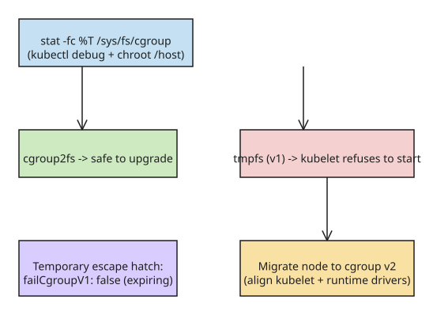

# Check Whether cgroup v1 Nodes Will Brk During a Kubernetes Upgrade to v1.35+

Since **Kubernetes v1.35**, the kubelet setting `failCgroupV1` defaults to **`true`**: on a node still running **cgroup v1**, the kubelet refuses to start, so the node goes `NotReady` — and on a **control-plane node it is worse**, because the kubelet starts the API server and etcd as static pods, so after a reboot they do not come back either. cgroup v1 support has been deprecated starting with v1.35 (see [the Kubernetes blog](https://kubernetes.io/blog/2026-10-06/kubernetes-cgroups-v2-shift/)), and the `failCgroupV1` escape hatch is slated for removal (community reports point to v1.38).

## Step 1 — Check one node

```bash
$ stat -fc %T /sys/fs/cgroup/
cgroup2fs
```

| Output | Meaning |
|---|---|
| `cgroup2fs` | cgroup v2 — nothing to do |
| `tmpfs` | cgroup v1 — after upgrading to v1.35+, its kubelet will not start |

Why this works: cgroup v1 keeps one hierarchy per controller (`cpu`, `memory`, …) while cgroup v2 keeps a single unified hierarchy; the filesystem type of `/sys/fs/cgroup` differs accordingly.

## Step 2 — Check every node without SSH

```bash
$ for n in $(kubectl get nodes -o name); do
    printf "%s " "$n"
    kubectl debug "$n" -n default -q -i --profile=general --image=busybox \
      -- chroot /host stat -fc %T /sys/fs/cgroup
  done
node/worker-1 cgroup2fs
node/worker-2 tmpfs
```

`kubectl debug` mounts the node's filesystem at `/host`; the `chroot /host` is **mandatory** — without it the command runs busybox's own `stat`, which prints `UNKNOWN` instead of `cgroup2fs` on a healthy v2 node (observed while testing on a v1.35 cluster).

## Step 3 — Know which nodes are likely on cgroup v1

OSes that default to cgroup v1: **CentOS 7, RHEL 7/8, Ubuntu 18.04/20.04, Amazon Linux 2**. Self-managed kubeadm clusters on long-lived VMs are the usual victims.

## Step 4 — Let kubeadm warn you first

`kubeadm`'s `SystemVerification` preflight check errors on `init`, `join` and `upgrade` once the kubelet is v1.35+. **Do not** paper over it with `--ignore-preflight-errors` — that is exactly how a control plane ends up unable to bring its static pods back after a reboot.

## Fix path

1. Migrate the node to cgroup v2 (in place where the OS allows it, otherwise a new OS image).
2. Verify the kubelet **and** containerd/crictl cgroup drivers are aligned on `systemd`/`cgroup v2` (check the kubelet config and the runtime config).
3. Only if you must stay on v1 for the upgrade itself, set `failCgroupV1: false` as a **temporary** escape hatch and track its removal date.

## Diagram



## References

- [One command tells you if your next Kubernetes upgrade will brick a node — DEV.to](https://dev.to/sai_pisey_02/one-command-tells-you-if-your-next-kubernetes-upgrade-will-brick-a-node-4g06) (primary source)
- [Full post on saipisey.com](https://saipisey.com/blog/cgroup-v1-kubelet-check) (extended version: in-place vs reimage, driver checks, escape-hatch expiry)
- [The Shift to cgroup v2 in Kubernetes — kubernetes.io blog](https://kubernetes.io/blog/2026-10-06/kubernetes-cgroups-v2-shift/) (official deprecation context)
- [About cgroup v2 — kubernetes.io docs](https://kubernetes.io/docs/concepts/architecture/cgroups/) (feature state and removal policy)
