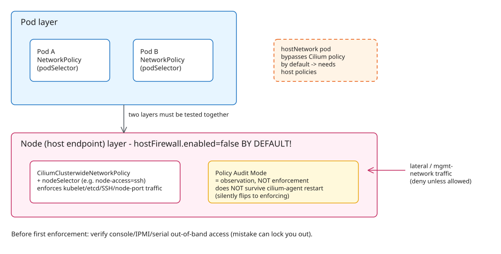

# How to Enable Cilium Host Firewall and Safely Enforce Node-Level Network Policy

Cilium's **host firewall** extends network policy enforcement from pods to the Kubernetes **node itself** — but `hostFirewall.enabled` **defaults to `false`** in the Cilium Helm chart. A cluster can have detailed pod policies and *still* allow broad node traffic between hosts, management networks, and workload networks, because policies aimed at the host endpoint are simply not enforced until the feature is turned on. Host policies are written as a `CiliumClusterwideNetworkPolicy` with a **node selector** (instead of an endpoint selector) and apply to the host traffic path, not just pod interfaces.



## When you need it

Ordinary `NetworkPolicy` covers pod interfaces. The host firewall covers:

- **Node traffic** (kubelet, etcd, node ports, management/SSH access, storage/backup paths).
- **`hostNetwork` pods** — a special case: these pods can have *full network connectivity without Cilium security policy by default*, and Cilium's troubleshooting guidance recommends host policies when policy must apply to them.

The two layers must be tested together: a policy that appears correct at one layer can leave an unexpected path at the other.

## Step 1 — Inventory the node boundary

Before writing any deny rule, list the services that must remain reachable on a node: API server access, etcd (control plane), kubelet and health checks, overlay/native routing traffic, DNS, monitoring, admin access, and node-to-node storage/backup/cluster traffic. Inventory `hostNetwork` workloads and decide whether they should exist at all, whether they can move to pod networking, and which host policies cover their traffic.

## Step 2 — Enable the feature and verify enforcement

```bash
helm install cilium cilium/cilium --version 1.20.5 \
  --namespace kube-system \
  --set hostFirewall.enabled=true \
  --set devices='{ethX,ethY}'
```

The `devices` flag pins the interfaces the host firewall applies to. If omitted, Cilium **auto-detects** interfaces — verify the detected set against the node's real network layout:

```bash
kubectl exec -n kube-system ds/cilium -- \
  cilium-dbg status | grep 'Host firewall'
# Host firewall:           Enabled   [eth0]
```

The Helm value alone does **not** prove the policy works — check `cilium-dbg status` and host endpoint state on a test cluster or small node pool first.

## Step 3 — Label nodes, then use policy audit mode as a bounded migration step

Host policies typically select nodes by label:

```bash
kubectl label node $NODE_NAME node-access=ssh
```

Then enable **Policy Audit Mode** on the host endpoint, which converts drops into observations so you can discover missing rules before enforcement:

```bash
CILIUM_NAMESPACE=kube-system
CILIUM_POD_NAME=$(kubectl -n $CILIUM_NAMESPACE get pods -l "k8s-app=cilium" \
  -o jsonpath="{.items[?(@.spec.nodeName=='$NODE_NAME')].metadata.name}")
alias kexec="kubectl -n $CILIUM_NAMESPACE exec $CILIUM_POD_NAME --"
kexec cilium-dbg endpoint config $HOST_EP_ID PolicyAuditMode=Enabled
kexec cilium-dbg endpoint config $HOST_EP_ID | grep PolicyAuditMode
# PolicyAuditMode        : Enabled
```

Two traps make audit mode a *temporary* tool only:

1. **Audit mode is not enforcement** — Cilium explicitly does not recommend it for production. A host endpoint left in audit mode means the cluster is *not* protected.
2. **Audit mode does not persist across `cilium-agent` restarts** — when the agent restarts, any existing host policy becomes **enforcing** immediately. Check configuration state after every agent restart and rollout.

Use it as a bounded step: capture traffic → build rules for legitimate dependencies → review → enforce.

## Step 4 — Roll out with a recovery path planned

The first host policy enforcement can **drop reply traffic** for legitimate connections (a documented Cilium known issue — connections should stabilize, with an enable/disable/re-enable workaround). A host firewall mistake can remove the very network access needed to repair it, so:

- Plan a maintenance window.
- Verify **out-of-band access first** (console, serial/IPMI, or a separately managed network) *before* enforcing a policy that could block SSH or kubelet traffic.
- If you lose in-band access, reach the agent via console/IPMI and `crictl exec` into the cilium-agent container, then temporarily convert drops back to warnings:

```bash
cilium-dbg endpoint config $(cilium-dbg endpoint get -l reserved:host \
  -o 'jsonpath={$[0].id}') PolicyAuditMode=Enabled
```

(This is temporary — the next `cilium-agent` restart re-enforces host policies. Re-enable enforcement with `PolicyAuditMode=Disabled` or `kubectl rollout restart ds/cilium`.)

## Step 5 — Monitor the control plane, not only pods

Watch host endpoint policy verdicts, interface coverage, agent restarts, and node health. **A node that stops sending metrics may be isolated rather than healthy.** Keep host firewall rules in the same review flow as cluster policies: a node selector can be broader than intended, and a cluster-wide object affects every matching node. Avoid permissive escape-hatch rules unless the owner documents why the traffic cannot be narrowed.

## Key takeaways

- `hostFirewall.enabled: false` by default → pod-level policy ≠ node-level protection; audit your clusters for this gap.
- Host policies = `CiliumClusterwideNetworkPolicy` + node selector.
- `hostNetwork` pods bypass Cilium policy by default.
- Audit mode = observation, not enforcement, and it silently flips back to enforcing on agent restart.
- Always secure an out-of-band recovery path before first enforcement.

## References

- [DEV.to: Cilium HostFirewall guards node traffic, but it is disabled by default](https://dev.to/sorrelthorncroft/cilium-hostfirewall-guards-node-traffic-but-it-is-disabled-by-default-5fg0)
- [Cilium docs: Host Firewall](https://docs.cilium.io/en/stable/security/host-firewall/)
- [Cilium docs: Host Policies](https://docs.cilium.io/en/stable/security/policy/host/)
- [Cilium Helm reference](https://docs.cilium.io/en/stable/helm-reference/)
- [Cilium blog: Securing the Node — A Primer on Cilium's Host Firewall](https://cilium.io/blog/2025/08/15/host-firewall-primer/)
