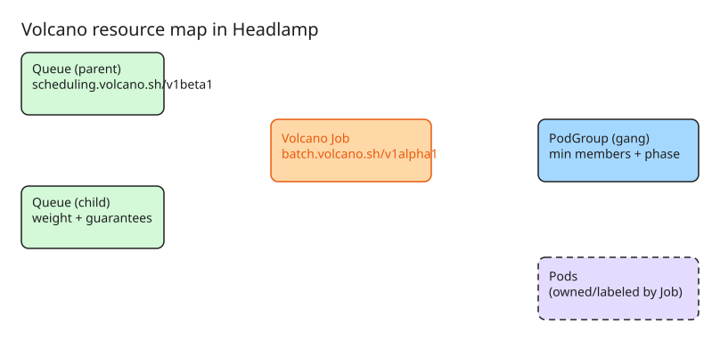

# Inspecting Volcano and Knative Workloads with Headlamp Plugins

[Headlamp](https://headlamp.dev) is an extensible Kubernetes web UI (desktop app or in-cluster). In June 2026 two plugins landed that bring batch-scheduling and serverless workloads into the same interface: a **Volcano plugin** for gang-scheduled HPC/AI-ML batch jobs, and a **Knative plugin** (0.3.0-beta) for serverless services. This note covers how to install both and what each surfaces.

## Why these plugins exist

- **Volcano** is a cloud-native batch scheduler for Kubernetes built for high-performance computing, AI/ML, and other batch workloads. Its CRDs (`Job`, `Queue`, `PodGroup`) are invisible to stock UIs; operators normally reconstruct relationships between jobs, queues, pods, and events with multiple `kubectl` commands.
- **Knative** brings serverless semantics (traffic routing, autoscaling, revision management) to Kubernetes, but day-to-day operation still means jumping between the `kn` CLI, `kubectl`, and a generic UI.

Both plugins add dedicated sidebar sections so you can move directly between related resources without switching tools. They complement — not replace — `kubectl`/CLI automation.

**Ecosystem context.** Volcano and Knative are two of a growing set of official [Headlamp plugins](https://github.com/headlamp-k8s/plugins) (now part of Kubernetes SIG UI). The same pattern applies to other workload types: the **Karpenter plugin** adds node-provisioning metrics and observability, and the **Kubeflow plugin** surfaces AI/ML workloads. If you're evaluating Headlamp for a cluster that runs any of these, check the plugins repo's release notes — several are still beta (the Knative plugin is 0.3.0-beta).

## Install the Volcano plugin

1. Install [Headlamp](https://headlamp.dev/docs/latest/installation/) (desktop app or in-cluster deployment).
2. Open the **Plugin Catalog** from the Headlamp UI.
3. Search for **Volcano** and install it.
4. Connect Headlamp to a cluster where [Volcano is already installed](https://volcano.sh/docs/GettingStarted/Installation) (working kubeconfig required).

A `Volcano` section appears in the sidebar with list and detail pages for:

| Resource | API Group |
| --- | --- |
| Volcano Job | `batch.volcano.sh/v1alpha1` |
| Queue | `scheduling.volcano.sh/v1beta1` |
| PodGroup | `scheduling.volcano.sh/v1beta1` |
| JobTemplate | `flow.volcano.sh/v1alpha1` |
| JobFlow | `flow.volcano.sh/v1alpha1` |

Detail pages show scheduling-focused fields: job status, queue, task progress, PodGroup phase, queue state, generated jobs, conditions, and related events — with cross-links (Job → Queue, Job → PodGroup). The Jobs list also exposes suspend/resume actions where the current job state supports them.

## Install the Knative plugin

1. Make sure Knative is installed in your cluster.
2. In Headlamp Desktop, open the **Plugin Catalog**, search for **Knative**, and click **Install**.
3. Reload Headlamp — a new `Knative` entry appears in the sidebar (current release: 0.3.0-beta; built as part of an LFX mentorship).

The plugin lets you inspect, understand, and act on Knative workloads from one place instead of alternating between `kn`, `kubectl`, and generic UIs. For source-level setup see the [Knative plugin README](https://github.com/headlamp-k8s/plugins) in the Headlamp plugins repository.

## Verify resources with kubectl

After installing Volcano and loading the plugin, create or use existing workloads, then cross-check what the UI displays:

```bash
kubectl get vcjobs -A
kubectl get queues
kubectl get podgroups -A
kubectl get jobtemplates -A
kubectl get jobflows -A
```

Then open `Volcano > Jobs`, `Queues`, `PodGroups`, `JobTemplates`, and `JobFlows` in Headlamp and confirm the list columns, detail sections, conditions, and events match.

## Use the resource map for relationships

Both plugins integrate with Headlamp's **resource map**, which visualizes how scheduling resources relate:

- Queue hierarchy (parent/child Queues)
- Volcano Jobs connected to their PodGroups
- Pods connected back to the owning/labeled Volcano Job
- Queue details reachable from the map without dense queue-to-workload edges

Open the resource map, enable the Volcano map sources, and follow a workload from Pod → Volcano Job → PodGroup, or inspect the queue hierarchy used by scheduled workloads.

## Clean up test workloads

If you created sample workloads only for testing:

```bash
kubectl delete vcjobs --all -n <namespace>
kubectl delete jobflows --all -n <namespace>
kubectl delete jobtemplates --all -n <namespace>
```

Do not delete shared Queues unless no other workloads use them.

## Diagram: Volcano resource relationships in Headlamp



## Future work and feedback

- Volcano plugin: Prometheus integration, richer scheduling insights, and more workflow-oriented visibility are planned.
- Both plugins live in the [Headlamp plugins repository](https://github.com/headlamp-k8s/plugins); open issues there for feature requests or bug reports.

## References

- [Inspect Volcano workloads faster with Headlamp (Kubernetes Blog)](https://kubernetes.io/blog/2026-06-25/visual-context-volcano-headlamp-plugin/)
- [See your serverless: introducing the Headlamp plugin for Knative (Kubernetes Blog)](https://kubernetes.io/blog/2026-06-25/headlamp-knative-plugin/)
- [Headlamp on Volcano (Volcano docs)](https://volcano.sh/docs/ecosystem/headlamponvolcano/)
- [Managing Cluster API Resources with the Headlamp Plugin](howto-manage-cluster-api-resources-with-headlamp.md) — companion note for CAPI in Headlamp
